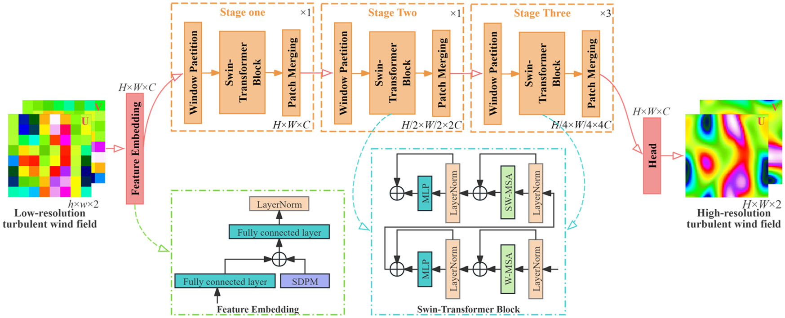
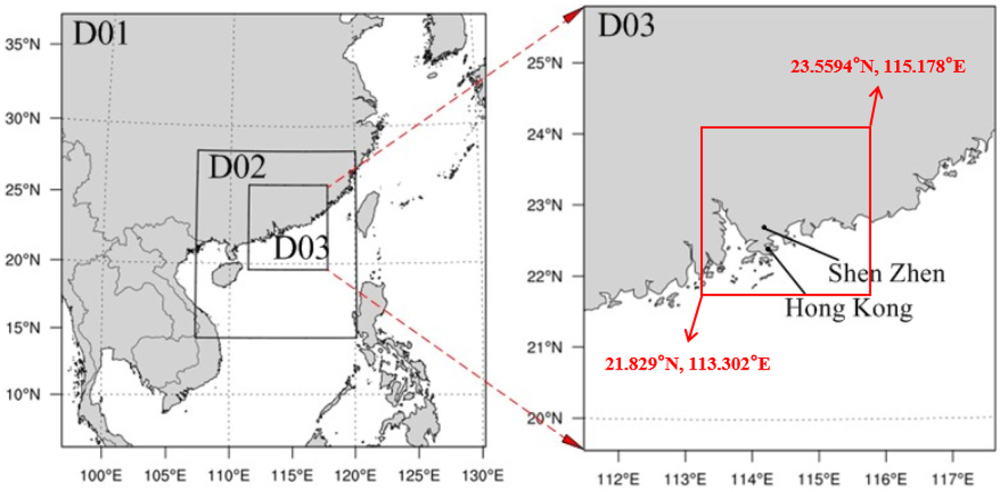
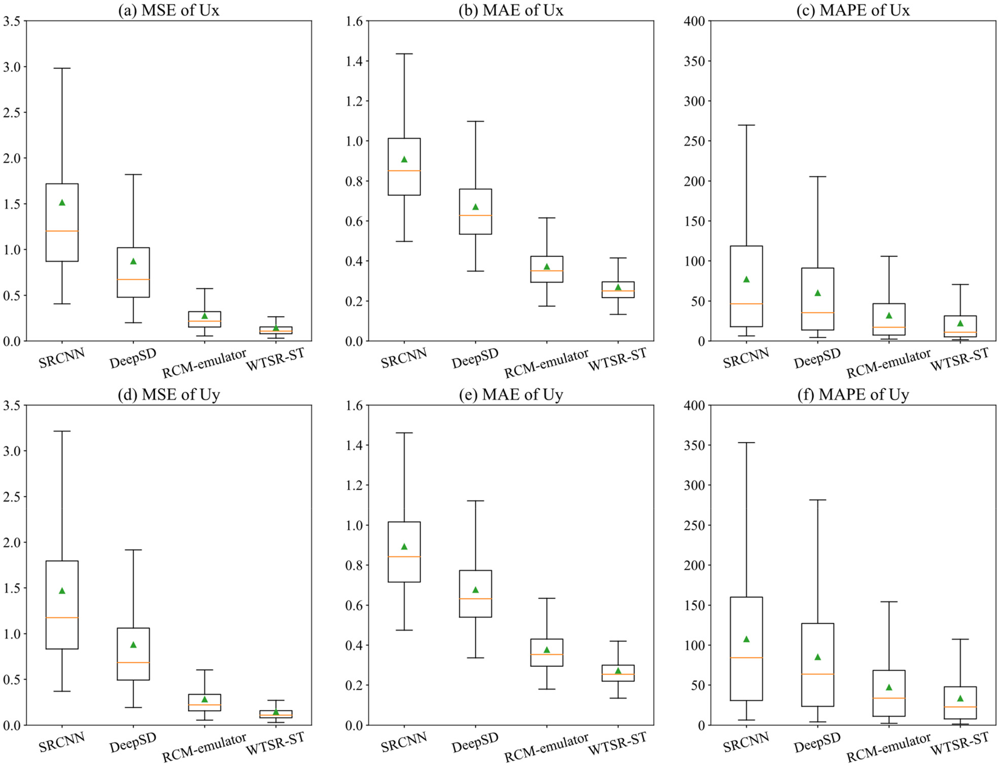
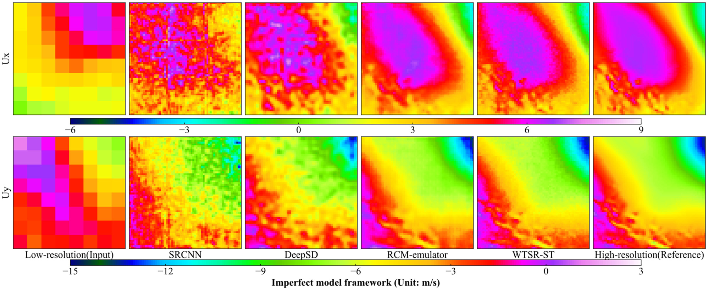
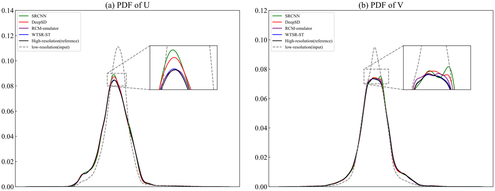

# 工程结构抗风 | 风场网格变细了，怎样判断细节真的恢复了？

把气象风场的网格加密，并不等于恢复了可信的风速细节。这篇论文改造移位窗口注意力网络，分别用同源二维湍流和不同分辨率的气象模拟检验重建效果，同时比较逐点误差、结构相似性与概率分布。

## 论文信息

- 论文题名: Super-resolution reconstruction of wind fields with a swin-transformer-based deep learning framework
- 作者: Tang Lingxiao; **Li Chao**; Zhao Zihan\*; Xiao Yiqing; Chen Shenpeng
- 期刊: Physics of Fluids
- 年份: 2024
- DOI: [10.1063/5.0237112](https://doi.org/10.1063/5.0237112)
- WOEAI 相关方向: 工程结构抗风 / 数值风洞

## 摘要

通过超分辨率（super-resolution，SR）技术，人们期待利用深度学习方法快速模拟高分辨率大气湍流。近年来，Swin-Transformer 的移位窗口注意力机制，相比常规注意力机制有明显改进。该方法将注意力计算限制在局部邻域，使计算量与序列长度呈线性关系。然而，其原始架构面向分类、检测和分割任务，与湍流超分辨率任务不匹配。

本文重新设计层级结构，并引入新的相对位置表示方法，以促进湍流风场的超分辨率处理。将通道打乱的感知损失纳入损失函数，指导权重参数更新。采用理想化二维湍流和现实边界层风两个实验算例验证性能。结果表明，所提方法在风矢量重建方面显著优于既有的超分辨率卷积神经网络、深度统计降尺度方法和区域气候模式模拟器。不论是均方误差、平均绝对误差、平均绝对百分比误差等逐点指标，还是结构相似性指标和概率密度函数等感知指标，其数值均低于另外三种网络。重建风矢量与目标高分辨率结果接近。本研究有助于推动移位窗口注意力机制在风场超分辨率中的应用。

摘要将各指标统称为“数值更低”，但正文实际以更高的结构相似性为较好结果，概率密度函数则比较形状是否接近参考。这里保留原摘要，同时提醒：所谓现实边界层风仍来自气象模拟，不是现场实测。

## 研究问题与解决思路

工程上需要更细的风场，但直接增加气象计算网格会推高计算和存储成本。插值能填入更多网格点，却未必补回涡区边界与局部速度变化；深度学习也可能只学会把图像变平滑。论文将注意力计算限制在小窗口内，再通过窗口移位交换信息，并改造空间位置表示和训练损失。检验分两步：先看同一个高分辨率场降采样后能否恢复，再看粗、细气象模拟本来就不完全一致时，网络还能保留多少有效信息。

## 窗口要看局部，也要交换信息

普通注意力需要比较大量网格点之间的关系，网格越密，计算负担越重。本文采用的窗口注意力只在局部计算相关性，下一步再移动窗口，让相邻窗口交换信息。这样既利用邻域细节，也逐步扩大信息交流范围。

网络先把两个水平风速分量映射到高维特征空间，经过三个阶段提取特征，最后通过像素重排和卷积生成高分辨率输出。空间解耦位置模块分别表示两个方向的位置信息；训练时还把特征通道打乱后送入感知网络，比较重建场与目标场的深层特征，而不只检查每个网格点的误差。

::: figure 1

论文图 1 WTSR-ST 的特征嵌入、移位窗口处理与输出框架

从左到右看输入、三个处理阶段和输出；绿色框展开特征嵌入，蓝色框展开注意力块。实线是主要流程，虚线是模块说明。

:::

训练损失由内容误差与感知差异组成，原文写为：

$$
l_{SR}=l_c+k l_p,\qquad k=0.02.
$$

内容损失衡量逐点平方误差，感知损失比较高维特征。两者着眼点不同，但本文没有逐项移除位置模块、层级改造和通道打乱的消融试验，不能把总体改进精确归因给其中某一项。注意力复杂度降低也不等于论文已经给出了整套风场计算的实测加速倍率。

## 同源降采样与气象降尺度，不是同一道题

第一组算例来自二维不可压缩流动，高分辨率数组为 $64\times64$，低分辨率数组为 $8\times8$。粗、细场源于同一次计算，时空一致性较强，网络主要学习如何补回被降采样削弱的信息。论文使用36000个样本，随机分成80%训练、10%验证和10%测试。

第二组采用天气研究与预报模式（WRF），在广东地区设置 $27\,\mathrm{km}$、$9\,\mathrm{km}$、$3\,\mathrm{km}$ 三层网格，提取离地 $100\,\mathrm{m}$ 的水平风速。输入取最外层，目标取最内层。由于分辨率和参数化不同，两套模拟的涡区和速度分布可能发生偏移，不能把它们当成同一张图的清晰版与模糊版。

::: figure 5

论文图 5 广东地区的 WRF 嵌套计算域及超分辨率区域

先看D01、D02、D03的嵌套关系，再看红框标出的超分辨率计算区域；地形图不是重建误差图。

:::

论文正文描述2016年8月至10月共92天、每10分钟保存一次结果；表格结束日期比正文少一天。数组仍写作 $8\times8$ 到 $64\times64$，但物理网格间距是27到3千米，二者不是同一个放大倍数。原文没有完整交代裁剪和配准细节，复现时需要先核清这些设置，而不是从图形尺寸猜测实现。

## 平均误差、结构和分布要分开核对

论文与三种卷积网络比较：浅层的超分辨率卷积网络、逐级放大的深度统计降尺度模型，以及采用编码—解码结构的区域气候模式模拟器。结果同时看均方误差、平均绝对误差、相对误差、结构相似性以及速度概率分布。

同源二维算例中，按原表III，所提网络测试集两个分量的均方误差为0.00085和0.00089，结构相似性均为0.999，表现优于所选比较网络。不过，正文写出的训练、测试均方误差及涨幅与表III不一致。因此这里明确以表III为数据出处，不把矛盾数字拼成新的改进百分比。

到了不同分辨率的WRF数据，问题明显变难。按表IV，测试集两个分量的均方误差升为0.134和0.135，平均绝对误差为0.269和0.272，结构相似性均为0.982。它们在该组比较中仍较好，但不是“所有风场都接近完美”的证据。这些误差表头没有给物理单位，也不能直接当成百分比。

::: figure 23

论文图 23 测试阶段重建 WRF 风场的统计评价

上排为水平风速分量 $U_x$，下排为 $U_y$；三列依次为均方误差、平均绝对误差和平均绝对百分比误差。绿色三角表示均值，橙线表示中位数。

:::

图23补充展示各网络测试误差的分布，可与表IV中的均值对照；它与图21的空间外观、图25的速度分布分别回答不同问题。

::: figure 21

论文图 21 测试阶段各网络重建的 WRF 风场，分辨率由27千米到3千米

上、下两行分别为两个水平风速分量；每行从左到右为低分辨率输入、四种网络结果和高分辨率参考，下方色标对应该行风速。

:::

按每行的风速分量，比较低分辨率输入、各网络结果与高分辨率参考；重点看涡区边界，不把颜色更平滑直接当成更准确。

概率分布回答的是另一个问题：各种速度出现的频率是否接近参考。论文把所有时间和空间点汇总后比较分布，所提网络最接近高分辨率参考，但中央概率偏高、两侧偏低的趋势仍值得注意。分布接近不能代替逐时逐点检验，更不能单独证明速度梯度、能谱和空间相关性都正确。

::: figure 25

论文图 25 测试阶段 WRF 重建风场的概率密度函数

黑线为高分辨率参考，蓝线为所提网络；两幅图分别对应两个水平分量。沿中央和两侧比较曲线，不只看峰值位置。

:::

## 千米级重建还不能替代工程绕流计算

论文另外把WRF输出的湍动能作为单独输入与目标进行重建。这不是从重建速度自动恢复全部湍流统计，也不是施加了能量守恒约束。其表V的误差标签与正文存在差异，均方误差和平均绝对误差之间也缺少可解释的尺度关系；这些数值需要进一步澄清，不宜用来宣称完整物理一致性已经验证。

已有证据支持的是：在本文两组数据和训练设置下，移位窗口网络对风速场的恢复优于所选比较模型。测试集没有参与训练，但论文没有展示跨年份、跨地区或按天气事件独立留出的验证。随机划分下的好结果，还不能等同于换一个地区也可靠。

对工程使用，更关键的边界是目标仍为 $3\,\mathrm{km}$，离建筑绕流、局部风压所需的空间尺度很远。作者把百米级空间分辨率、秒级时间分辨率，以及湍流、风切变和稳定度的复杂变化列为后续工作。潜在用途是减少部分气象降尺度的重复计算；迁移前仍需核对数据配准、原文公式与代码的一致性，并用目标地区和目标天气的独立资料验证。

## 从论文到工程

这项研究为气象风场的精细化重建提供了可进一步利用的数据方法，使已有模拟结果有机会更充分地服务于区域风环境分析。它的工程意义在于探索空间细节、计算开销与信息可靠性之间的取舍，为后续多尺度建模准备更合适的气象背景。分别检验结构恢复与跨分辨率差异，也有助于判断模型实际补充了哪些信息，把数据重建放在清楚的尺度衔接关系中，为进一步研究更细尺度的风场提供基础。推广仍需目标地区和天气过程的独立验证。

点击阅读原文，可查看完整科学正文精解、13个原式、26幅原图和5张数据表，以及正文与表格不一致之处的逐项说明。

[阅读原文：WOEAI 全文精解](https://woeai.readthedocs.io/zh-cn/latest/paper-notes/ref-tang2024-POF.html)

本文由 AI 辅助整理与撰写
