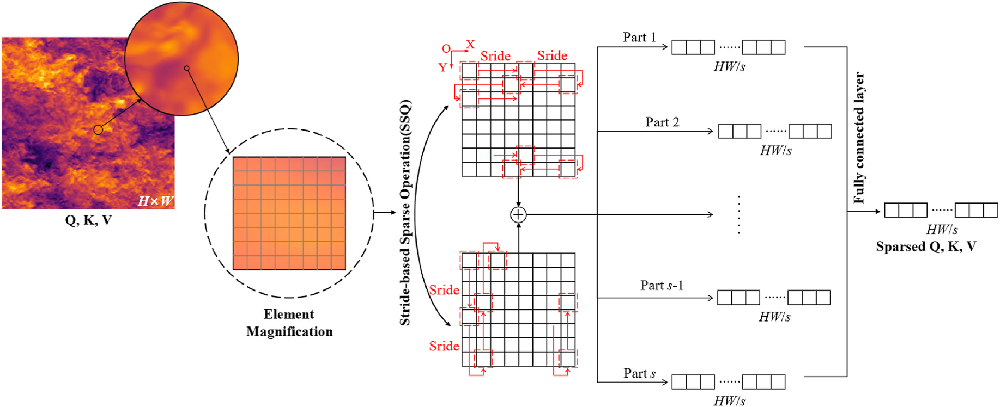
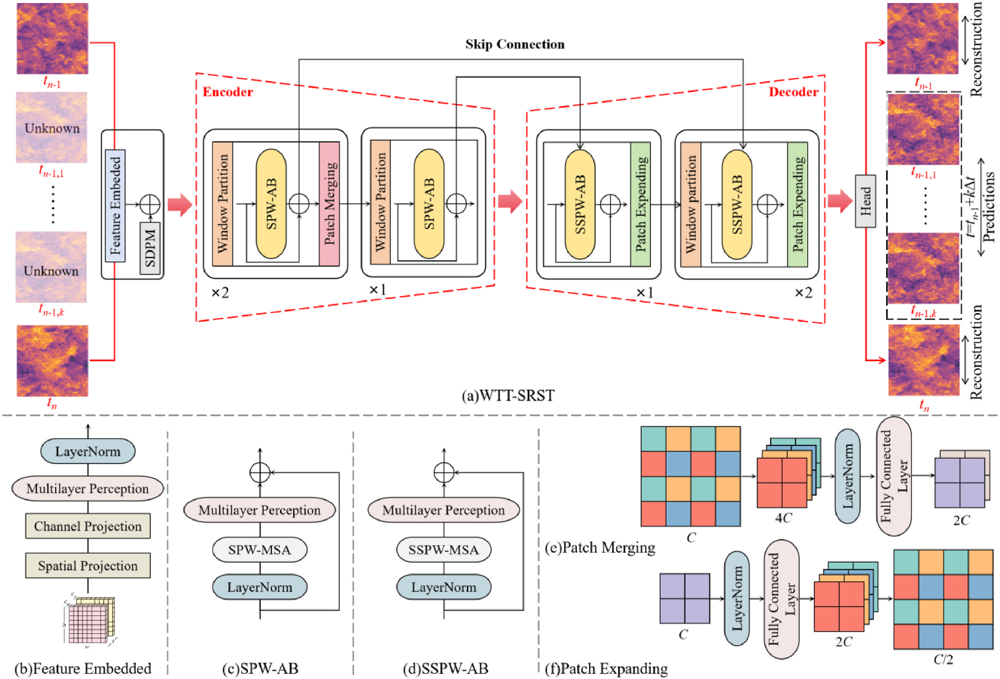
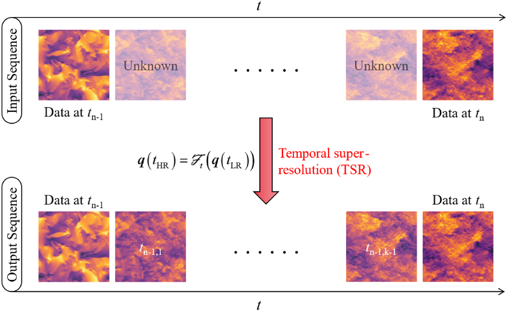
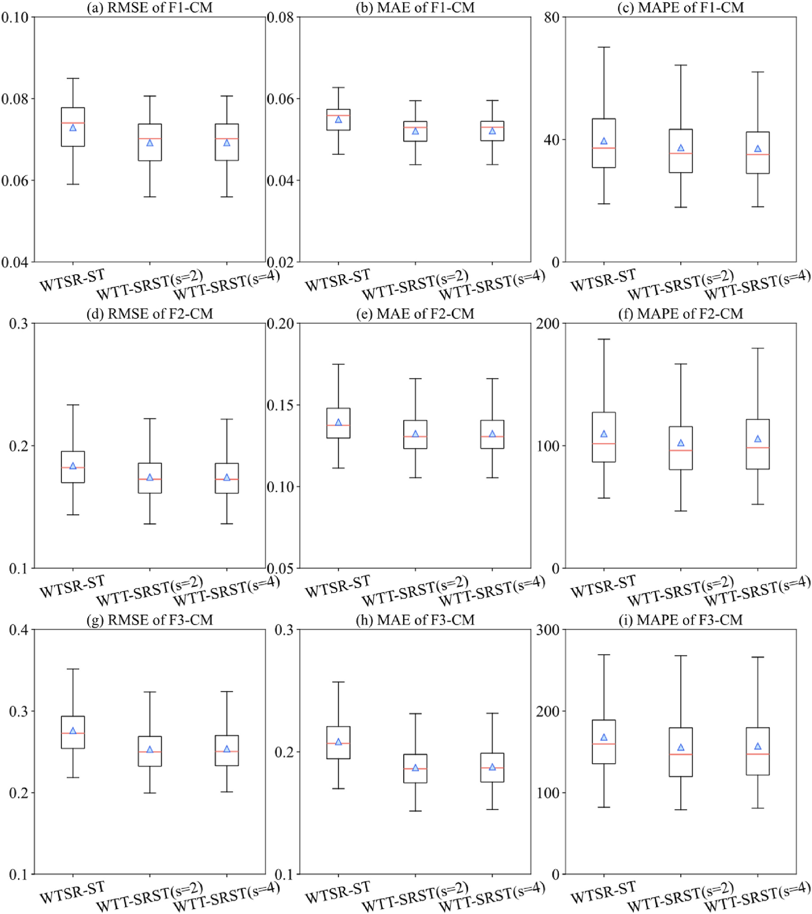
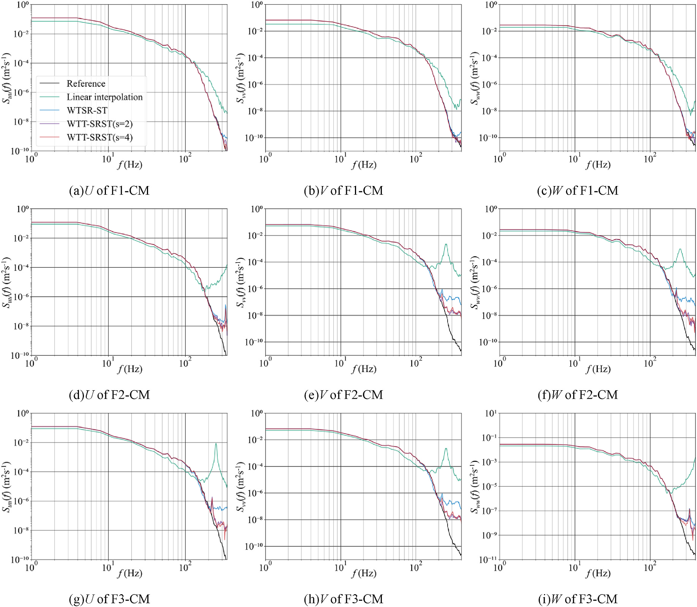
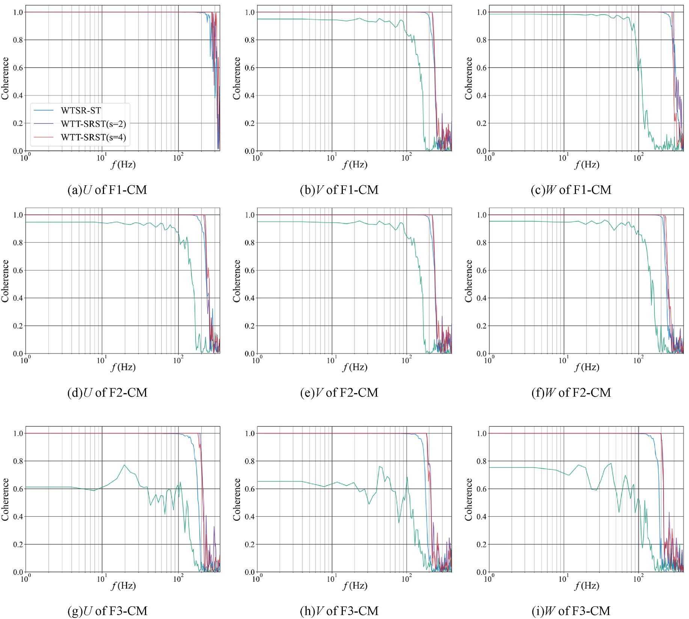
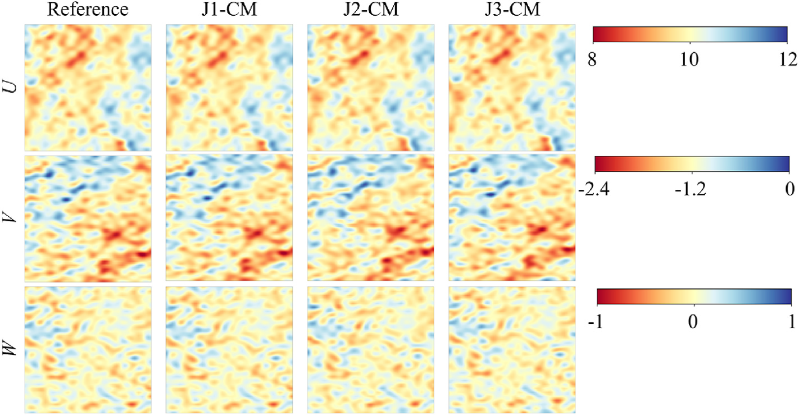

# 数值风洞 | 两张风场快照之间，怎样补出湍流变化？

两张已知风场快照之间缺了一段湍流演化，能否减少逐个细时间步求解的成本？本文用稀疏窗口注意力和相对物理残差重建中间序列，检验时间细节与计算开销之间的取舍；这属于插值重建，不是未来风场预报。

## 论文信息

- 论文题名: A novel framework for temporal super-resolution of wind in urban energy applications
- 作者: Tang Lingxiao; **Li Chao**\*; Zhao Zihan\*; Chen Lingwei; Zhang Mingming
- 期刊: Renewable Energy
- 年份: 2026
- DOI: https://doi.org/10.1016/j.renene.2025.124336
- WOEAI 相关方向: 工程结构抗风 / 数值风洞

## 摘要

及时、精确地获取行星边界层风随时间演化的信息，对于城市风能调度与管理至关重要。然而，使用物理模型预测高时间分辨率湍流的高昂成本限制了工程应用。深度学习技术已经成为数值方法的一种有前景替代方案，但关于高时间分辨率风场重建的研究仍然较少。

本文提出一种融合 Sparse Window-based Attention 的新框架，以具有成本效益的方式实现湍流场超分辨率。该框架可以通过修改 stride 值来自定义注意力稀疏度。本文进一步提出 Relative Physical-informed Loss，以保证生成风场的物理合理性。

与 Window-based Attention 相比，所提出的注意力机制显著降低计算成本并提高推理效率。尽管增加插值风场快照会使性能略有降低，模型仍能重建风场结构。统计指标、湍流特征、功率谱和相干函数的评估显示，重建风场具有较强的物理一致性。同时，该方法将训练时间缩短 $32.92\%$，计算能耗降低 $32.89\%$。更大的 stride 会进一步降低能耗，但会以性能下降为代价，体现出准确性与效率之间的权衡。

## 研究问题与解决思路

风场的时间细节关系到频谱和空间相干，但高分辨率求解、存储以及神经网络计算都有成本。本文研究能否利用两张已知快照重建中间的三分量速度场，同时减少注意力计算开销，并保留参考数据中的湍流特征。方法通过步长控制注意力稀疏度，以重建场和参考场的物理残差差异约束训练。其有效性需要同时用误差、频谱和相干性检验，不能仅凭图像相似认定物理一致。

## 稀疏注意力和相对残差分别约束哪一部分？

这项工作的核心是 WTT-SRST。它借鉴 Swin-Transformer 的窗口注意力思想，但针对湍流风场的计算规模和物理特征做了两类改造。

第一类改造是 Sparse Window-based Attention。标准窗口注意力虽然已经避免了全局 attention 的高成本，但在大规模风场网格上仍然会消耗大量显存和计算量。论文提出 Stride-based Sparse Operation（SSO），用 stride 控制注意力计算中的稀疏采样，让模型在保留主要湍流结构的同时减少注意力计算。

::: figure 1

论文图 1 基于步长的稀疏操作示意图

从左向右看原始特征、网格采样和全连接融合；红色框与箭头标出 stride 的采样位置及移动方向。

:::

沿步长采样到特征融合的路径读图，比较采样前后的网格位置及特征连接方式。

在论文给出的复杂度表达中，Sparse Window-based Multi-head Self-Attention 的计算复杂度可以写为：

$$
\Omega_{\mathrm{SPW\text{-}MSA}} = 4hwc^2 + 4\frac{L^2}{s^2}hwc
$$

这里 $h,w$ 为特征图尺寸，$c$ 为通道数，$L$ 为窗口尺寸，$s$ 为 stride。仅第二项按 $1/s^2$ 缩减，$4hwc^2$ 不随 stride 改变，不能把整个模型都说成平方加速；更大 stride 也会损失高频特征。

第二类改造是 Relative Physics-informed Loss（RPL）。论文在二维平面处理三分量速度，将无法完整计算的垂向项并入残差，再比较重建场与参考场的残差差异。“相对”是相对于参考场的差值，不是把完整三维 Navier-Stokes 残差严格压到零，也不是无需参考数据的独立求解器。式（8）至（10）、符号说明与实验表中的损失下标并不完全一致，不能据此擅自重构唯一实现。

::: figure 4

论文图 4 所提出 WTT-SRST 的详细结构与各模块架构

上部(a)从两端输入快照沿编码器、解码器到输出序列；下部(b)至(f)分别展开嵌入、注意力、合并和扩展模块。

:::

先看输入与输出的时间分辨率，再沿编码器、解码器和跳跃连接读图；注意两类稀疏窗口注意力模块的连接顺序。

::: figure 6

论文图 6 风场快照的时间超分辨率流程

上行为输入，下行为输出，时间均由左向右；两端已知快照之间标有待重建时刻。

:::

区分已知输入快照与两者之间待重建的时刻，沿时间顺序查看输入与输出的对应关系。

## 重建误差、湍流特征和资源开销怎样比较？

训练结果与线性插值、WTSR-ST 作对比；测试图 16 主要比较 WTSR-ST 与本文方法。在已测试工况中，WTT-SRST 的误差整体较低，但这种相对改善不等于所有工况的绝对误差均小。

训练输入由高时间分辨率序列下采样得到，测试输入则先做时间平均滤除部分高频；缩尺序列最后 $1\,\mathrm{s}$ 留作独立测试。这不等于已验证任意粗时间步求解器输出；较大插值间隔下，原文测试 MAPE 可超过 $100\%$。

::: figure 16

论文图 16 重建与参考风速误差的箱线图

三行依次为 F1-CM、F2-CM、F3-CM，三列为 RMSE、MAE、MAPE；各图横轴列出对比模型，纵轴量程分别读取。

:::

对风能应用而言，平均误差并不能完全说明问题。低频信号控制大尺度结构，高频信号则包含瞬态细节和局部扰动。如果模型只在点值上接近参考结果，却丢失高频湍流特征，后续风机载荷、功率波动或调度分析仍可能受到影响。

论文进一步比较了重建风场的功率谱和相干函数。结果显示，WTT-SRST 能较好地保留低频分布，并在高频范围内比线性插值和对比模型更接近参考结果。随着插值快照数量增加，或 stride 取值增大，高频细节会出现一定退化，但整体仍体现出较强的物理一致性。

::: figure 14

论文图 14 脉动速度的功率谱密度结果

三列依次为 $U$、$V$、$W$ 分量，三行为 F1-CM、F2-CM、F3-CM；横轴频率、纵轴功率谱，按左上图例辨认不同方法。

:::

在相同速度分量下比较参考场与重建场的谱线，分别观察低频能量区和高频端的偏离。

::: figure 15

论文图 15 重建风速序列的相干函数

三列为 $U$、$V$、$W$ 分量，三行为不同插值条件；横轴为频率，纵轴为相干性，按左上角图例辨认模型与步长。

:::

效率是这篇论文的重要目标。单个注意力模块测试显示，Sparse Window-based Attention Block 在 $s=2$ 和 $s=4$ 时的 GPU 显存占用分别为 $359.92\,\mathrm{MB}$ 和 $250.35\,\mathrm{MB}$，明显低于 Swin-Transformer Block 的 $1225.26\,\mathrm{MB}$。论文结论中进一步指出，在 $s=2$ 和 $s=4$ 时，该模块显存占用分别约为 Swin-Transformer Block 的 $29.37\%$ 和 $20.43\%$。

表 9 的原始架构、所提架构加普通注意力、所提架构加稀疏注意力（$s=2$），参数量分别为 $3.718$、$3.344$、$2.993$ 百万，显存为 $3472.55$、$3076.36$、$1034.24\,\mathrm{MB}$，前向时间为 $7.03$、$6.40$、$5.19\,\mathrm{ms}$。$19.50\%$ 和约 $70\%$ 都以原始整体架构为基线。$s=2$ FLOPs 为 $23.78$ G，高于原始架构的 $21.58$ G，不能笼统说所有资源指标下降。

两类残差约束共同加入后，三种插值条件的 MSE 分别降为无物理约束基线的 $86\%$、$88\%$、$74\%$。这里比较的是 MSE，不是全部统计指标。物理残差提供训练方向上的软约束，不能单凭误差改善证明任意流场严格守恒。

表 11 还报告，在指定硬件与训练设置下，$s=2$ 相对原始架构的训练时间由 $1282$ 降到 $860\,\mathrm{min}$，节时 $32.92\%$，模型执行能耗估算降低 $32.89\%$。这些比例不代表完整 CFD 流程或风电系统的节省。

全尺度评估取 JHTDB-Wind 风电场上游、轮毂高度的 $64\times64$ 水平平面。数据为凌晨 $02{:}00$–$04{:}00$ 两小时 LES 序列，参考间隔 $0.5\,\mathrm{s}$，输入间隔 $1.5$/$3.0$/$4.5\,\mathrm{s}$，训练/验证/测试比例 $90\%$/$5\%$/$5\%$。表 10 的平均误差均较基线小，但 J1-CM 的 MAPE 标准差从 $8.13$ 增到 $10.28$；J3-CM 的平均 MAPE 仍为 $111.87\%$，不能宣称所有稳定性指标都改善。

::: figure 24

论文图 24 凌晨 3:45 生成风场的可视化表示

从上到下为 $U$、$V$、$W$ 分量，四列为参考场及 J1-CM、J2-CM、J3-CM；每行使用右侧独立色标。

:::

行对应三个速度分量，列为参考场和三种输入间隔，色标单位 $\mathrm{m/s}$。这是风电场上游截面，不是复杂城区建筑绕流、风机功率或调度收益验证。

## 从已知快照插值到工程使用，还差哪些验证？

这类模型可用于补充已有风场序列的时间细节，前提是两端快照和目标工况落在经过检验的数据范围内。使用前需确定输入间隔和步长参数，并按后续分析关心的频谱、相干性及误差指标选择模型；论文没有直接验证发电量、调度收益或任意粗时间步求解器的输出。

首先，缩尺空场采用特定入口剖面，重建高度 $0.2\,\mathrm{m}$、范围 $0.64\,\mathrm{m}\times0.64\,\mathrm{m}$ 的水平平面；全尺度也取风电场上游平面。复杂城市下垫面和真实环境是原文列明的后续研究。两张已知快照间插帧不能直接变成未来风场或发电量预报。

其次，stride 是效率和精度之间的调节旋钮。更大的 stride 可以进一步降低能耗和计算量，但也会削弱高频特征提取能力，使 RMSE、MAE、MAPE、误差云图和相干函数表现出现退化。因此，实际应用中不能只看推理速度，还要根据目标场景检查频谱、相干性和误差范围。

第三，RPL 比较二维可计算残差，依赖未解析项具有可比性的假设，不能保证任意三维流场严格守恒。能耗仅按指定硬件额定功率和使用率估算运行期间开销，不含待机、数据生成和完整城市风能系统成本；原文碳强度与表 11 的能耗/排放换算还需澄清，不能背书为实测绝对碳足迹。

## 从论文到工程

这项研究让已有风场数据中的时间信息得到更充分利用，为兼顾计算资源与湍流细节的风场重建提供了思路。对于需要连续流场输入的后续分析，其潜力在于减少高密度数据生成与保存的负担，同时保留对动力响应有意义的频谱和空间联系。把资源开销与物理特征放在一起比较，也有助于工程人员按分析目标选择合适的数据精度，判断哪些计算值得精细求解、哪些中间信息可以重建。迁移前仍需验证目标风场的误差及湍流特征。

点击阅读原文，可查看本论文的全文精解、模型结构与各组误差和资源对比。

本文由 AI 辅助整理与撰写
