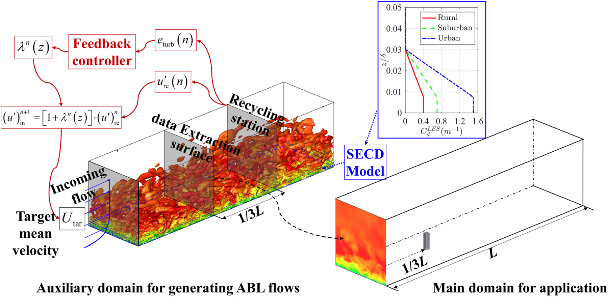
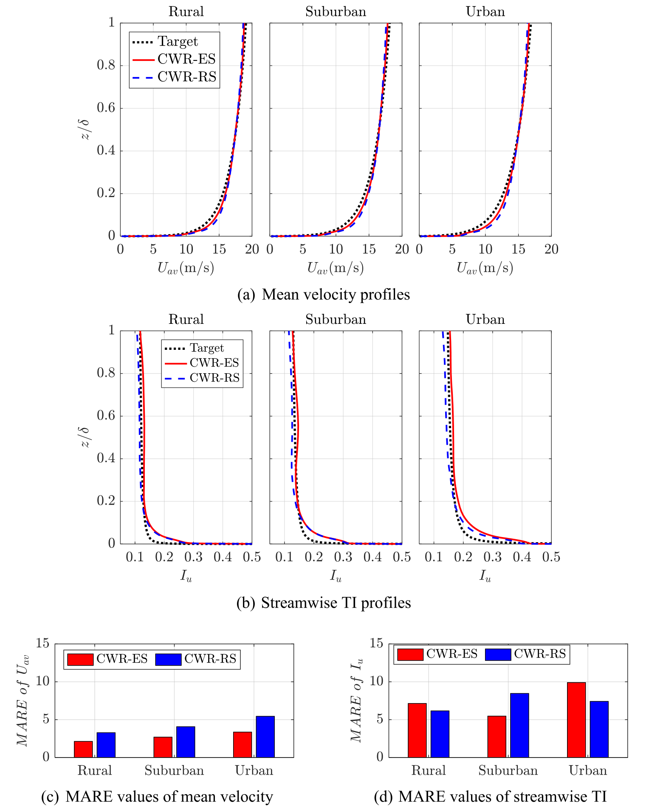
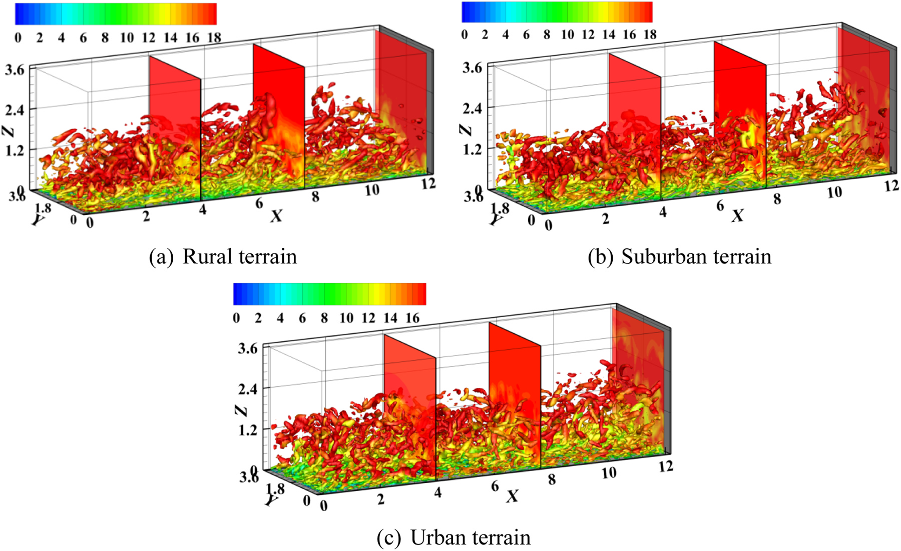
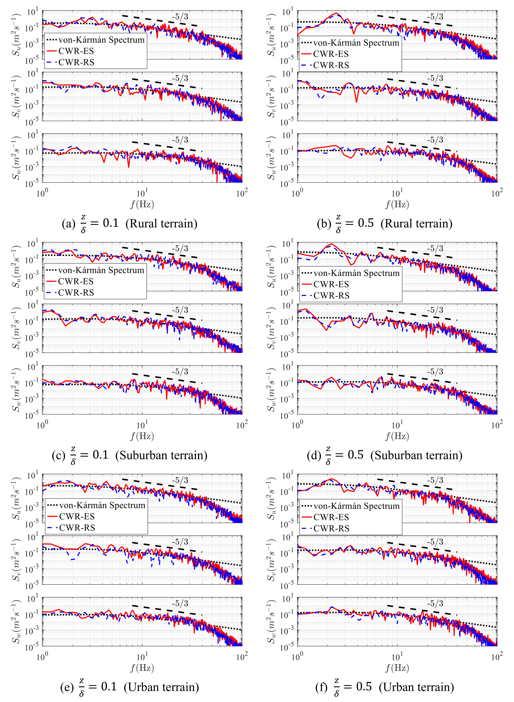
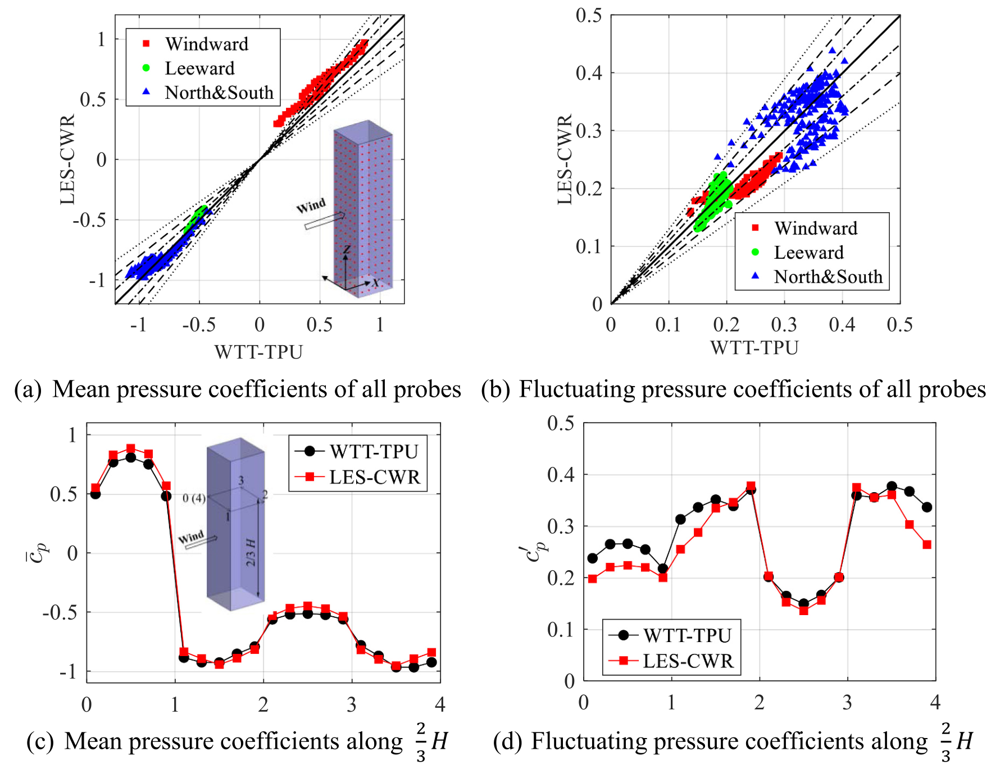
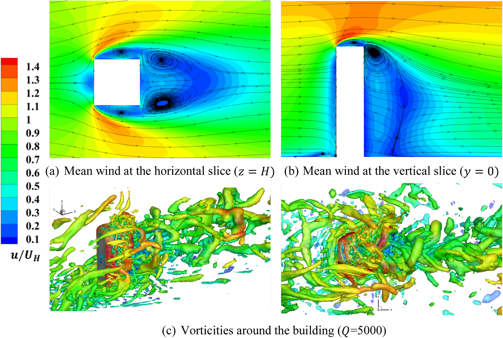
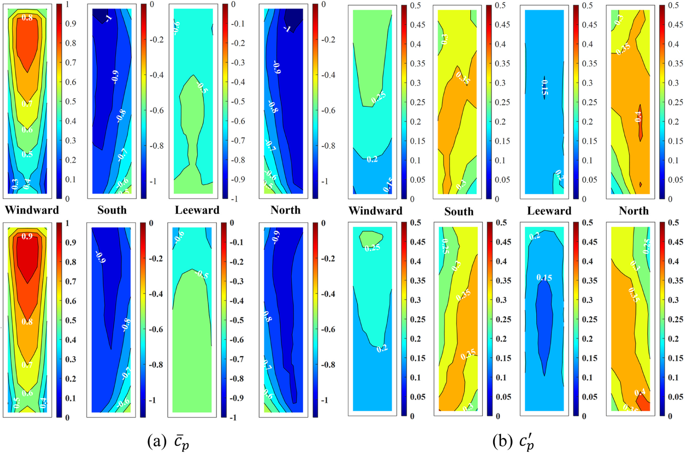

# 工程结构抗风 | 目标湍流强度，能否让入流自己调出来？

换一种地貌或计算域，数值风洞往往需要重新调试入口风场。本文在弱循环法中加入比例反馈，用模拟与目标湍流强度之间的偏差调整回收速度，研究能否减少粗糙元布置试错，并检查生成风场进入建筑计算后的表现。

## 论文信息

- 论文题名: A new controllable weak recycling inflow turbulence generator for evaluating wind effects on building in LES
- 作者: <u>Wang Jinghan</u>; **Li Chao**\*; Chen Lingwei; Zhou Shengtao\*; Hu Gang; Ou Jinping
- 期刊: Engineering Structures
- 年份: 2024
- DOI: https://doi.org/10.1016/j.engstruct.2024.118742
- WOEAI 相关方向: 工程结构抗风 / 数值风洞

## 摘要

弱循环方法，又称“重缩放-循环”方法，已经通过在发展段采用错列块体来模拟微尺度湍流大气边界层（ABL），从而复现物理 ABL 风洞布置。然而，当面对不同目标结构、计算域尺寸或地表暴露条件时，该方法需要重新评估粗糙元的尺寸和布置，因而存在应用上的挑战。

为解决这些问题，本文提出一种可控弱循环（controllable weak recycling, CWR）方法，用于在大涡模拟（LES）中生成粗糙地表上的湍流 ABL 风场。该方法能够在单次模拟中直接生成具有任意目标特征的湍流边界层，显著提高生成效率并降低计算资源消耗。

本文的改进方法将反馈比例控制算法引入“重缩放”过程，以最小化模拟湍流强度与目标湍流强度之间的误差。此外，方法在近地面区域采用既有阻力模型，以维持粗糙地表上的水平匀质 ABL 风场。本文通过 LES 模拟三类不同粗糙地形上的湍流 ABL 风场，对所提出的 CWR 方法进行验证。结果表明，生成的入口湍流符合给定的平均风速和湍流强度，并沿流向表现出一致的自持性。同时，生成的风谱与各向异性 von-Kármán 谱高度一致。当把提取的风速时程施加到主计算域入口时，研究发现高层建筑上的平均和脉动风压与指定风洞试验结果吻合较好。

## 研究问题与解决思路

弱循环法可生成发展的湍流边界层，但不同地貌和计算域下往往需要重新布置粗糙元，目标风场的调整成本较高。本文在重缩放过程中加入比例反馈，直接调节回收的纵向脉动速度，并用近地面阻力模型维持预设平均风剖面，再通过三类地形和建筑风压算例检查效果。反馈控制的目标是纵向湍流强度，风谱、相干性及下游响应仍须分别验证。

## 比例反馈怎样进入弱循环的重缩放过程？

CWR 方法的核心，是把反馈控制放入 weak recycling 的重缩放流程。论文首先在回收站收集瞬时速度，计算模拟湍流强度与目标湍流强度之间的误差，再构造控制系数 $\lambda$ 调整回收的纵向脉动速度，最后把更新后的入口速度重新施加到计算域中。这个过程循环进行，直到流场稳定、回收站纵向湍流强度在可接受误差内逼近目标。平均风速剖面是预先施加的，近地面由 SECD 阻力模型维持，并不是同一个比例控制器同时调节全部风场统计量。

在参数研究后，论文发现 CWR 方法在本文算例中只需要比例项就能有效控制湍流强度。这个简化后的控制关系可以写为：

$$
\lambda^n(z)=K_P\left[I_{\mathrm{re}}^n(z)-I_{\mathrm{tar}}(z)\right]
$$

其中，$I_{\mathrm{re}}^n(z)$ 是第 $n$ 个时间步在回收站得到的纵向湍流强度，$I_{\mathrm{tar}}(z)$ 是目标湍流强度，$K_P$ 是比例增益。它表达的是一个直接反馈逻辑：如果模拟值偏离目标，就用比例控制修正重新引入的纵向脉动速度。

原论文式（15）实际用 $1+\lambda^n(z)$ 乘以回收的纵向脉动速度，并在入口叠加预设平均风速；$\lambda$ 本身不是完整的速度倍率。控制还采用 $|1+\lambda|\leq 2.5$ 的限制，镜像重引入用于减少伪周期性。

近地面处理则沿用 SECD 模型，以模拟不同粗糙地形对平均风场的影响。这样，CWR 不再依赖为每个目标风场反复布置粗糙块和尖劈，而是在数值模型中通过阻力项和反馈控制共同调节 ABL 风场。

::: figure 3

论文图 3 CWR 方法获得指定湍流大气边界层风场的示意图

沿箭头由左侧辅助域看向右侧主域；辅助域上方为反馈回路，域内标有提取面和回收站，蓝色插图为 SECD 阻力系数剖面。

:::

图中展示了 CWR 的整体流程：辅助域内通过反馈控制调整回收站处的脉动速度，SECD 模型维持近地面粗糙地形影响，再从提取面输出入口速度时程给主域使用。

## 三类地形与建筑风压验证各支持什么结论？

在城市地形算例中，论文比较了无控制、较弱调整和适当调整三种比例增益。结果显示，$K_P=-80.0$ 时系统能够稳定收敛，且平均风速和纵向湍流强度的整体平均绝对相对误差均保持在 $10\%$ 以下。更强的控制会带来振荡甚至求解发散，因此这不是“控制越强越好”，而是需要在稳定性和误差之间找到合适增益。这里的增益与误差结论针对文中模型和参数，并非所有计算域或求解设置的通用取值。

论文进一步将 CWR 应用于乡村、郊区和城市三类粗糙地形。以 $K_P=-80.0$ 作为统一比例增益时，回收站处平均风速的 MARE 分别为 $3.28\%$、$4.07\%$ 和 $5.45\%$；纵向湍流强度的 MARE 分别为 $6.16\%$、$8.47\%$ 和 $7.41\%$。从提取面到回收站的统计偏差也较小，说明生成的湍流 ABL 风场沿流向保持了较好的自持发展。

::: figure 11

论文图 11 CWR 方法生成湍流大气边界层的平均风速与纵向湍流强度比较

三列依次为乡村、郊区和城市；上排为平均风速，中排为纵向湍流强度，下排为各自的平均绝对相对误差。红线及红柱对应提取面 ES，蓝线及蓝柱对应回收站 RS，黑色虚线为目标剖面。

:::

图11把两处位置的均值、湍流强度及误差并列，统计检验与下方的涡结构可视化应分别阅读。

::: figure 13

论文图 13 不同粗糙地形下湍流大气边界层风场的瞬时涡量

（a）、（b）、（c）依次为乡村、郊区和城市地形；各面板上方色标表示涡结构的着色速度，下方坐标标出流向与高度。

:::

图中用 $Q=200$ 提取三类粗糙地形下的瞬时涡结构，并按速度幅值着色。它直观展示了 CWR 生成的湍流结构在计算域内持续发展，而不是快速衰减为过度平滑的入口风场。

对数值风洞来说，平均风速和湍流强度只是第一层检查，频率能量分布同样重要。论文将 CWR 生成的风谱与各向异性 von-Kármán 谱对比，结果显示生成风场在能量含量区和惯性子区总体吻合，并能观察到 $-5/3$ 斜率特征。高频部分的能量损失仍然存在，主要与 LES 的数值耗散和网格分辨率有关。

::: figure 12

论文图 12 三类粗糙地形湍流大气边界层的风谱比较

从上到下为乡村、郊区和城市，左、右列分别为两个高度；每幅依次列出三个速度分量。黑线为目标谱，红线为提取面 ES，蓝线为回收站 RS，横轴为频率。

:::

图12保留完整频带和两个高度，不能只凭某一频段接近目标就忽略高频偏离。

论文将提取到的 CWR 风速时程作为主计算域入口条件，用于孤立高层建筑的风荷载评估，并与 TPU Aerodynamic Database 的风洞试验结果对比。这一验证采用 $1{:}400$ 缩尺、深宽高比 $1{:}1{:}4$ 的孤立高层建筑。结果显示，建筑迎风面、背风面和侧面的平均风压分布总体一致；迎风面和背风面的脉动风压偏差小于 $20\%$，侧面最大偏差达到 $30\%$。

::: figure 20

论文图 20 建筑表面测点风压系数比较

上排（a）、（b）为全部测点的平均与脉动风压散点，横轴为 TPU 风洞值、纵轴为 LES；下排（c）、（d）为指定高度的环向测点对比。散点的红、绿、蓝分别区分迎风、背风和两侧面，参考线标有不同相对误差范围。

:::

图20把误差边界与具体表面测点联系起来；侧面脉动风压的偏差不能被图21的整体云图吻合掩盖。

::: figure 19

论文图 19 建筑周围平均风场和流动结构

上排（a）、（b）分别为水平和竖直截面的平均速度与流线；下排（c）为建筑周围涡结构，左侧色标表示归一化速度。

:::

图中展示了建筑周围的平均速度场、流线和瞬时涡结构。它说明 CWR 生成的入口风场进入建筑主域后，能够形成分离、尾流和马蹄涡等典型建筑绕流特征。

::: figure 21

论文图 21 建筑表面风压系数云图

上方八幅为 TPU 风洞数据，下方八幅为 LES；左半比较平均风压系数，右半比较脉动风压系数，各面依次标为迎风面、南侧、背风面、北侧。

:::

上排为 TPU 风洞试验数据库结果，下排为 LES 结果。图中比较了平均风压系数和脉动风压系数，显示 CWR-LES 对主要风压分布具有较好的复现能力，同时也暴露出侧面脉动风压仍有改进空间。

## 增益和地面阻力参数能否直接照用？

CWR 可作为调整目标入流的一条路线，但比例增益、阻力系数与网格需要配合校核。应用中应把辅助域达到目标统计与主域建筑风压验证分开记录，尤其检查高频能量损失、相干性以及侧面脉动风压。

“误差低于 $10\%$”只对应前述城市地形参数研究。在独立的 TPU 建筑来流验证中，回收站和主域目标位置的纵向湍流强度 MARE 分别为 $12.39\%$ 和 $15.68\%$；风谱较好匹配的范围主要在 $20\,\mathrm{Hz}$ 以下，高频结果仍受辅助域与主域网格不匹配影响。

论文也明确给出了后续改进空间。首先，SECD 模型会在近地面区域放大湍流强度，仍需要更准确地建立阻力系数与湍流统计特征之间的关系。其次，SECD 阻力系数在本文中仍依赖试算确定，这限制了方法在更多地形条件下的直接推广。

第三，CWR 方法当前仅直接反馈调整纵向湍流强度，没有同时把湍流相干性作为控制目标。因此，在高层建筑侧面脉动风压预测中，LES 结果相对风洞试验仍出现较大偏差。将 CWR 用于具体工程时，仍需要结合目标风场谱、相干性、网格分辨率、计算域尺度以及风洞或现场数据进行验证。

## 从论文到工程

这项研究为目标来流的调整提供了反馈思路，使数值风洞的入口准备能够围绕所需风场特征开展更有方向的改进。它的价值在于将平均风剖面与湍流强度的维持分别纳入分析，帮助工程人员比较地表表示、循环设置和下游荷载之间的联系。对于建筑风效应研究，这样的控制方式有机会减少来流调试中的盲目尝试，并为不同地貌条件下的数值模拟建立较清晰的验证步骤，让计算资源更多投入到实际关注的响应。使用仍需检验目标谱、相干性及风荷载。

点击阅读原文，可查看本论文的全文精解、反馈控制公式与入流验证结果。

本文由 AI 辅助整理与撰写
