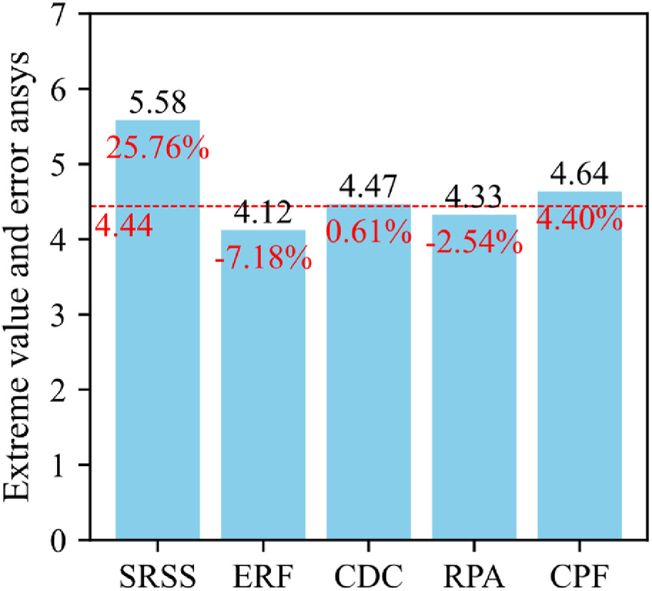
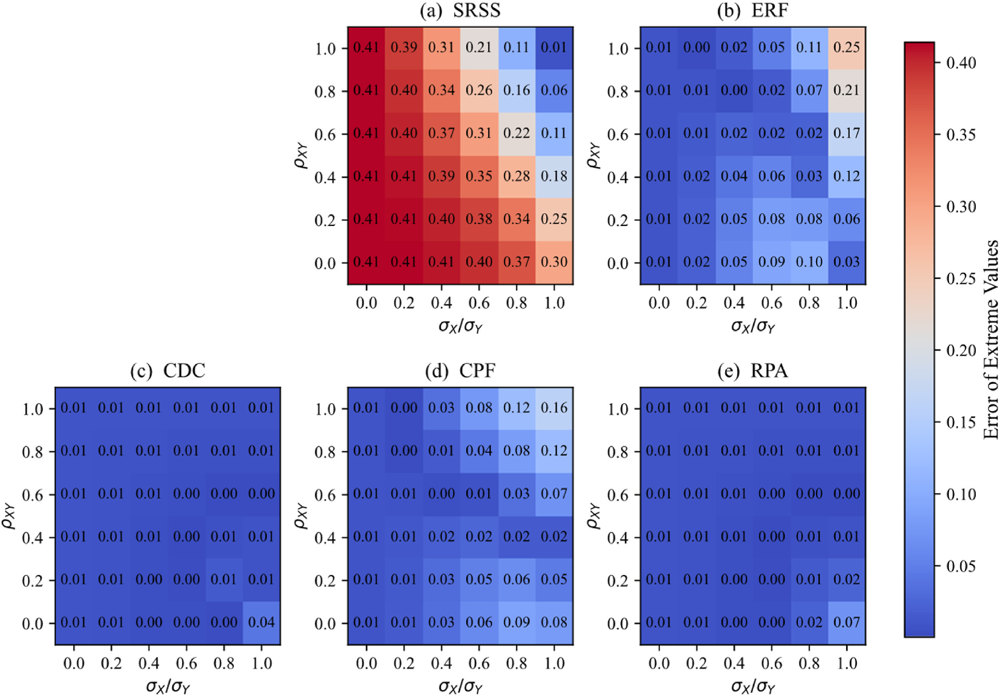
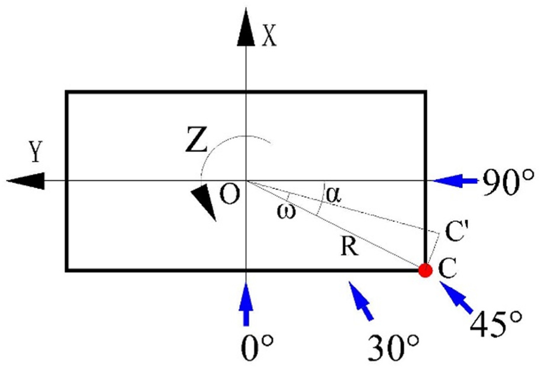
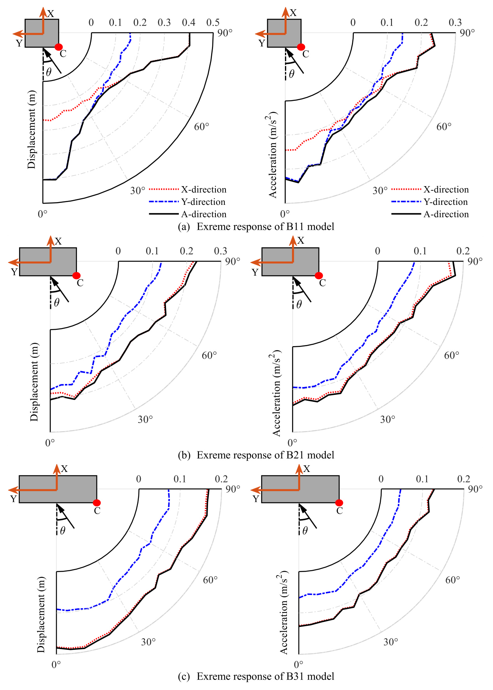
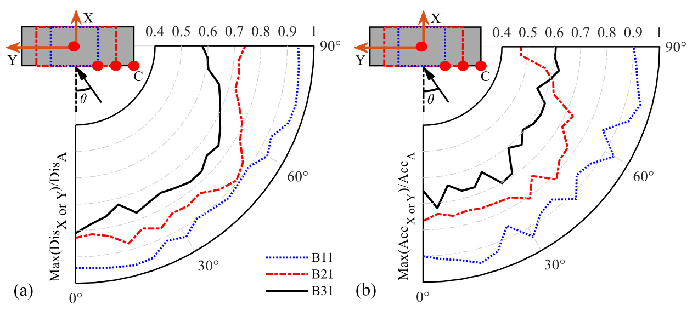

# 结构抗风 | 两个方向的峰值，怎样合成建筑真实的不利响应？

高层建筑的楼面角点会同时发生两个方向的平动和扭转。分别检查主轴方向峰值，未必能反映角点的二维运动；把两个峰值直接组合，也可能偏保守。本文比较多种统计组合方法，分析相关性、建筑宽深比和角点位置的影响。

## 论文信息

- 论文题名: Statistical extremes of 2D vectorial response for wind-excited tall buildings
- 作者: <u>Yang Junhui</u>; **Li Chao**\*; Zhang Zhu; Chen Lingwei; He Xin; Zheng Qingxing; Zhang Jianjun
- 期刊: Journal of Building Engineering
- 年份: 2025
- DOI: https://doi.org/10.1016/j.jobe.2025.113635
- WOEAI 相关方向: 工程结构抗风 / 工程结构抗风与优化

## 摘要

在高层建筑结构设计中，现行规范通常采用一维主轴方向的极值响应来定义结构极限状态。然而，结构位移和人体对加速度的感知本质上是二维矢量过程。只关注主轴方向响应会显著低估建筑的实际极值响应。本文首先基于稳态高斯随机过程，考察风致一维峰值因子和二维矢量响应极值的计算方法。随后，以两个相互垂直的平稳高斯随机信号为例，在不同相关系数 $\rho_{XY}$ 和标准差比 $\sigma_X/\sigma_Y$ 条件下研究多种二维矢量响应极值计算方法的准确性。

结果表明，平方和开方（SRSS）、经验折减系数（ERF）和组合峰值因子（CPF）方法没有考虑各方向响应之间的相关性，结果偏差较大；相关性依赖组合（CDC）方法计算结构二维矢量响应极值最准确，旋转主轴（RPA）方法可以量化一维分量响应与二维矢量响应之间的相关性和角度关系。

研究还发现，高阶振型对高层建筑风致响应的贡献可以忽略，为提高计算效率，本文建议仅考虑前 $11$ 阶振型。风向角和截面宽深比对风致响应有显著影响，设计中应尽量避免建筑主轴与当地主导风向一致，以避免产生较大的横风向响应。当宽深比不小于 $2:1$ 时，角点处加速度响应极值相对于中心点偏差约为 $19\%$，此时应采用角点而不是中心点评估建筑风致响应极值。较大的扭转周期比可能增大建筑风致二维矢量响应极值，设计中应予以避免。

摘要译注：原摘要笼统称高阶振型贡献可忽略；正文第 3.2.3 节和结论进一步区分位移与加速度，加速度仍需计入更多振型，下文按这一细分结果说明。

## 研究问题与解决思路

两个主轴方向的响应峰值通常不在同一时刻出现，其相关性会影响二维合成极值；角点还叠加扭转运动，中心点的一维峰值未必代表不利位置。本文先在平稳高斯随机信号中比较多种极值组合方法，再用高层建筑风致响应考察风向、宽深比和扭转周期比的影响，同时检验位移与加速度所需的振型数量，为不同响应目标选择合适的统计计算方式。

## 在相同随机输入下比较五种极值组合方法

二维响应时程写为：

$$
A(t)=\sqrt{X^2(t)+Y^2(t)}
$$

其中 $X(t)$、$Y(t)$ 是相互垂直方向的响应。需要估计的是合成时程 $A(t)$ 的极值，而非将两个不同时间的分量峰值直接合成。

我们首先梳理一维峰值因子和二维矢量响应极值的统计基础，然后把常见的五类二维极值合成方法放在同一框架中比较：SRSS、ERF、CDC、RPA 和 CPF。它们的差别主要在于是否考虑两个分量响应之间的相关系数 $\rho_{XY}$、标准差比 $\sigma_X/\sigma_Y$，以及二维响应相对于主轴方向的角度关系。

论文图 3 二维矢量响应极值合成结果和误差

读图时可以对照同一组 $X(t)$、$Y(t)$ 输入下各方法给出的极值估计和误差柱：不同方法的结果差异一目了然，其中 CDC 方法在该算例中的误差最小。

为避免只在单一相关性条件下得出结论，我们进一步设置不同的 $\rho_{XY}$ 和 $\sigma_X/\sigma_Y$，用大量随机模拟检验各方法偏差。这个步骤把“二维矢量响应极值”从一个概念判断变成了可比较的统计问题。

论文图 5 不同标准差比和相关系数下的二维矢量响应极值误差

这是一组误差热图：横轴为 $\sigma_X/\sigma_Y$，纵轴为 $\rho_{XY}$，颜色和格内数字表示相对误差。SRSS、ERF、CPF 的估计公式不显式使用相关系数，但相对真实值的误差仍会随相关系数变化。

随后，我们把这些方法应用到高层建筑风致响应分析中，研究风向角、截面宽深比和扭转周期比的影响。这样，方法比较不止停留在随机信号层面，也进入了具有工程几何和动力特征的高层建筑模型。

论文图 1 建筑主轴和风向

读图时注意楼面两个主轴方向、风向角的定义和角点 $C$ 的位置：后文比较的各种二维合成方法，都在这一坐标约定下计算角点响应。

## 相关性、振型与角点位置分别带来多大差别？

我们先在随机信号算例中比较各方法。SRSS 方法由于不考虑两个主轴方向响应之间的相关性，会给出偏保守结果；ERF 和 CPF 也会因相关性处理不足而出现较大偏差。论文中给出的结果显示，在不同 $\rho_{XY}$ 和 $\sigma_X/\sigma_Y$ 条件下，SRSS 最大偏差可达约 $42\%$，ERF 约 $25\%$，CPF 约 $16\%$，RPA 约 $7\%$，而 CDC 最大偏差仅约 $4\%$。 原文正文报告 SRSS 约 $42\%$，图 5 的最大格值为 $0.41$；这里保留作者报告的近似量级，不将它视为已独立复算的精确上界。

这说明二维极值不是一个可以用单一方向峰值简单替代的问题。对高层建筑抗风设计来说，二维响应的相关性、分量大小差异和方向关系都会改变最终极值判断。

我们在随机信号和高层建筑案例中进一步比较各方法的综合表现。CDC 方法在两类算例中的综合误差都最小，是本文比较中最稳定的二维矢量响应极值计算方法。它的优势在于把相关系数 $\rho_{XY}$ 和两个方向响应标准差差异纳入组合计算，而不是默认两个分量完全独立或完全同步达到峰值。

RPA 方法也有重要价值。它通过旋转主轴，把非主轴方向的二维响应极值问题转化为一维方向上的极值搜索，可以帮助理解一维分量响应与二维矢量响应之间的角度关系。不过在本文结果中，RPA 在某些条件下可能偏小，因此用于设计判断时需要注意保守性。

我们考察参与振型数量对风致响应计算的影响。以该模型 $0^\circ$ 风向、前 $20$ 阶结果为参照，屋面角点位移响应前 $3$ 阶振型的累计贡献已达到 $99.8\%$，因此位移计算中忽略更高阶振型通常可以显著提高效率且误差很小。

但对屋面角点加速度响应，高阶振型贡献更明显。论文中给出的结果显示，前 $6$ 阶振型累计贡献为 $96.7\%$，前 $11$ 阶达到 $99.0\%$。在本文建筑模型条件下，位移计算用前 $3$ 阶振型已经足够，而加速度计算建议考虑前 $11$ 阶振型。不能把位移响应的简化经验直接搬到舒适度相关的加速度评估中。

我们对不同宽深比建筑在不同风向角下的响应进行比较。结果显示，当建筑宽深比为 $1:1$ 时，风向与建筑主轴一致时二维风致响应极值较大；随着风向角增大，二维响应极值先降低后升高，在 $45^\circ$ 附近达到较小值。因此，设计中应尽量避免建筑主轴方向与当地主导风向一致，以降低显著横风向响应的风险。

论文图 18 不同宽深比建筑顶层角点的主轴响应和合成响应极值

读图时按 $1:1$、$2:1$、$3:1$ 三组宽深比对照：黑线代表二维合成响应，红线和蓝线分别代表两个主轴方向响应，三组曲线随风向角的相对位置变化反映了控制响应的转移。

当宽深比增大时，二维矢量响应极值逐渐接近弱轴方向响应极值。对本文未增大扭转周期比的 $3:1$ 模型 B31，表 4 的全风向最大值比较中，角点二维响应相对角点主轴响应的位移、加速度差别分别为 $2.20\%$、$1.58\%$。该小于约 $3\%$ 的结果不能推广到任意扭转周期比或所有逐风向比较。但这并不意味着所有宽深比下都可以忽略二维合成，尤其在 $1:1$ 和 $2:1$ 情况下，风向和角点位置仍会带来明显差异。

工程分析中常以楼面中心点响应作为代表值，但本文结果显示，角点二维矢量响应可能明显大于中心点主轴响应。当宽深比不小于 $2:1$ 时，只考虑中心点主轴方向响应极值，可能使真实加速度响应极值产生约 $19\%$ 以上偏差，此时应改用角点评估建筑风致响应极值。当宽深比不小于 $3:1$ 时，这一偏差可进一步增大。

论文图 20 中心点主轴响应与角点合成响应之比

图中比较了楼面中心点主轴响应与顶层角点二维合成响应之间的比例，比例偏离 $1$ 越远，说明只看中心点带来的误差越大。

## 怎样把统计结果用于抗风与舒适度评估？

早期方案可结合主导风向比较建筑朝向，并在不利角点核查二维响应。位移与加速度需要分别做振型截断检查：前者的简化经验不能直接用于舒适度评价，论文中的建议阶数也不能作为所有建筑的固定值。

组合方法主要针对零均值脉动响应，平均风响应另作静力处理。本文结论基于稳态高斯随机过程假设、论文选取的高层建筑模型、风洞试验风荷载数据、PI 方法计算的风致响应时程，以及文中设定的宽深比和扭转周期比工况。换成复杂非高斯响应、显著非线性结构、不同地貌风场、不同结构体系或其他舒适度评价标准后，二维矢量极值计算仍需要重新核验。

CDC 方法在本文比较中表现最好，但这不意味着其他方法在所有工程情境中都没有价值。SRSS 的保守性、RPA 的角度解释能力，以及规范和工程实践中的既有流程，都需要结合设计阶段和安全裕度要求综合判断。

此外，论文给出的 $11$ 阶振型建议来自本文建筑模型的加速度响应分析。它说明高阶振型对加速度不可轻易忽略，但不应被机械推广为所有高层建筑的固定阶数。实际工程中仍应结合结构动力特性、模态质量参与、风荷载谱和响应目标进行校核。

点击阅读原文，可查看本论文的全文精解、极值组合公式与建筑算例。
