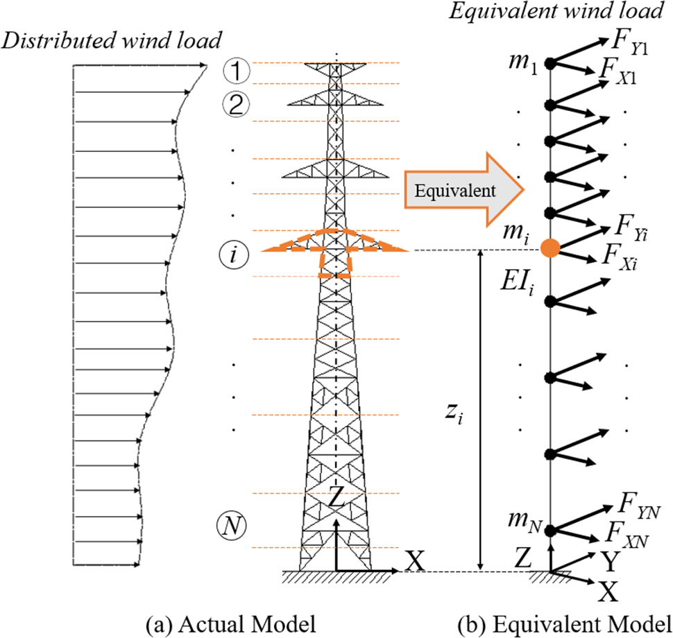
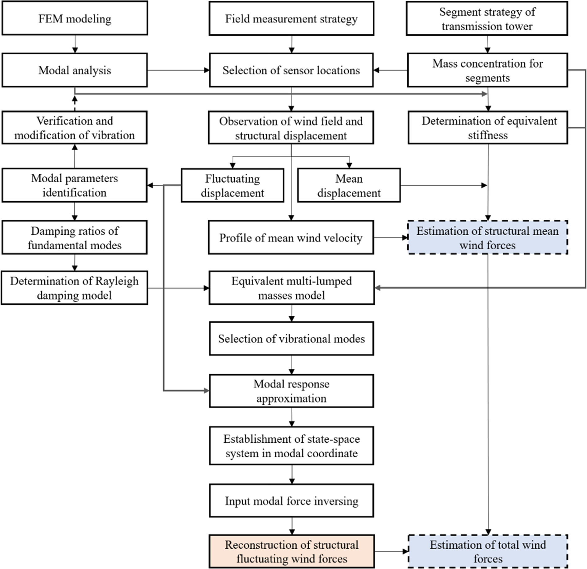
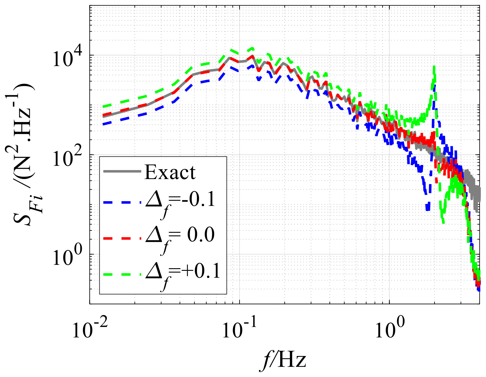
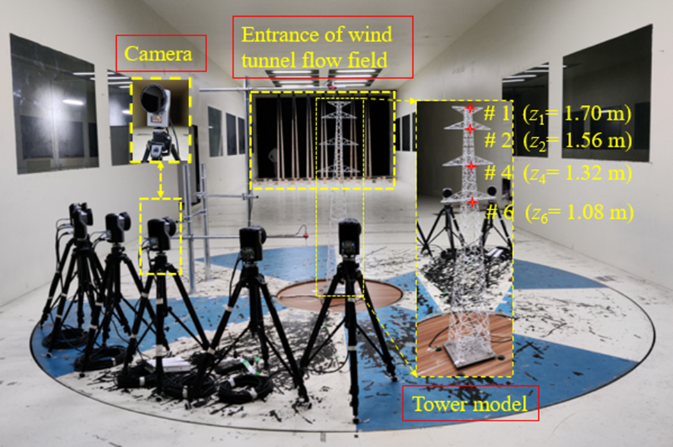
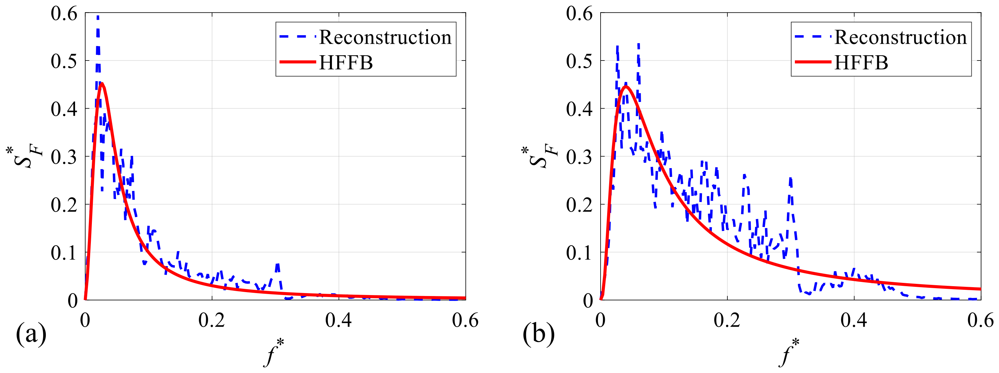
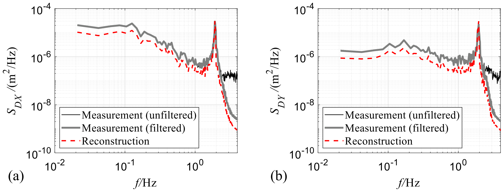

# 结构风工程 | 只测四处位移，能反推出输电塔怎样受风吗？

输电塔的振动可以用相机测到，沿塔身分布的风力却难以直接测量。本文利用四层横担的位移，先识别主导模态受到的风力，再重构分段荷载，并检查这些荷载能否重现风洞中的动力响应。

## 论文信息

- 论文题名: Reconstruction of dynamic wind forces on a transmission steel lattice tower using aeroelastic wind tunnel test data
- 作者: <u>Zhang Wentong</u>；**Li Chao**\*；Liu Gaixia；Xiao Yiqing\*
- 期刊: Engineering Structures
- 年份: 2023
- DOI: [10.1016/j.engstruct.2022.115167](https://doi.org/10.1016/j.engstruct.2022.115167)
- WOEAI 相关方向: 结构风工程 / 结构抗风

## 摘要

本文提出一种利用有限结构位移估计钢格构塔动力风力的方法，将模态状态空间系统模型与基于Kalman滤波的算法相结合。为便于应用，以等效集中力作为反演对象，表征格构塔上的分布风力。采用相应的等效悬臂杆模型，其刚度矩阵通过修正柔度法估计。依据模态叠加原理，利用识别出的输入模态风力，在物理空间重构动力风力。文中详细设计了动力风力重构方案，选取一座典型输电钢格构塔并开展气弹风洞试验。通过数值模拟与风洞试验，研究所提方案的性能和有效性。结果表明，重构动力风力能够产生与实际相当的动力响应，并对测量噪声影响表现出稳健性。虽然模态力识别对结构固有频率的建模误差较敏感，但可依据所识别模态力功率谱的变化判断这种影响。所提反演方法可作为利用有限响应测量评估钢格构塔动力风力的工具。

## 研究问题与解决思路

工程上往往只能在塔的少数位置测量响应，却希望知道风荷载怎样沿高度作用。直接求每一处未知风力，需要更多测点或额外分布假设。本文先把复杂格构塔化成多集中质量悬臂杆，用已识别的模态参数连接位移与荷载，在模态空间中估计输入力，再叠加回物理空间。反演对象是能代表分布荷载的等效集中力，检验重点是它们能否产生相当的动力响应，而不是宣称少数位移已经唯一确定所有杆件的真实风力。

## 先识别主导模态受的力，再重构各段荷载

研究对象是一座高 $42.5\,\mathrm m$、有四层横担的角钢输电塔。有限元模型有上千个构件单元，直接逐个反演其风力并不方便。作者将塔沿高度划成10段，把每段质量集中到一个代表高度，建立等效悬臂杆模型。

等效并非只把质量加起来。连接、地基条件和模型简化都会影响固有频率与振型；结构模型不准，同样的位移可能被解释成不同的荷载。论文采用修正柔度法估计等效刚度，并根据测量识别的动力参数更新模型，使其主导振动特征接近实际对象。

::: figure 1

论文图 1 多集中质量模型与等效风荷载示意图

读图：左侧为分布荷载作用下的格构塔，右侧为杆件连接的集中质量模型；箭头表示各段两个水平方向的等效力。

:::

反演在模态空间中进行。模态可以理解为结构的一种特征振动形态，把少数测点位移投影到这些形态后，可估计相应模态位移。作者用Kalman滤波与自适应递推最小二乘估计器相结合的算法，从模态响应识别模态力，再按振型把力分配回各段。

::: figure 2

论文图 2 钢格构塔风荷载重构的框架

先沿顶部三列辨认有限元、测量策略与塔身分段输入，再顺箭头读到中部等效模型、模态响应及底部模态力反演与脉动力重构；右侧虚线框为平均力和总力估计支路。

:::

流程图中的支路不扩大本篇实际验证范围：后文仍限定为脉动力重构，未把平均风力也说成已完成反演。

本塔的振动由第一阶模态主导，数值算例中其能量贡献超过99%，因此本文只保留这一阶。重构荷载保留了这一模态对应的作用，**不等于恢复了每一段的全部真实瞬时风力**。数值模拟正好说明这一区别：局部风力时程仍有差异，但用重构荷载算出的位移时程与功率谱可以较好吻合。

## 风力识别看似稳定，回算位移仍可能受模型误差影响

数值检验先设置已知风力生成响应，再向位移加入0%、10%、20%三种水平的高斯白噪声。本文用3 Hz低通滤波处理位移，取四层横担对应的测点1、2、4、6估计模态响应。在这组设置下，识别模态力对噪声表现稳健；这不意味着任意噪声类型或任意测点布置都已验证。

固有频率的影响更明显。将模型频率设得比真实值高10%或低10%，识别模态力谱会在真实固有频率附近出现异常起伏。对应塔顶位移均方根误差分别约为+13.1%和−8.3%。这个现象为诊断模型偏差提供了线索，但论文没有证明看到一条异常谱就能唯一确定误差来源。

::: figure 14

论文图 14 固有频率误差下识别模态力的功率谱密度

读图：灰线为准确谱，蓝、红、绿虚线分别对应频率相对误差−0.1、0、+0.1；重点比较固有频率附近的变化。

:::

阻尼给出了另一种提醒。把阻尼比从0.02改为0.01或0.03，识别模态力变化很小，但将该力输入模型后，位移仍会改变。其中0.01工况的塔顶位移误差达到29.9%。因此，不能把“模态力识别不太敏感”直接写成“整个响应预测都不敏感”；重构荷载与结构模型必须一起检查。

## 风洞检验支持响应等效，不是局部荷载的直接真值验证

气弹模型几何比例为1:25，模型高 $1.7\,\mathrm m$，风速相似比为1:3。试验按B类大气边界层布置，考察7个来风方向与两种参考风速。运动捕捉系统记录四层横担标记点的位移。相似条件并非全部严格满足：Cauchy数和Strouhal数相似保留，Froude数和Reynolds数相似作了放宽。

::: figure 19

论文图 19 风洞试验布置

读图：左侧为相机与试验流场入口，右侧放大塔模型，并标出1、2、4、6四个测量位置及其高度。

:::

实际风力反演重点分析塔顶原型参考平均风速 $37.5\,\mathrm{m/s}$、来风沿塔体X轴的$90^\circ$工况，不是把全部风向和两种风速都完成同样的重构验证。由于没有各段实际风力的直接测量，作者采用两条证据：整塔测力结果与重构荷载比较，以及把重构荷载重新施加到更新后的模型，回算位移。

与高频测力天平（HFFB）试验相比，重构的顺风总脉动力系数为0.096，测力值为0.097；横风方向为0.050对0.040，相差25%。广义风力谱的拟合优度分别为0.914和0.868，横风重构谱在部分频段偏高。这些差别应与吻合结果一起看。

::: figure 27

论文图 27 脉动风力功率谱密度比较

读图：（a）为顺风向，（b）为横风向；蓝色虚线是重构结果，红色实线是HFFB经验谱，横轴为无量纲频率。

:::

位移回算也有位置差别。塔顶顺风与横风位移均方根误差为6.8%和11.0%；较低的测点6分别为−21.3%和−16.3%。测点1位移谱与滤波后的实测较吻合，测点6背景响应谱则偏低。原文还比较了位移时程包络及相关性，但不能将这些检查改写成各位置误差都小于10%。

::: figure 29

论文图 29 测点 6 动力位移的功率谱密度

（a）为顺风向，（b）为横风向；黑线为未滤波实测、灰线为滤波实测、红色点划线为重构结果，横轴为频率。

:::

图29保留较低测点的背景谱差别，与文中塔顶和测点6的RMS误差共同说明响应等效的范围，不据较好的塔顶结果代表所有高度。

这条路径适合探索如何用有限响应测量评估等效风荷载，前提是主导模态、测点布置及动力参数足够可靠。本文未反演平均风力，也未验证明显扭转或多模态共同主导的塔。算法排印还存在分支不等号缺失、符号和附录下标不一致等复现细节，全文精解保留原式并注明，不能直接当作已核实的可执行算法。

## 从论文到工程

这项研究把少量响应测量与等效风荷载联系起来，为已有输电塔的数据利用提供了可进一步研究的方向。它的价值在于让结构监测与动力分析之间形成接口，使测到的运动有机会反过来帮助理解荷载分布，支持后续工况比较与响应评估。对监测方案设计而言，模态信息和测点位置也因此成为可以共同考虑的因素，有助于把有限测量资源放到对识别更有用的位置，为试验与数值模型的相互检验提供依据。使用仍需验证动力模型及测点可识别性。

点击“阅读原文”，查看完整反演方程、五张原表与柔度法附录，并对照重构荷载和位移的验证边界。

本文由 AI 辅助整理与撰写
