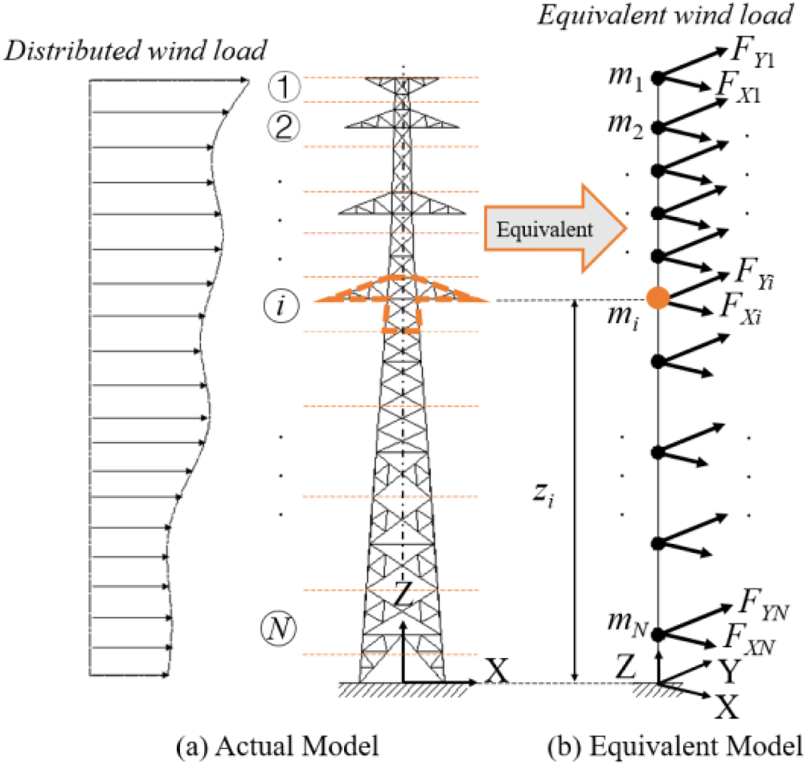
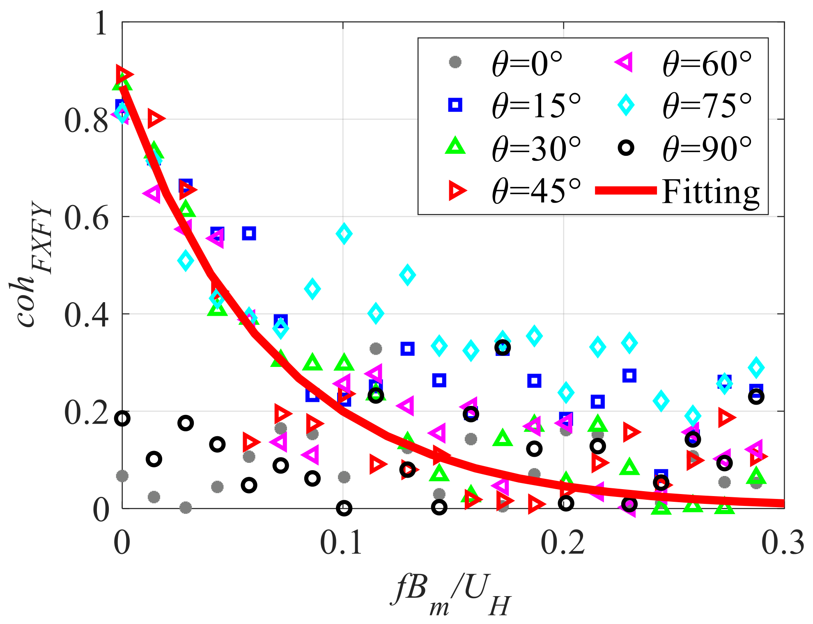
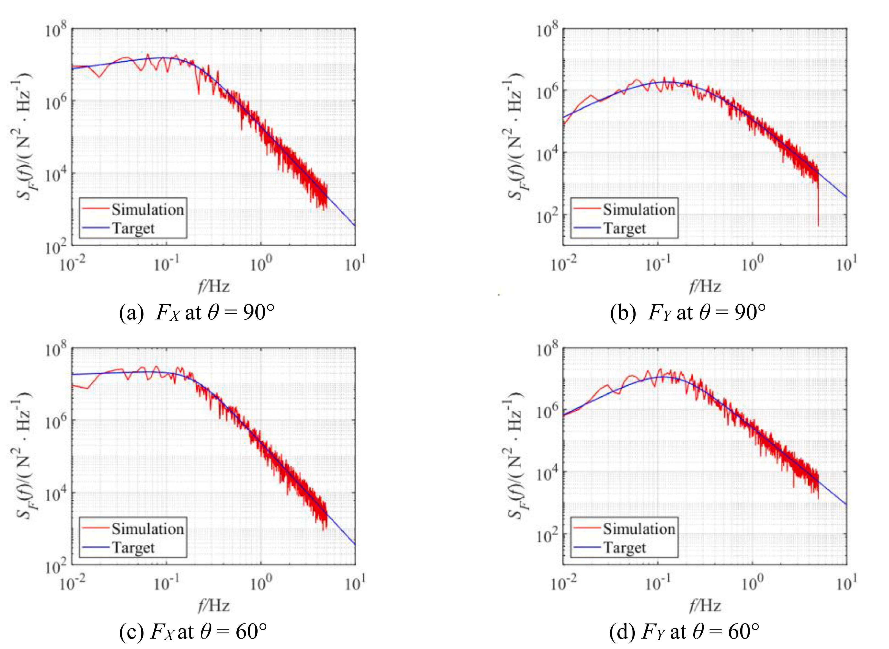
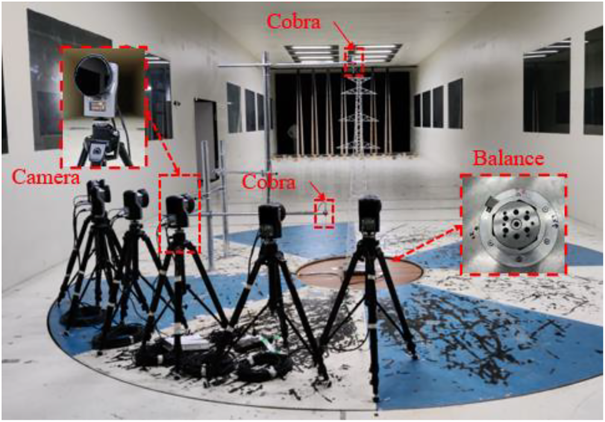
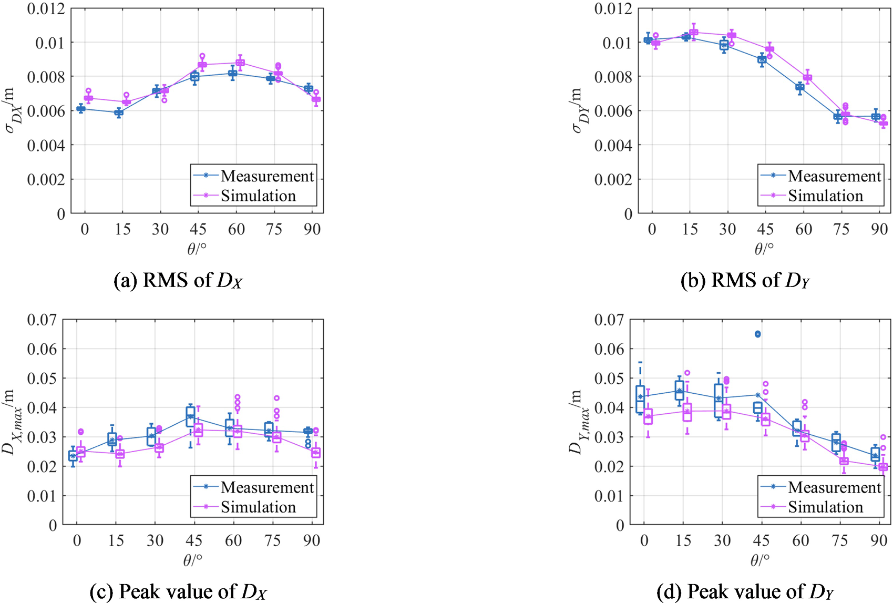

# 结构抗风 | 只测塔底反力，怎样估计整座输电塔的风荷载？

测到塔底的总作用，还不能知道每一段塔身怎样受风。本文从整塔广义风力谱出发，估计沿高度分布的脉动荷载，并把斜风下两个塔体方向的相关性纳入计算，再用风洞中的塔顶振动检验结果。

## 论文信息

- 论文题名: Estimation of dynamic wind forces on a steel lattice tower based on generalized wind force spectra
- 作者: <u>Zhang Wentong</u>；**Li Chao**\*；Liu Gaixia；Xiao Yiqing\*
- 期刊: Structures
- 年份: 2023
- DOI: [10.1016/j.istruc.2022.12.073](https://doi.org/10.1016/j.istruc.2022.12.073)
- WOEAI 相关方向: 工程结构抗风 / 结构抗风

## 摘要

本文提出一种估计钢格构塔动力风荷载的方法。基于广义风力谱推导局部风力谱，并考虑斜向来风下不同轴向风力之间的相干性。建立风力互功率谱密度（PSD）矩阵后，可采用谐波叠加法在时域中模拟脉动风力。文中介绍了一座典型输电钢格构塔的风洞试验。利用试验数据分析不同塔体轴向风力的相干性，并拟合相应经验函数。结合此前风洞试验获得的广义风力经验功率谱，在目标风环境下模拟该输电塔的动力风力。计算塔在所估计风力作用下的动力响应，并与气弹风洞试验测量值比较。结果表明，本文提出的钢格构塔分布式动力风力估计方法有效。

## 研究问题与解决思路

输电塔动力分析需要知道不同高度、不同方向的风力如何共同变化，但整塔测力试验只能给出塔底反力。若仅从风速和局部迎风面积推算，可能高估顺风荷载，也难以补齐横风荷载。本文把试验得到的整塔广义风力谱作为约束，用风场和塔身特征分配各段荷载谱，再补入斜风下两个塔体方向的相干关系，生成可用于动力分析的随机荷载时程。这里估计的是统计特征相符的分布荷载，不是从塔底记录唯一还原每根杆件某一时刻的真实受力。

## 先把整塔的谱分到各段，再处理两个方向的相关性

高频测力天平（HFFB）能够测量整塔模型的基底剪力、倾覆弯矩和扭矩。在主导振型近似线性的条件下，底部测力结果可以换算为广义风力谱。这个谱描述相应广义风力的脉动能量在不同频率上的分布，也包含整塔各部位受风及相互干扰的综合影响，但它没有直接给出各段风力。

论文将塔划分为若干分段，把分布荷载等效为各代表高度上的集中力。分配各段风力谱时，权重涉及平均风速、湍流强度、有效投影面积、风荷载分配系数、沿高度相干性与线性振型。这样，整塔谱提供频率特征，分段参数描述局部差异。具体算例采用10段模型，横担与方形塔身使用不同的斜风荷载系数，不能只按高度均分。

::: figure 1

论文图 1 格构塔等效风荷载示意图

读图：左侧为分布荷载，右侧为集中质量等效模型；各高度标出两个水平轴向的等效风力。

:::

还需要区分“顺、横风方向”和“塔体的两个固定方向”。风斜着吹时，塔体X、Y轴上的力都混合了顺风与横风分量。即使顺、横风力彼此相关很弱，也不能把斜风下两个塔体轴向的荷载都当作互不相关的随机信号。

试验中，来流沿塔体坐标轴时，两轴风力相干性较弱；斜风下，相干性随频率升高而减小。作者用$30^\circ$、$45^\circ$、$60^\circ$三种来流的数据拟合指数衰减关系，并用于本文其他斜风工况。这个拟合只服务于所研究塔型和频率范围，不是所有格构塔通用的系数。

::: figure 5

论文图 5 两个塔体轴向风力之间的相干函数

读图：横轴为无量纲频率，纵轴为相干函数；不同标记对应不同来风角，实线为拟合曲线。

:::

有了各段自功率谱和相互之间的互功率谱，作者用谐波叠加生成随机风力时程。功率谱匹配检验的是荷载的频率特征，互谱和相干函数还检验不同位置、不同方向如何共同变化。只有单个方向的谱吻合，并不足以完成这一步检查。

::: figure 11

论文图 11 广义风力的功率谱密度

上排为 $90^\circ$、下排为 $60^\circ$ 来风，左列为塔体 X 向、右列为 Y 向；红线为模拟谱，蓝线为目标谱，横轴为频率。

:::

图11检查分配到各段再汇总后的荷载是否仍保留整塔谱约束；它与后续位移统计量的对比属于不同层次的验证。

## 均方根误差小于10%，不等于峰值也达到同样精度

验证对象是一座角钢输电塔。风洞模型几何比例为1:25，模型高 $1.7\,\mathrm m$，来流模拟B类大气边界层。试验考察从$0^\circ$到$90^\circ$、间隔$15^\circ$的7个风向，动力响应比较对应塔顶原型参考平均风速 $37.5\,\mathrm{m/s}$。

::: figure 4

论文图 4 风洞试验布置

读图：图中标出塔模型、相机、Cobra风速探针和底部测力天平的位置。

:::

测力和测位移并非同步进行。为避免较高模型明显振动干扰力谱，HFFB试验采用较低风速；气弹试验则需要足够风速产生可测振动，再由视觉测量系统记录塔顶位移。因而，比较对象是两类试验支持的统计特征，而不是同一段风力和位移记录的逐点重现。

作者先检查模拟荷载的自谱、互谱及整塔广义风力谱是否符合目标，再把荷载输入结构动力模型。对每个风向，重复100次荷载生成与动力分析；试验一侧用滑动时间窗提取20个样本，每段 $600\,\mathrm s$。这里的20个样本不能当作20次独立风洞试验。

图14上排比较塔顶位移均方根，下排比较峰值。均方根反映一段时间内的整体波动水平；峰值更受随机样本影响。本文7个风向下，两方向位移均方根的模拟样本均值与测量样本均值误差小于10%，而峰值分布更分散，均值仍有偏差。

::: figure 14

论文图 14 塔顶位移统计量比较

读图：（a）、（b）是两方向位移均方根，（c）、（d）是位移峰值；蓝色为实测、紫色为模拟，箱线标出分布，连线标记表示各风向的均值。

:::

**小于10%的结论只对应上述位移均方根的样本均值，不是峰值误差保证。** 论文也指出，沿高度采用风速相干性可能高估风力相关程度，使塔的整体响应略偏大；忽略气动导纳的准定常对照，还会进一步高估顺风响应。

## 换一座塔，需要补齐哪些输入

这套方法的潜在用途，是把整塔测力试验提供的谱信息转成可用于动力分析的分段荷载。但迁移前仍需要相应塔型的广义风力经验谱、各段物理与气动参数，以及风向相关的相干描述。本文部分经验谱系数沿用先前研究，并未在本篇逐一列全，不能把这里的流程直接当作无需校准的通用荷载生成器。

结构模型也使用了试验信息：刚度根据识别出的固有频率确定，总模态阻尼包含结构阻尼与气动阻尼，而且随风速、风向变化。因此，本次响应比较支持的是特定塔型、给定模型和工况下的方法检验，不是对任意未知塔的完全独立盲预测。

横担仍是值得细查的部位。其外形与塔身不同，合风力方向也未必与来风方向一致，论文将二者设为相同会引入一定偏差。原式在正交风下零分配系数的处理、部分谱参数的记号差异，也保留了复现时需要澄清的细节，全文精解已就近说明，没有补造算法。

此外，本文未计入各段局部扭矩；对扭转效应明显的塔，还需扩展方法。研究没有验证塔线耦合、倒塌或任意非平稳极端风事件，不能仅凭塔顶振动吻合，就推断这些工程问题已经解决。

## 从论文到工程

这项研究为整塔试验数据服务于分布风荷载分析提供了途径，使有限的测力信息有机会支撑更完整的输电塔动力评估。将沿高度的荷载与不同方向的联系共同考虑，有助于设计者比较塔型、动力特性和局部响应之间的关系，也为连接试验与结构计算建立了中间模型。对于后续输电塔抗风研究，这种思路可帮助组织试验需求和荷载模拟工作，让已有数据更有针对性地用于响应分析及方案比较。换塔型时仍需核验动力参数与荷载假设。

点击“阅读原文”，查看完整谱推导、分段参数，以及七种风向下位移时程、概率密度和功率谱的附录对照。

本文由 AI 辅助整理与撰写
