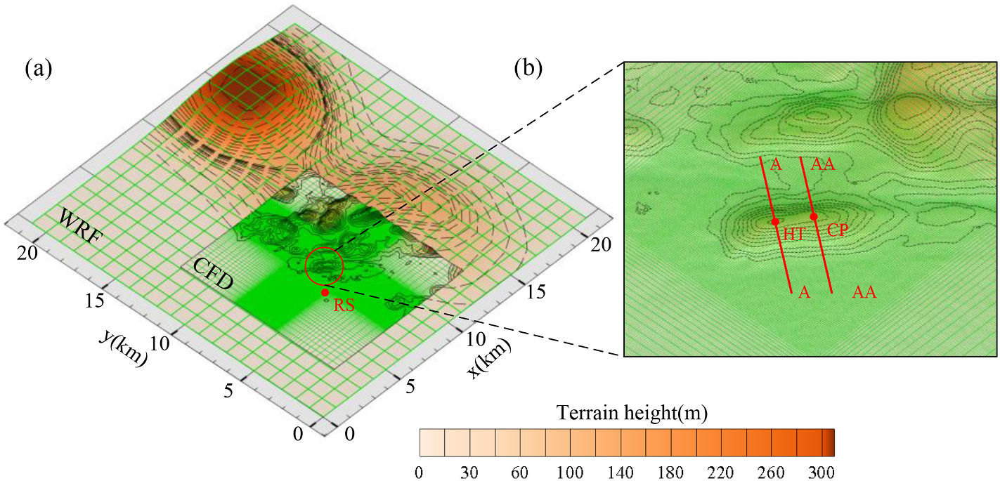
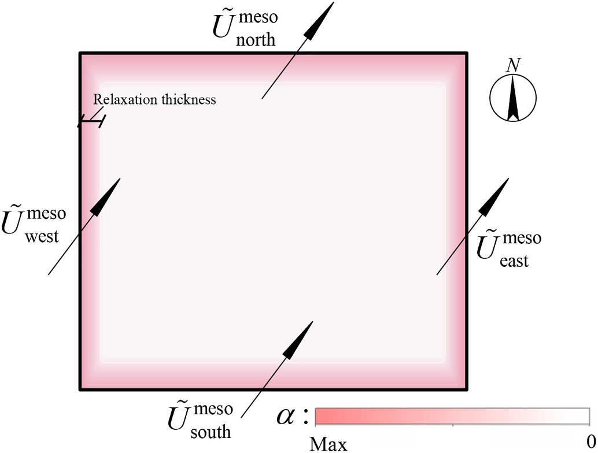
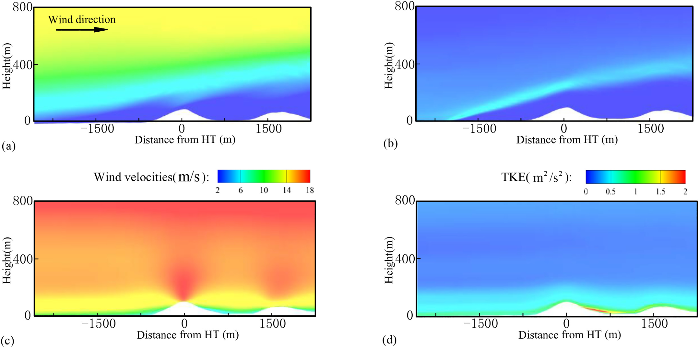
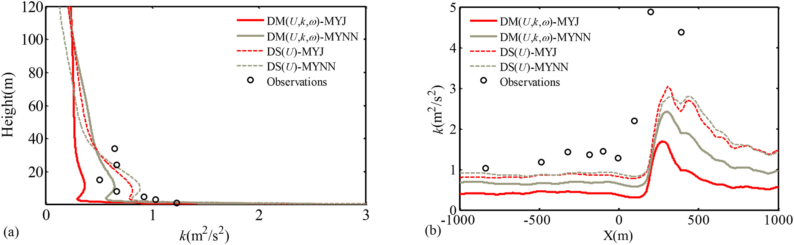

# 数值风洞 | 气象风场接入精细网格，为什么边界会让计算失稳？

中尺度气象模型能提供来风背景，精细 CFD 能解析山体附近的增速和分离，但两套结果不能在边界上直接硬接。这篇论文优化边界松弛处理，再用浅水系统和 Askervein 山地观测检验如何减少嵌套带来的数值反射与失稳。

## 论文信息

- 论文题名：New consideration of lateral boundary treatment for meso- and micro-scale nested PBL simulations over complex terrain
- 作者：<u>Zhao Zihan</u>；Xiao Yiqing；**Li Chao**\*；Wang Jinghan；Hu Gang
- 期刊：Atmospheric Research
- 年份：2021
- DOI：https://doi.org/10.1016/j.atmosres.2021.105507
- WOEAI 相关方向: 工程结构抗风 / 数值风洞

## 摘要

通过嵌套中尺度数值天气预报（NWP）模型与微尺度计算流体动力学（CFD），可以模拟复杂地形上细致的行星边界层（PBL）流动。当侧边界上的变量被完全指定时，CFD 或有限区域模型的过指定处理可能导致不适定性和数值不稳定。这些行为源于中尺度与微尺度模型的控制方程、湍流黏度模型及下垫面不一致。本文在 CFD 边缘区域施加松弛处理，使其风速分量趋向外部指定的 NWP 值。松弛方案由简单平流输运方程推导，并利用遗传算法优化。与已有方法相比，其在浅水系统中吸收波反射的数值能力更好。随后，在中性层结的 Askervein Hill 算例中，系统研究松弛强度、湍流模型常数以及 NWP–CFD 嵌套边界预报变量选择等关键问题。从简单系统获得的松弛方案在 CFD 中同样有效，缩短了过指定出口边界附近风速的适应距离。本文提出并验证了一套完整方法，使由 NWP 提供入流边界的微尺度域获得适定 PBL 解。

## 研究问题与解决思路

精细模型需要气象背景，却又会解析出粗网格中没有的地形和流动。如果入口、出口甚至顶部都直接指定粗网格结果，精细流场可能无法同时满足这些约束。论文将边界附近设为过渡区，通过源项逐渐调节速度差；先在简单平流方程中优化各层松弛强度，再检验浅水波反射，最后放入真实山地的中微尺度耦合。除了问过渡区怎样设，还比较哪些湍流量应从外层传入，哪些应留给微尺度模型自行发展。

## 同一座山，在两个网格中可能不是同一个形状

Askervein 山体短轴、长轴约为 $1\,\mathrm{km}$ 和 $2\,\mathrm{km}$，在最内层气象网格中只占一至两个单元；微尺度 CFD 则能较清楚地描述山体。来流经过山顶时产生的增速、背风侧分离，以及局地湍流变化，都可能与气象模型不同。

论文图 8 中微尺度计算域相对位置与地表网格

左图绿色线为气象网格，中心是精细 CFD 区域；右图放大山体与 HT、CP 测点及两条测线。

入口以外的边界也会影响结果。非定常风向可能使同一侧面同时包含入流与出流；若全部指定外层速度和湍流量，就可能形成“过指定”。论文不是主张取消气象边界，而是在边界约束与内部流动发展之间留出适应空间。

## 松弛不是越强越好，要同时看过渡和反射

松弛源项把微尺度速度逐渐拉向中尺度参考值。论文在边界附近设置多层，靠边界较强，向内部减弱至零。过渡过窄，或强度变化过陡，都可能产生新的数值反射；一味加大阻尼并不能保证结果更好。

论文图 10 三维 Askervein 算例中的松弛区示意

粉色带表示边界过渡区，颜色向内部变浅；四个方向的箭头对应由 WRF 指定的侧边界来风。

作者先用一维平流方程描述粗、细网格解的差异，把反射系数作为优化目标，再用遗传算法寻找各层权重。在二维浅水算例中，采用高斯初始扰动、积分 $3$ 小时，与 Lehmann 方案比较。对 4、6、8 层，最大残余位势扰动的相对差分别为 $23.5\%$、$38.1\%$、$50\%$，本文方案更小。

这些百分比只属于这个浅水反射试验，不能写成真实山地风速误差降低了同样比例。浅水算例检验的是过渡区吸收非物理扰动的能力，随后还需要检查完整 CFD 中的速度、湍流与质量守恒。

## 平均风速接近，不代表湍动能也接对了

真实算例采用 1983 年 10 月 3 日 TU-03B 观测中的近中性时段。三维 CFD 域为 $11\,\mathrm{km}\times12\,\mathrm{km}\times1.8\,\mathrm{km}$，松弛区厚度 $0.9\,\mathrm{km}$，采用六层方案，并在每次迭代中进行质量守恒调整。

论文比较了两类处理：一类传入气象模型的速度和湍流标量，并调整 CFD 常数使湍流黏度一致；另一类只传入速度，对湍流标量设零梯度，使用标准常数。两类都保留气象背景，但允许内部湍流发展的方式不同。

不做特殊处理时，过指定边界在三维计算中产生不适定风场。松弛与质量守恒调整结合后，山顶增速和背风分离能够再现。不过，平均速度对湍流常数不太敏感，不等于湍动能也如此。论文中两类边界的平均速度差别较小，湍动能差别却更明显。

论文图 15 Askervein Hill 沿 A–A 截面的竖向风场比较

上排是不适定计算结果，下排为采用松弛和质量守恒处理的工况；左列为风速，右列为湍动能。两排配置不同，不能把图中全部差别仅归因于一个参数。

在本文三维比较中，不直接指定气象湍流标量的 DS(U) 工况，整体统计指标优于相应比较工况；其中 MYNN 输入又比 MYJ 更好。但结论仍有明显边界：例如 DS(U)-MYJ 的背风侧最大湍动能约为 $3.04\,\mathrm{m^2/s^2}$，实测为 $4.87\,\mathrm{m^2/s^2}$，并没有消除低估。

## 留给边界的距离，也是计算域设计的一部分

二维敏感性试验表明，出口不匹配产生的新流动形态可能延续约 $1.5$ 至 $2\,\mathrm{km}$。采用线性松弛时，需要考虑更宽的过渡与发展距离；调强源项虽能让速度接近参考剖面，也可能对湍动能产生负面影响。因此，减少计算域不能只看目标山体是否放得下，还要检查出口的影响是否进入关注区域。

论文图 18 湍动能比较

左图为 HT 站竖向剖面，右图为 A–A 测线水平分布；空心点为观测，比较背风峰值时注意曲线与散点的差距。

论文验证的是近中性山地流。加入热力层结和浮力后，还会产生重力波等传播过程，边界可能再次反射这些扰动，原文将其列为后续研究。实际使用时，应同时检查边界指定变量、松弛厚度与强度、湍流模型常数和质量守恒，而不是把一套权重直接套到任意天气或地形。

## 从论文到工程

这项研究把多尺度风场之间的过渡作为独立设计问题，为精细地形模拟接入气象背景提供了边界处理依据。它的价值在于使计算域尺度与缓冲区设置能够共同服务于流动发展，帮助研究者减少接口约束对局部风场判断的干扰。对于山地风资源、线路环境等后续分析，这种思路有机会改善不同网格模型的衔接方式，并让边界敏感性成为可以主动检验的环节，为更复杂天气条件下的耦合研究建立基础。推广仍需核验热力过程与边界反射。

点击“阅读原文”，查看完整推导、七张可编辑表格、全部原图和附录符号表。

本文由 AI 辅助整理与撰写
