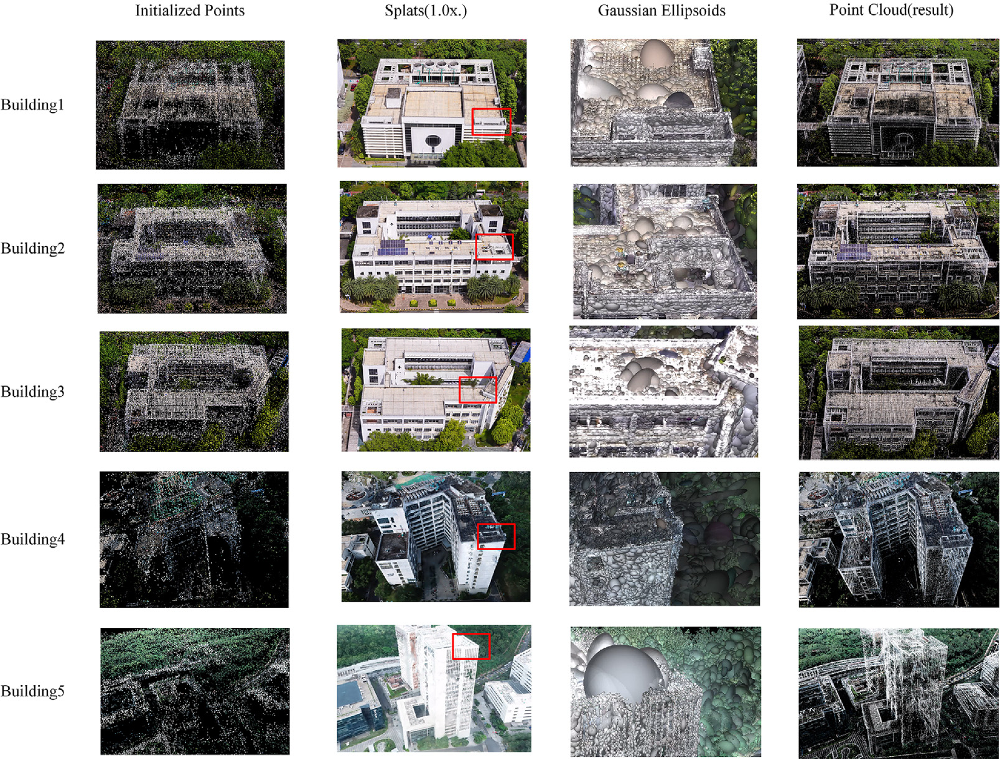
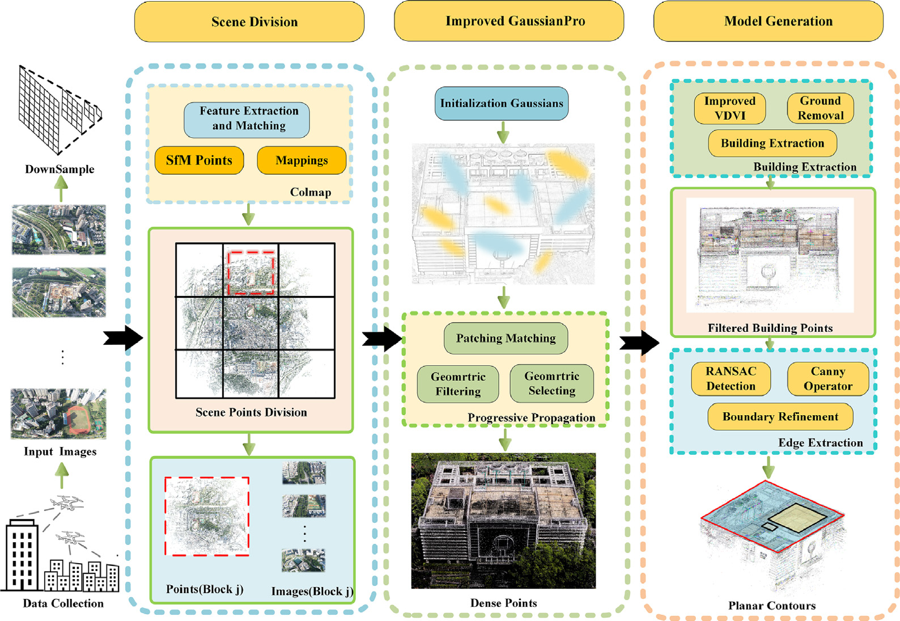
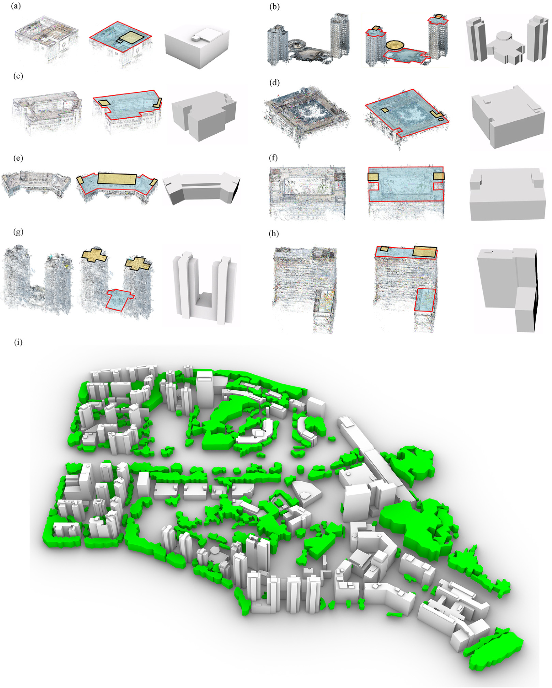
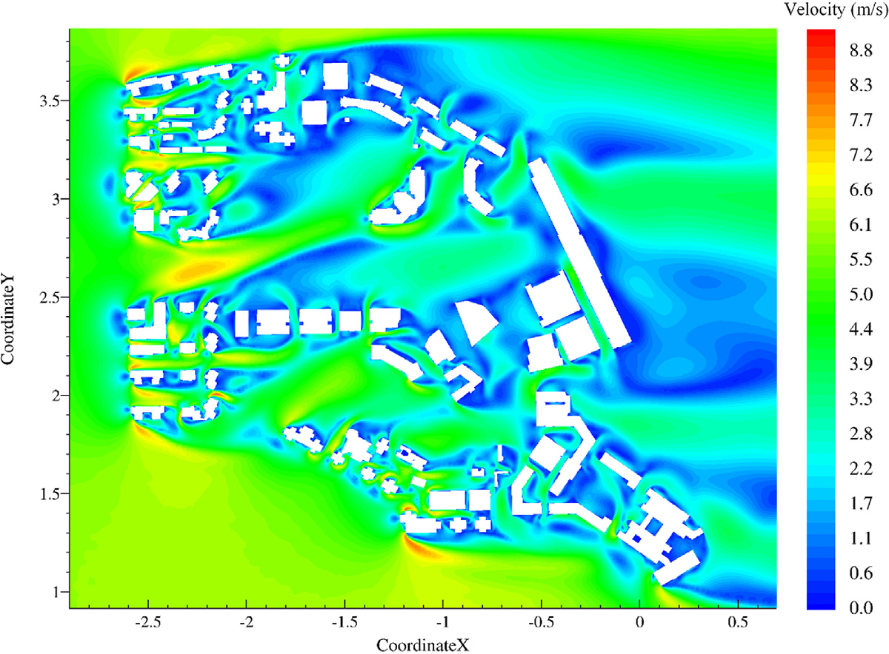
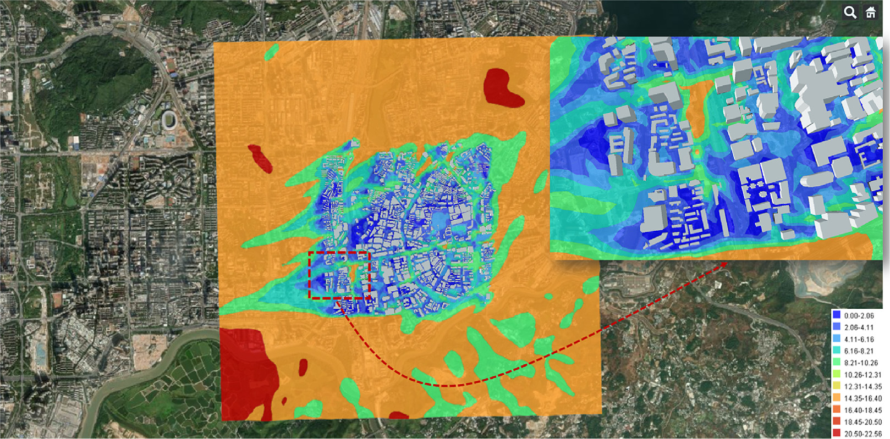

# 数值风洞 | 无人机拍到的建筑，怎样变成可计算的城市几何？

城市建筑重建得像，不等于可以直接划分网格并计算风场。孔洞、杂乱轮廓和植被遮挡都可能增加前处理负担。本文从无人机影像出发，结合三维高斯重建与建筑轮廓整理，检查生成几何用于城市风环境计算的可行性。

## 论文信息

- 论文题名: A novel framework utilizing 3D Gaussian Splatting to construct building geometry for urban wind simulations
- 作者: <u>Zhao Peisheng</u>; **Li Chao**; Jiang Jianxun; Chen Lingwei; Wang Xiaolu\*
- 期刊: Sustainable Cities and Society
- 年份: 2025
- DOI: https://doi.org/10.1016/j.scs.2025.106237
- WOEAI 相关方向: 工程结构抗风 / 数值风洞

## 摘要

计算流体力学（CFD）模拟是城市风环境评估中的重要方法。快速、准确地建立细致的建筑几何模型，是开展高质量 CFD 模拟的关键前提。利用点云生成这类模型是主流方法之一，但现有方法对建筑点云生成的效率和精度关注不足，在建立几何拓扑时也难以提取足够细节，因此生成的几何模型并不适合直接用于 CFD 模拟。

针对这些问题，本文提出一种基于 3D Gaussian Splatting 的算法框架。首先，利用无人机拍摄影像并通过 COLMAP 生成稀疏点；随后，提出一种基于这些稀疏点的场景分割方法，将整体场景划分为均匀区块。本文首次引入并改进 3D Gaussian Splatting，以显著提升速度的方式生成高精度建筑点云。

此外，研究设计了一套集成算法，用于从点云中提取植被、地形和建筑，再对建筑轮廓进行简化和细化，生成适合 CFD 模拟的几何模型。与传统方法相比，该框架能够将场景扩展到城市尺度，并支持可调节的细节水平。点云精度平均提高 $12\%$，生成速度提升 $3$-$5$ 倍，几何模型细节水平达到 LoD2 和 LoD2.5，并可通过定制飞行规划进一步提升。最后，研究开展了基于 CFD 模拟的行人舒适度分析和 WebGIS 可视化，模拟结果呈单调收敛，压力场网格收敛指数达到 $3.76\%$。这些结果表明，该算法框架适用于典型城市风场模拟。

## 研究问题与解决思路

城市风环境计算需要边界清晰、细节适当的建筑几何，而影像重建通常首先追求视觉效果，点云中的植被、孔洞和不规则轮廓仍需处理。本文研究如何从无人机影像获得可供计算的城市模型，通过场景分块和改进三维高斯方法生成点云，再分离地物、提取并细化建筑轮廓，最后以网格收敛及行人风环境算例检验可用性。几何重建精度与风场预测精度需要分别评价。

## 从场景分块到建筑轮廓整理

本文提出的框架由两个核心部分组成：密集点云生成和建筑几何模型生成。

第一步是场景分块。我们先使用 COLMAP 从无人机影像中得到 SfM 稀疏点云以及二维特征点与三维点之间的映射关系，再根据这些映射关系把整个场景划分为多个区块。这样做的目的，是让城市尺度场景可以被分块训练和并行处理，缓解大场景重建中的内存和时间压力。

第二步是改进 3D Gaussian Splatting。我们以 GaussianPro 为基础，将场景表示为不断优化和加密的高斯点，通过 patch matching、geometric filtering、geometric selecting 和 progressive propagation 等过程提升建筑点云质量。与直接追求视觉渲染不同，本文更关注重建结果能否支撑后续建筑轮廓提取和 CFD 几何建模。

第三步是几何模型生成。研究用改进的 VDVI、地面去除、建筑提取、RANSAC、Canny 算子和边界细化等步骤，将点云中的植被、地形与建筑分离，并将建筑屋面轮廓整理成更规则的几何模型。

论文图 14 选定建筑的密集点云

图中从初始化点、splat 渲染、高斯椭球到最终点云展示了 3DGS 如何逐步获得建筑细节，也提示了屋面、立面遮挡和背景颜色对点云质量的影响。

论文图 1 算法框架总体流程

这张图展示了从无人机影像、场景分块、改进 GaussianPro 到建筑模型生成的完整路径，说明本文并不是只做视觉重建，而是面向 CFD 可用几何模型来组织算法。

## 点云质量、生成时间与网格收敛分别如何？

论文用同一数据集比较了本文框架与 COLMAP、Context Capture、NeuS、NeuDA 等方法。结果显示，本文方法相对 COLMAP 的点云精度平均提高约 $12\%$，并且在生成速度上明显更快。结论部分进一步概括为：密集建筑点云生成速度比传统方法快 $2$-$3$ 倍，同时保持较高精度。

这组比较仅使用5栋代表建筑。表 2 中 B4 的距离误差反而高于 COLMAP，且方法的完整性和召回率存在不足，平均改善不代表每栋建筑都更好。原摘要写速度提升3–5倍，结论写2–3倍，未统一比较基准；因此两种概括不能作为同一端到端加速保证。

从重建结果看，本文框架生成的建筑几何模型具有较规则的平面轮廓，能够保留主要屋面细节，并避免尖角、凹凸不平等可能导致 CFD 计算发散的问题。论文报告几何模型的细节水平达到 LoD2 和 LoD2.5。

这也是本文和纯视觉重建工作的区别之一：视觉上更“像”的模型，不一定更适合 CFD；而 CFD 需要的是能够表达主要建筑外形、边界清晰、网格质量可控的几何。

论文图 18 几何模型重建结果

这张图把建筑点云、平面轮廓和几何模型并列展示，并给出整体场景结果，说明框架如何从点云走向可用于风场模拟的城市几何。

为了验证几何拓扑的有效性，论文进一步开展三维不可压缩牛顿流体模拟，采用 $k$-$\omega$ SST RANS 湍流模型求解稳态速度和压力。计算域按照最高建筑高度 $H_{\mathrm{max}}$ 设置：上游边界距加密区取 $5H_{\mathrm{max}}$，侧向边界距加密区取 $5H_{\mathrm{max}}$，下游边界距加密区取 $15H_{\mathrm{max}}$，高度取 $6H_{\mathrm{max}}$；加密区覆盖研究区域内所有建筑，直径为 $20H_{\mathrm{max}}$、高度为 $2H_{\mathrm{max}}$。

网格收敛分析中，粗、中、细三套网格的单元数分别约为 $7.9$ 百万、$16.8$ 百万和 $37.9$ 百万。论文表 3 中，基础网格速度和压力的 GCI 分别为 $3.51\%$ 和 $3.76\%$，二者最大值为 $3.76\%$，基础网格的湍流量最大 GCI 为 $4.89\%$，并据此选择基础网格用于后续工况和行人舒适度评估。这些是基础网格的离散化指标；粗网格的对应 GCI 更高，不能把 $3.76\%$ 解释为所有网格、所有物理误差的上限。

论文图 25 研究区域 2 m 高度处的速度幅值

速度场显示了建筑边缘、狭窄通道和开阔区域的风速差异，把几何重建结果进一步连接到行人高度风环境分析。

在行人舒适度分析中，论文基于附近气象站的长期风速风向数据、Weibull 分布、POT 方法和 CFD 风速比结果，对 $30$ 个监测点进行分类。结果显示，多数监测点属于 I 类和 II 类，满足行人舒适度要求；少数点位达到 III 类或 IV 类，原因与小建筑、狭窄通道和通道加速效应有关。

论文还将建筑几何和 CFD 风场结果与 Cesium、GeoServer、WebGIS 展示流程连接起来，对风场数据进行插值和可视化。这一步不是说平台功能已经完全工程化，而是展示了从“自动几何重建”到“风场数据库与可视化表达”的应用可能性。

论文图 34 风场插值结果

WebGIS 视图把建筑几何、插值后的风场分布和底图放在同一空间语境中，便于后续工程沟通、规划评估和灾害研究场景继续扩展。

## 这条前处理路线在什么条件下仍需人工复核？

该流程可为街区风环境评估提供几何前处理，并支持后续风场展示。应用时应分别记录影像采集、稀疏重建、密集点云生成和几何清理的耗时，不能用其中一个阶段的加速倍数代表端到端效率。

首先，当建筑颜色接近背景颜色、颜色变化不明显，或者存在强光、阴影、植被遮挡时，点云细节仍然可能丢失。其次，当前精细几何生成重点是建筑；论文已经分离植被和地形点云，并以简化植被棱柱及冠层阻力源项参与 CFD，采用的是简化表示，尚未解析全部植被形态。植被和地形的精细表达仍需改进。第三，对于形态复杂的建筑和高密度居住区，建筑点云可能相互连接，导致单体建筑分离和几何生成效果下降。

此外，SfM 前处理在大场景中仍可能耗时数小时至数天，密集点云阶段的加速不等于整体流程同比例加速。网格收敛是数值一致性检查，不能替代现场风速的独立验证。

因此，更准确的理解是：本文框架适合为典型城市风场模拟提供更快、更可用的建筑几何生成路径，但在复杂建筑、密集街区、特殊光照和高风险工程场景下，仍需要人工复核、数据质量控制和专项 CFD 验证。

点击阅读原文，可查看本论文的全文精解、几何重建过程与行人风环境算例。
