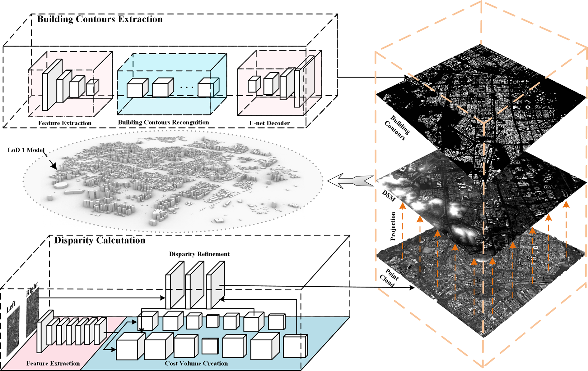
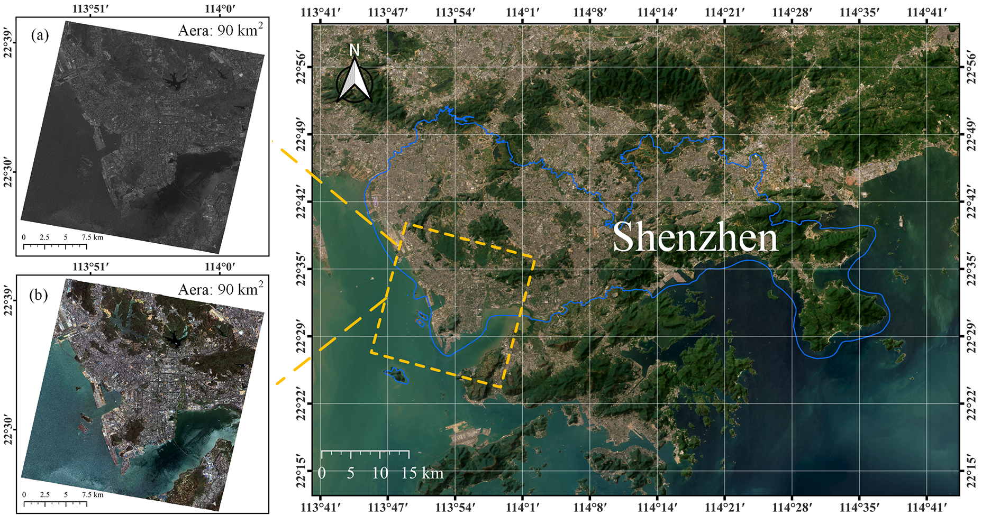
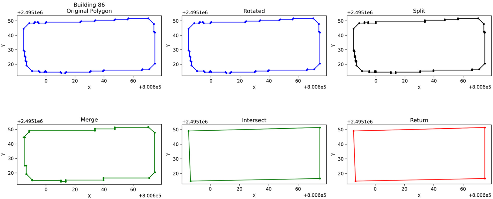
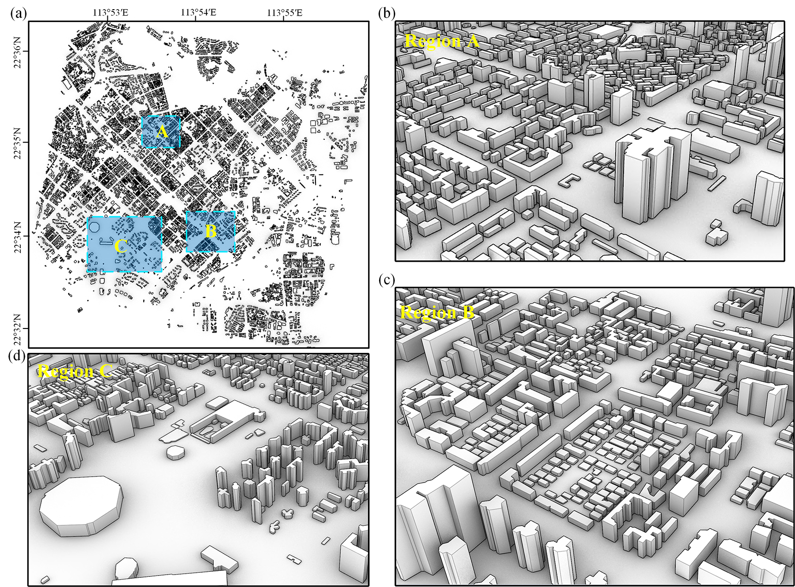
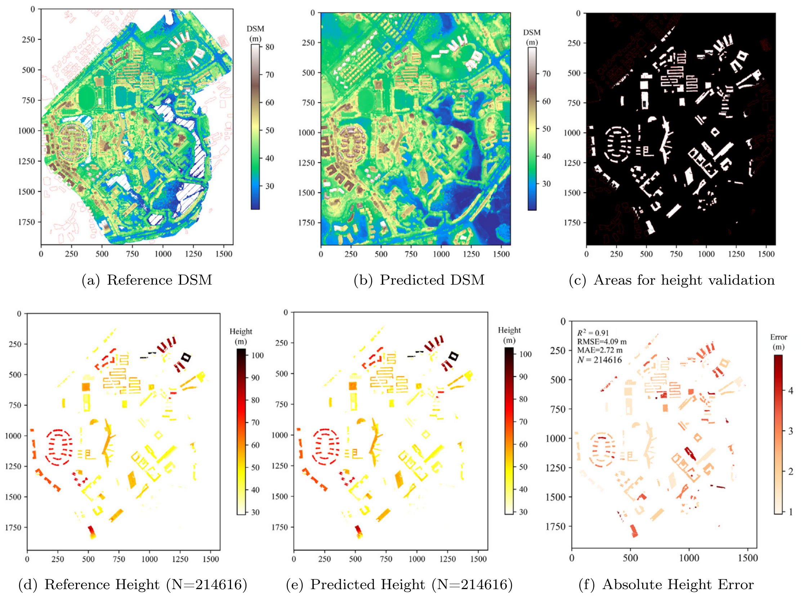
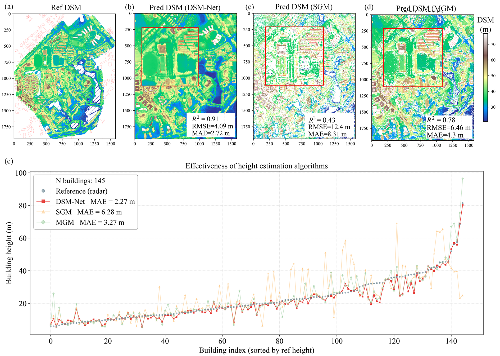

# 数值风洞 | 卫星影像怎样转成风环境计算可用的城市几何？

城市风环境计算开始之前，建筑几何往往还要逐片区整理。本文利用立体卫星影像提取建筑轮廓和高度，再处理短边、粘连等几何问题，尝试减少人工建模工作；几何重建精度与最终风场精度仍需分别检验。

## 论文信息

- 论文题名: A novel framework for urban geometry rapid reconstruction utilizing high-resolution stereo satellite imagery for wind environment assessment
- 作者: <u>Zhao Peisheng</u>; **Li Chao**; Chen Lingwei; Wang Jinghan; Wang Sirou; Wang Xiaolu\*
- 期刊: Building and Environment
- 年份: 2026
- DOI: https://doi.org/10.1016/j.buildenv.2026.114811
- WOEAI 相关方向: 工程结构抗风 / 数值风洞

## 摘要

快速、准确地构建能够直接用于计算流体力学（CFD）的规则城市建筑模型，对城市风环境评估具有重要意义。传统建筑几何生成方法依赖人工建模或现场点云采集，数据获取耗时巨大，难以满足应急场景下城市尺度快速重建的需求。为解决这一问题，本文提出一种利用高分辨率立体卫星影像快速生成适用于 CFD 模拟的城市几何模型框架。

以深圳为例，研究首先对高分七号（GF-7）立体影像进行影像融合和正射校正，构建语义分割数据集；随后训练 remote sensing mamba（RS-Mamba）网络提取建筑轮廓。同时，研究利用 digital surface model network（DSM-Net）估计视差，并通过前方交会算法生成点云；这些点云随后被投影为数字表面模型（DSM），用于计算建筑高度。

为了满足 CFD 对几何质量的要求，研究开发了轮廓简化与规则化算法，在城市尺度快速生成高质量 Level of Detail 1（LoD1）建筑与植被模型。最后，基于深圳和东莞的 UAV-LiDAR 验证得到 $R^2 = 0.91$、$\mathrm{MAE} = 2.72\,\mathrm{m}$ 和 $\mathrm{RMSE} = 4.09\,\mathrm{m}$，优于 SGM、MGM 以及 CSF/Top-hat 方法。结果表明，该框架能够有效缓解 GF-7 影像的拖尾效应，并为高保真城市风环境评估提供数值稳定的几何基础。

## 研究问题与解决思路

城市尺度风环境模拟需要可网格化的建筑几何，但人工建模和现场点云采集难以支撑频繁更新，遥感识别结果又常带有轮廓粘连、短边及高度误差。本文关注如何把卫星影像转换为可用于 CFD 的城市模型，将建筑识别、立体测高和轮廓规则化串联起来，分别用独立测试集和激光雷达数据检验建筑识别与高度。研究验证的是几何重建质量，不能将其直接等同于风速、风压计算精度。

## 从影像识别到规则化建筑模型，需要哪些处理？

流程依次处理影像准备、轮廓与高度提取，以及面向 CFD 的几何规则化。图1先把这几步连起来，阅读时可沿轮廓与高度两路信息，找到它们汇合成城市模型的位置。

::: figure 1

论文图 1 所提出框架的整体流程

沿流程箭头依次看建筑轮廓提取、视差估计、点云生成、DSM 投影和 LoD1 几何建模，注意轮廓与高度两路信息的汇合位置。

:::

这套框架把不同环节的输出接成几何输入；建筑识别、测高和后续数值模拟仍需要各自检验。

第一步是数据准备。研究使用 GF-7 多光谱和前后视全色立体影像，经过正射校正和融合，构建本地语义分割数据集，并结合公开数据集进行迁移学习。GF-7 的立体成像能力使研究能够同时处理建筑平面轮廓和高度信息。图2可对照多光谱与全色影像中的同一建筑，辨认两类输入。

::: figure 2

论文图 2 GF-7 的 MUX 与 PAN 数据集

对照多光谱与全色影像中同一建筑的位置，观察覆盖范围、屋顶边界与局部纹理。

:::

第二步是建筑轮廓和高度提取。DSM-Net 在论文符号表中展开为 Dual-Scale Matching Network（双尺度匹配网络）；摘要中使用了不同的名称，本文按正文的双尺度匹配流程解释。研究使用 RS-Mamba 进行建筑足迹语义分割，以 DSM-Net 估计立体影像视差，再通过前方交会生成对象空间点云，并投影得到 $1\,\mathrm{m}$ 分辨率 DSM。建筑高度通过建筑轮廓内部 DSM 与周边缓冲区地面高程之间的差值估计。

第三步是面向 CFD 的几何规则化。遥感识别得到的原始轮廓可能存在短边、锐角、孔洞、粘连和不规则边界，这些问题会降低网格质量并影响计算稳定性。论文结合连通域处理、Ramer–Douglas–Peucker（RDP）轮廓简化、分割、合并与交点规则，将不规则建筑轮廓转化为更适合数值模拟的 LoD1 建筑模型；植被则通过增强植被指数（EVI）识别并构建简化棱柱模型。

图18用第86栋建筑展示这一处理过程。先比较原始多边形与最后复原的轮廓，再沿中间步骤看边界怎样整理。

::: figure 18

论文图 18 轮廓简化与精修结果

按上排从左到右、再下排从左到右阅读：原始多边形、旋转、分割、合并、求交和旋转复原。每幅图的点和连线表示同一栋建筑在相应阶段的轮廓，X、Y坐标保留原图偏移量，原图未标单位。

:::

首幅与末幅对照可见，这一示例的小折线减少、边界更规整。它展示的是几何处理结果；CFD能否稳定求解及风场误差仍需后续检查。图10再把平面轮廓与竖向拉伸后的建筑体块放在一起，可看出两者如何对应。

::: figure 10

论文图 10 三维建筑几何的局部视图

观察建筑平面轮廓与竖向拉伸后的对应关系；LoD1 在这里表示以建筑体块为主的几何细节水平。

:::

图中的体块保留了建筑的平面分布和高度信息，细部表达仍受LoD1层级限制。生成三维外观之后，还要用独立数据核对它的高度。

## 轮廓和高度重建的误差有多大？

研究表明，经过迁移学习和本地数据微调后，RS-Mamba 能够较完整地提取 GF-7 影像中的建筑轮廓。论文报告的独立测试结果中，建筑识别的 Precision、Recall、F1-score 和 IoU 分别达到 $0.9602$、$0.9166$、$0.9379$ 和 $0.9178$。

以上四指标按原文列报。原文 IoU 公式的分母重复写了 FP，其定义与指标汇总口径仍需作者澄清，这里保留为原文报告值。

这些结果评价的是该独立测试中的建筑识别能力，高度误差还需要另一组数据检验。

论文使用东莞理工学院区域的 UAV-LiDAR 数据作为地面真值，对 DSM 和建筑高度估计进行验证。结果显示，预测与参考高度在建筑区域内逐像素比较具有较好一致性，量化指标达到 $R^2 = 0.91$、$\mathrm{MAE} = 2.72\,\mathrm{m}$ 和 $\mathrm{RMSE} = 4.09\,\mathrm{m}$。

图13将这一步的验证范围和误差放在同一幅图中。先找出上排(c)的白色验证区域，再对照下排参考高度、预测高度和绝对误差，避免把整幅DSM都当作同一口径的建筑高度检验。

::: figure 13

论文图 13 建筑高度验证结果

上排(a)、(b)分别为参考与预测DSM，(c)以白色标出建筑高度验证区域；下排(d)、(e)为对应建筑高度，(f)为绝对高度误差。高程、高度和误差的色标单位均为米；$N=214616$表示验证像素数，不是建筑栋数。

:::

这组结果按建筑区域内的像素统计，误差图还保留了位置之间的差别。接下来比较不同算法时，论文又使用逐栋高度这一统计单位，需要与逐像素指标分开阅读。

论文进一步将 DSM-Net 与传统 SGM、MGM 方法比较。在 145 栋建筑的逐栋高度排序比较中，DSM-Net 的 $\mathrm{MAE}$ 为 $2.27\,\mathrm{m}$，低于 SGM 的 $6.28\,\mathrm{m}$ 和 MGM 的 $3.27\,\mathrm{m}$。这说明在该研究区域中，DSM-Net 对城市建筑高度建模具有更好的精度；这里的逐栋 MAE 与上文逐像素 MAE 统计单位不同，不能直接视为同一指标的变化。

图14上排对照各算法的DSM，下排(e)才是逐栋建筑高度；可先看相同建筑编号处的曲线与参考点相差多少。

::: figure 14

论文图 14 不同 DSM 生成与建筑高度估计算法的比较

上排(a)为参考DSM，(b)–(d)分别为DSM-Net、SGM和MGM结果；下排(e)横轴为按参考高度排序的145栋建筑编号，纵轴为高度。灰色点为参考，红色方块、橙色三角、绿色菱形分别为三种算法；上排色标单位为米。

:::

识别建筑和生成 DSM 之后，还需要处理不规则轮廓，才能形成 CFD 所需的几何输入。

对于数值风洞应用来说，建筑轮廓是否规则、短边和尖角是否减少、模型是否能稳定网格化，往往决定了后续计算能否顺利进行。论文中的轮廓简化、规则化和 LoD1 建模步骤，正是为了弥合“遥感视觉结果”和“风工程数值模型”之间的差距。

## 几何重建之后，风环境计算还要检查什么？

这套流程可以为城市片区风环境评估准备几何输入。使用者需要合适的立体影像、地面高程估计和轮廓规则化结果，再针对目标计算设置边界条件与网格。本文没有给出完整的风场实测误差或网格收敛检验，不能仅凭高度重建指标认定后续 CFD 已经可靠。

这项工作并不意味着卫星影像可以替代所有高精度现场测量，也不意味着城市风环境模拟可以完全自动化。

首先，GF-7 影像分辨率会影响密集城市区域的轮廓分离效果。论文指出，在城中村等高密度区域，建筑足迹相距很近，$0.68\,\mathrm{m}$ 级影像仍可能出现轮廓粘连。

其次，当前几何生成算法主要针对建筑优化，植被识别依赖 EVI，生成的是相对简化的植被几何，不能等同于完整树冠结构重建。

最后，LoD1 城市几何适合支撑城市尺度风环境模拟和快速评估，但对于对局部细部非常敏感的专项工程，仍需要结合更高精度数据、局部复核和针对性的 CFD 建模策略。

## 从论文到工程

这项研究把卫星观测与风环境计算所需的城市几何连接起来，为大范围建筑模型的建立和更新提供了可进一步采用的技术路径。它的工程意义在于让城市数据采集更直接地服务于风场分析，使规划方案比较、区域风环境筛查等工作有机会共享较一致的几何基础。识别、测高与轮廓整理分开检验，也有助于设计者判断模型在哪些区域需要补充精细数据，把后续建模工作投入到更影响结果的位置。具体应用仍需复核几何质量与目标计算尺度。

点击阅读原文，可查看本论文的全文精解、几何处理流程及全部图表。

本文由 AI 辅助整理与撰写
