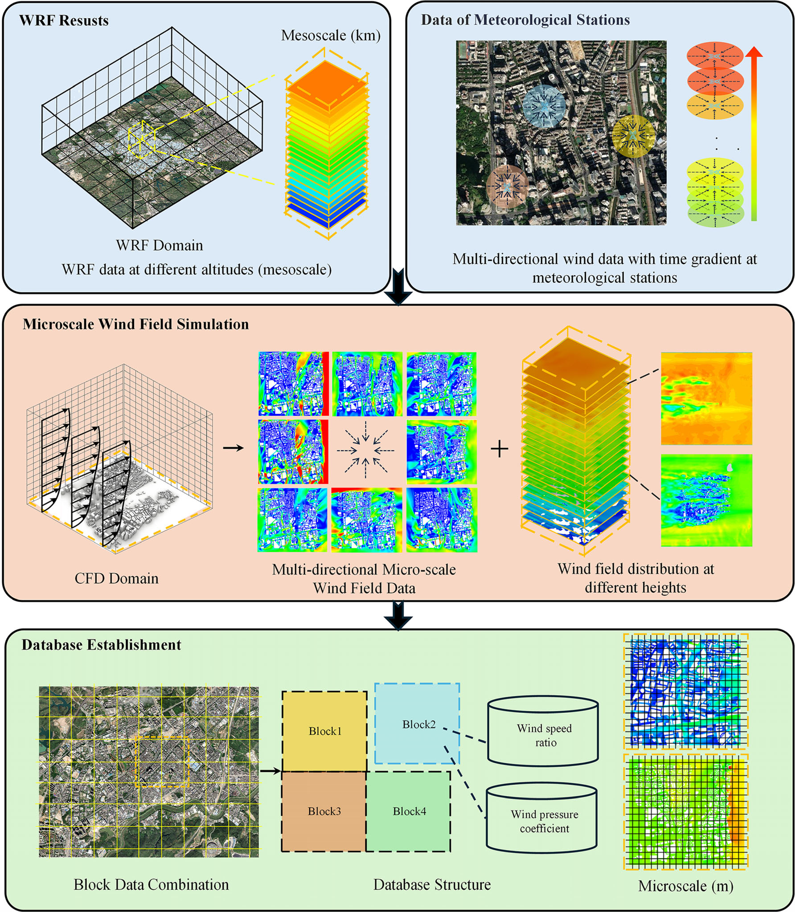
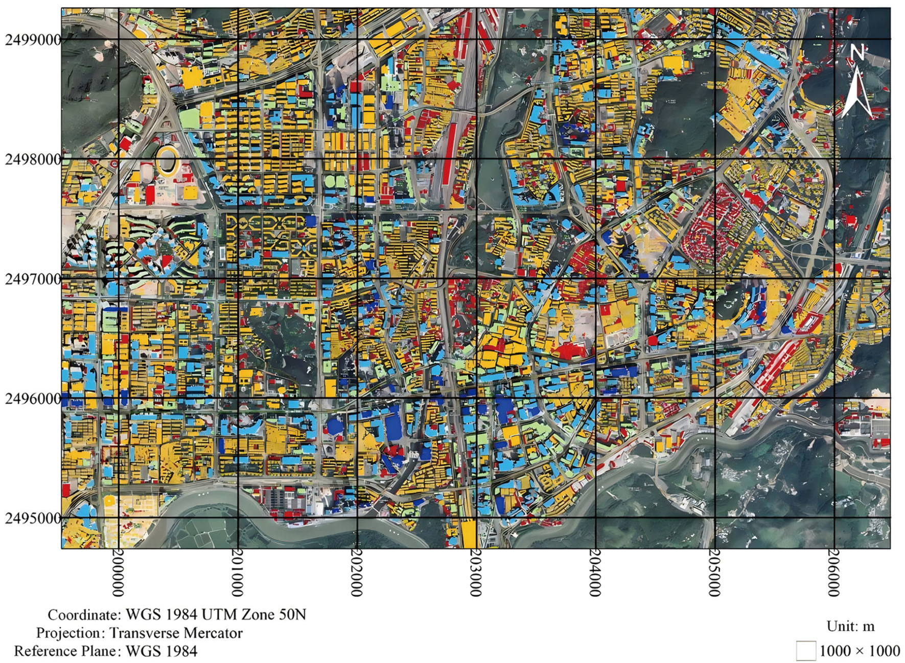
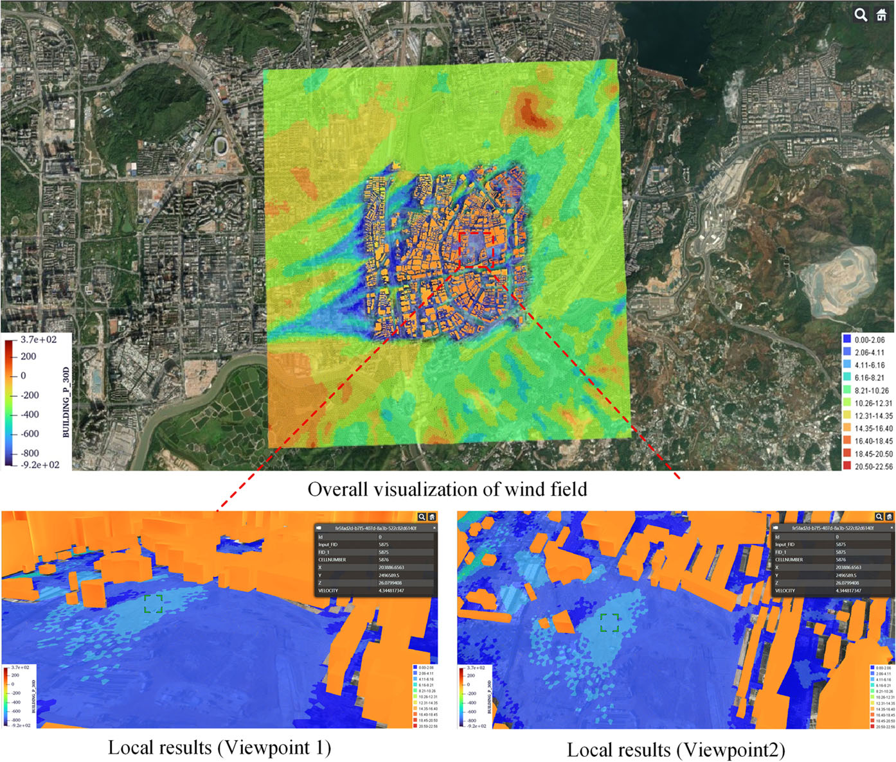

# 数值风洞 | 城市风环境评估，能否把 CFD 先算好、再按需调用？

城市风环境评估需要街区尺度的细节，但每换一个片区或一组来流条件就重做一次高分辨率 CFD，工程上很难承受。这篇论文把城市切成区块，预先算好并建成数据库，再检验这种分块结果是否可信。

论文发表于 Building Simulation，以深圳部分城区为例，将建筑尺度的数值模拟与城市风环境评估联系起来。

## 论文信息

- 论文题名: A fast prediction framework for urban microscale wind environment based on precomputed CFD database
- 作者: <u>Zhao Peisheng</u>; **Li Chao**; Yang Chao; Han Zhichen; Chen Lingwei; Hu Gang; Li Lixiao; Wang Xiaolu\*
- 期刊: Building Simulation
- 年份: 2026
- DOI: https://doi.org/10.1007/s12273-025-1379-7
- WOEAI 相关方向: 工程结构抗风 / 数值风洞

## 摘要

城市微尺度风场预测的精度和效率，对于风环境评估和城市规划等应用至关重要。然而，传统数值天气预报依赖中尺度模拟数据，往往受到空间和时间分辨率不足的限制。为解决这一问题，本文通过建立基于分块计算流体力学（CFD）的城市微尺度风场数据库，提出一种快速风场预测新框架。

该框架将基于 GIS 的建筑与地形模型划分为 $1\,\mathrm{km} \times 1\,\mathrm{km}$ 区块，并以各区块的 CFD 模拟结果组成预计算数据库。研究进一步开展综合分析，以确定考虑周边建筑气动影响所需的最优过渡区长度。相邻区块界面处风剖面差异较小，验证了这种独立分块模拟方法的可行性。

此外，论文还将统计得到的平均风速与多个气象站一年的现场数据进行比较，展示了该框架的预测能力。最后，包含风速比和风压系数的预计算 CFD 数据库被集成到 WebGIS 平台中，从而支持实际应用。

## 研究问题与解决思路

城市微尺度风环境评估面临计算精度与计算成本之间的矛盾：逐片区开展高分辨率 CFD 计算难以支持频繁评估，而独立分块又可能引入区块边界误差。本文关注的是，能否在控制分块误差的前提下，将风场计算结果组织为可重复查询的数据库。研究采用带过渡区的分块预计算，并通过相邻区块比较和气象站实测检验其适用性。

## 从“每次重算”改为“先算好、再查询”

论文以中尺度气象结果和气象站数据作为输入，连接城市分块的微尺度计算：城市按 $1\,\mathrm{km} \times 1\,\mathrm{km}$ 切成区块，每个区块计算多个来流方向、不同高度的风场，结果整理成风速比和风压系数，存入数据库。之后的评估是查询已有结果，而不是从头计算。

论文图 1 所提出框架的工作流程

自上而下三层：中尺度 WRF 结果与气象站多风向数据作为输入；中间为区块微尺度 CFD，按多风向、多高度给出风场；底部为数据库，按区块存放风速比与风压系数。

论文图 2 深圳建筑分块划分示意图

黑色网格线为区块边界，右下角标注单个区块为 $1000 \times 1000\,\mathrm{m}$；坐标轴为投影坐标，单位为米。

## 过渡区留多长，分块计算才可信？

只算核心区块，会截断周边建筑对风场的影响；把周边留得太大，计算量又上去了。论文比较了不同过渡区长度 $X_L$ 下核心区域的风场，用 $\mathrm{FB}$、$\mathrm{NMSE}$、$\mathrm{FAC2}$ 和线性相关系数 $R$ 评价。$X_L$ 越大，系统误差和随机误差越小，相关性越高。

据此，论文建议核心建筑群取 $4H_{\mathrm{max}}$ 作为过渡区长度，计算规模受限时可取 $3H_{\mathrm{max}}$，$H_{\mathrm{max}}$ 为核心区域最高建筑高度。**这一建议来自文中的深圳算例，不是所有城市的通用取值。**

相邻区块能否接得上，论文比较了两个相邻区块公共界面上的风速和湍流强度：整体一致，局部仍有差异。最终的界面结果是在 $4H_{\mathrm{max}}$ 过渡区下对两侧结果取平均得到的，并非严格无误差的拼接。

## 与气象站实测比，误差有多大？

验证选用研究区域内的气象自动站，以 10 分钟平均风速为基础，比较 CFD 与实测的风速比。论文用原文式（9）定义二者的相对误差：

$$
E = \frac{K_{\mathrm{CFD}} - K_{\mathrm{m}}}{K_{\mathrm{m}}} \times 100\%
$$

$K_{\mathrm{CFD}}$ 是 CFD 得到的风速比，$K_{\mathrm{m}}$ 是实测风速比，$E$ 带正负号。比较风速比而不是风速本身，看的是测点相对参考站的比例关系，也就是微尺度风场的空间结构是否被算对。

论文图 21 气象自动站的位置与观测环境

图 (a) 中大白框为计算域，小白框为区块 I，GY、DM、CWW 三个目标站位于其中，PA 参考站在计算域西侧；图 (b)–(d) 为 GY、DM、PA 站的现场照片。

数据按 PA 参考站的风速阈值和风向筛选。风速较高时热力影响减弱，误差进入可接受范围：在 $11\,\mathrm{m/s}$ 阈值下，三个站平均风速比的相对误差在 $90^\circ$ 风向下低于 $17\%$，在 $120^\circ$ 风向下低于 $20\%$。这一阈值下两个风向分别只有 26 个和 22 个十分钟样本，**结果不能外推为整个城市、所有来流条件下的误差上限。**

## 能用在哪里，还缺什么？

数据库已接入 WebGIS 平台，风速比和风压系数可以在地图上查询和展示。论文讨论的用途包括：在已建库的几何和来流条件下做城市风环境评估、识别行人高度的局地强风区域，以及结合气象输入探索行人风安全和风敏感构件的风险预警。后两项是应用流程的展示，预警准确率没有在文中验证，也没有验证 AI 代理模型或数字孪生系统。

论文图 25 WebGIS 中风速与风压数据的可视化展示

上图为研究区域风场的整体展示，左下色标对应建筑风压，右下图例为风速分级；下方两幅为两个视角的局部结果，弹窗显示所选网格的属性。

“快速调用”并不等于免去计算。单个区块的 CFD 约需 27 小时，数据处理和写入另需约 4 小时；建筑发生变化时，受影响区块及其周边要重新计算后再更新数据库。

适用范围也有明确前提：验证基于中性大气边界层，未考虑植被、公交站等行人高度的小型设施；数据库覆盖的风向、高度和建筑条件决定了能查询的范围；特殊建筑形态、极端风况或高风险区域，仍需要专项 CFD 复核。在这些前提下，它适合承担方案阶段的快速筛查和比较。

点击阅读原文，可查看本论文的全文精解，包括全部 26 幅图、11 张表和数据库应用流程。
