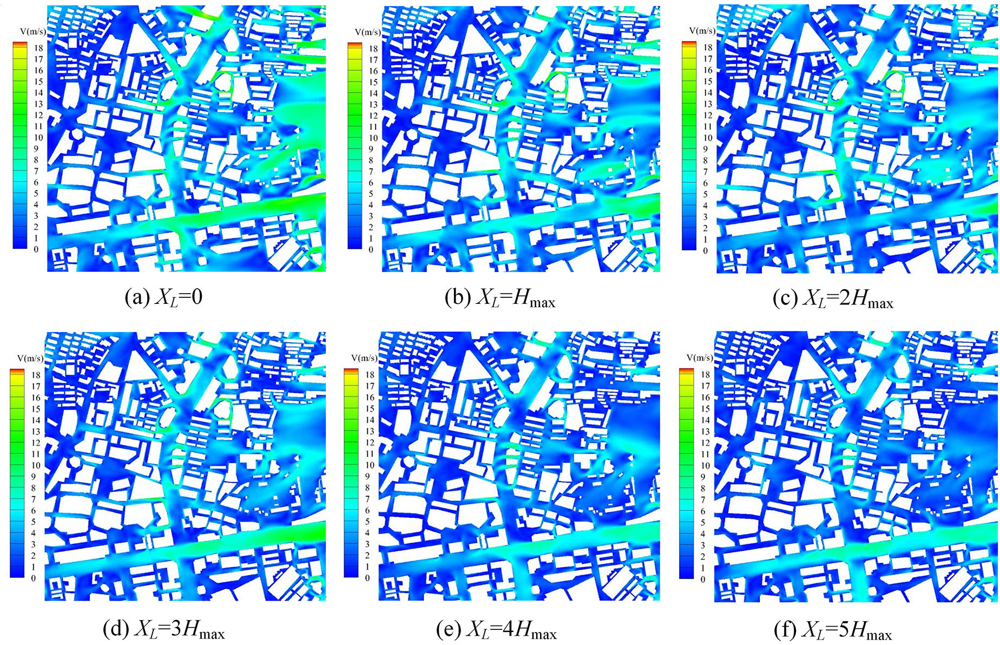
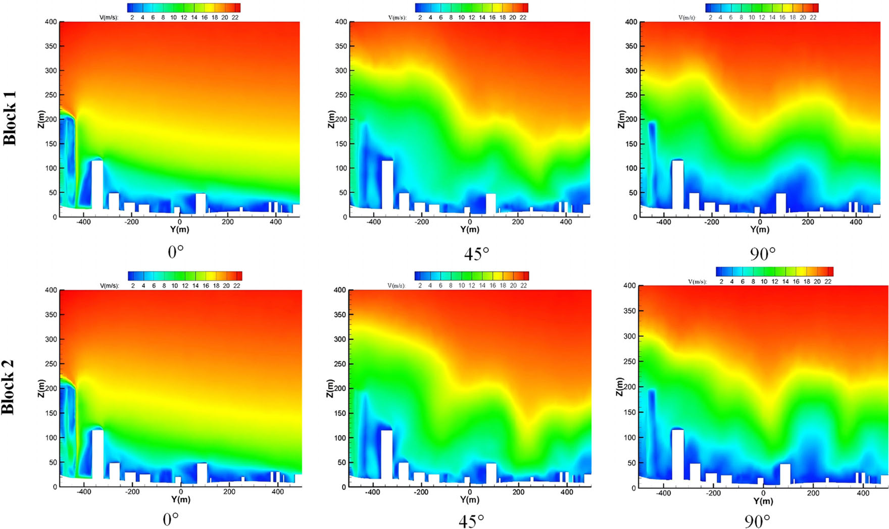
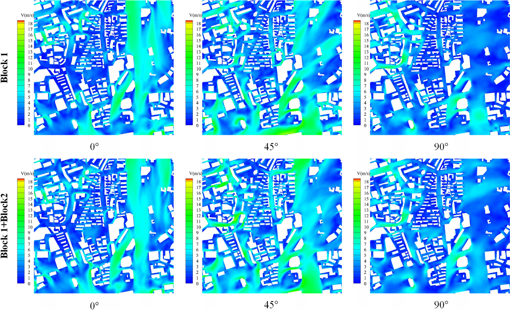
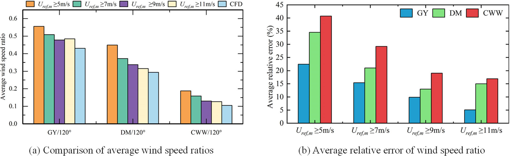

# 结构风工程 | 城市风环境评估，能否把 CFD 先算好、再按需调用？

城市风环境评估既要看清建筑周围的风，又希望多次查询时少做重复计算。这篇论文把城市分块预计算，再按风向和位置调用数据库，并检验分块是否丢失周边建筑的影响、结果与气象站观测是否一致。

论文发表于 Building Simulation，以深圳部分城区为例，将建筑尺度的数值模拟与城市风环境评估联系起来。

## 论文信息

- 论文题名: A fast prediction framework for urban microscale wind environment based on precomputed CFD database
- 作者: <u>Zhao Peisheng</u>; **Li Chao**; Yang Chao; Han Zhichen; Chen Lingwei; Hu Gang; Li Lixiao; Wang Xiaolu\*
- 期刊: Building Simulation
- 年份: 2026
- DOI: https://doi.org/10.1007/s12273-025-1379-7
- WOEAI 相关方向: 结构风工程 / 数值风洞

## 摘要

城市微尺度风场预测的精度和效率，对于风环境评估和城市规划等应用至关重要。然而，传统数值天气预报依赖中尺度模拟数据，往往受到空间和时间分辨率不足的限制。为解决这一问题，本文通过建立基于分块计算流体力学（CFD）的城市微尺度风场数据库，提出一种快速风场预测新框架。

该框架将基于 GIS 的建筑与地形模型划分为 $1\,\mathrm{km} \times 1\,\mathrm{km}$ 区块，并以各区块的 CFD 模拟结果组成预计算数据库。研究进一步开展综合分析，以确定考虑周边建筑气动影响所需的最优过渡区长度。相邻区块界面处风剖面差异较小，验证了这种独立分块模拟方法的可行性。

此外，论文还将统计得到的平均风速与多个气象站一年的现场数据进行比较，展示了该框架的预测能力。最后，包含风速比和风压系数的预计算 CFD 数据库被集成到 WebGIS 平台中，从而支持实际应用。

## 研究问题与解决思路

规划与风环境评估需要知道，哪些街区会出现局地强风、哪些位置值得进一步分析。中尺度气象数据难以给出建筑周围的细节，直接对整座城市开展高分辨率计算又受资源限制。分块可缩小单次计算规模，却会截断周边建筑的影响。论文为每个核心区块保留周边过渡区，先比较分块与合并计算的差别，再与气象站观测核对，将通过这些检验的算例结果组织成可查询的数据库。

## 从“每次重算”改为“先算好、再查询”

先把两个阶段分开看。建库时，研究用地理信息系统（GIS）的建筑与地形数据建立几何模型，按 $1\,\mathrm{km} \times 1\,\mathrm{km}$ 划出核心区块，通过计算流体力学（CFD）求解不同来流方向的风场，并将风速比和风压系数存入数据库。

调用时，再把中尺度气象模型（WRF）的结果或气象站观测与库中数据结合，得到相应位置、风向和高度的风场信息。几何和来流条件在库内覆盖时，后续评估才可复用已有计算。

图1给出这两类数据与计算结果怎样连接。沿箭头看气象信息经过哪些环节，最后以什么形式存入库中。

::: figure 1

论文图 1 所提出框架的工作流程

先看上方并列的中尺度气象结果与气象站数据，再沿箭头读到中间的多风向、多高度微尺度风场；最下方用 Block 1–4 示意分块存储，两只圆柱分别标为风速比和风压系数数据库。

:::

这些连接把气象尺度的信息与建筑周围的风场细节接起来；库中保存的是分块结果，查询仍要选定其覆盖的空间和来流条件。图2进一步给出核心区块怎样从连续城区中划出，可先沿黑色网格查看相邻区块的位置。

::: figure 2

论文图 2 深圳建筑分块划分示意图

黑色网格线为区块边界，右下角标注单个区块为 $1000 \times 1000\,\mathrm{m}$；坐标轴为投影坐标，单位为米。

:::

图中的核心区块边界不等于 CFD 计算域的外边界。为保留周边建筑和地形的影响，实际计算还要向外延伸；这部分范围留多大，需要另作检验。

## 过渡区留多长，分块计算才可信？

只算核心区块，会截断周边建筑对风场的影响；把周边留得太大，计算量又上去了。论文以过渡区长度 $X_L=5H_{\mathrm{max}}$ 的计算为比较基准，逐步缩短周边保留范围，看核心区域的风场偏离多少。因此，这一步比较的是不同计算范围之间的一致性，还没有与实测作比较。

下面以$90^\circ$风向、$10\,\mathrm{m}$高度的风速图为例，先对照完全不留过渡区的(a)与基准(f)，再看(d)、(e)还剩哪些局部差别。

::: figure 12

论文图 12 90° 风向下不同过渡区长度对应的 10 m 高度风速

按上排(a)–(c)、下排(d)–(f)阅读，过渡区长度依次为$0$、$H_{\mathrm{max}}$、$2H_{\mathrm{max}}$、$3H_{\mathrm{max}}$、$4H_{\mathrm{max}}$、$5H_{\mathrm{max}}$；色标为风速，单位为米每秒，对照同一街区位置的颜色分布。

:::

不保留周边时，这一高度的风速分布与基准差别较大；过渡区达到$3H_{\mathrm{max}}$和$4H_{\mathrm{max}}$后，整体更接近基准，局部仍有变化。这张图只展示一个风向和高度，是否值得继续扩大范围，还要结合多风向的定量指标判断。

研究用分数偏差（FB）和归一化均方误差（NMSE）衡量结果的偏差与离散程度。

另用二倍因子（FAC2）统计两种计算结果在对应测点的风速之比落在 $0.5$–$2$ 内的比例，并以线性相关系数 $R$ 检查空间变化是否一致。在这组比较中，$X_L$ 增大后，FB 和 NMSE 减小，FAC2 和 $R$ 提高；到 $3H_{\mathrm{max}}$ 与 $4H_{\mathrm{max}}$ 时，指标变化已较小。

据此，论文建议核心建筑群取 $4H_{\mathrm{max}}$ 作为过渡区长度，计算规模受限时可取 $3H_{\mathrm{max}}$，$H_{\mathrm{max}}$ 为核心区域最高建筑高度。**这一建议来自文中的深圳算例，不是所有城市的通用取值。**

选定周边范围后，还要检验相邻区块能否接得上。图17把同一个公共界面分别从两个独立区块的计算中取出，可按列比较同一风向下的上下两幅。

::: figure 17

论文图 17 公共面上的风速分布

上排为区块1，下排为区块2；三列依次为$0^\circ$、$45^\circ$、$90^\circ$。横轴$Y$、纵轴$Z$单位为米，色标为风速，单位为米每秒；白色轮廓表示界面处的建筑。

:::

论文比较了两个相邻区块公共界面上的风速和湍流强度：整体一致，局部仍有差异。最终的界面结果是在 $4H_{\mathrm{max}}$ 过渡区下对两侧结果取平均得到的，并非严格无误差的拼接。图17中的相近分布支持界面衔接，但不能单凭边界上的接近，就认定核心区域内部也没有偏差。

作者也将两块分开计算的核心区结果与两块合并计算作比较，检验差异是否延伸到区块内部。图19把区块1单独计算与两区块整体计算并排对照，观察重点从竖向公共界面换到了核心区内的水平风速分布。

::: figure 19

论文图 19 区块 1 与整体区块核心区的 10 m 高度风速

上排为区块1单独计算，下排为区块1与区块2合并计算；三列依次为$0^\circ$、$45^\circ$、$90^\circ$。各图均取$10\,\mathrm{m}$高度，色标为风速，单位为米每秒。

:::

在所比较的三种风向下，两种计算的核心区平均风速分布基本一致，原文还用同一组统计指标定量比较。界面与核心区两项检验共同支持这组分块算例的可行性；它们比较的仍是数值结果，尚未回答与真实观测相差多少。

## 与气象站实测比，误差有多大？

分块与合并计算接近，仍可能共同偏离真实风场。下一步才是与观测比较：研究选用区域内的气象自动站，以 10 分钟平均风速为基础，比较 CFD 与实测的风速比。论文用原文式（9）定义二者的相对误差：

$$
E = \frac{K_{\mathrm{CFD}} - K_{\mathrm{m}}}{K_{\mathrm{m}}} \times 100\%
$$

$K_{\mathrm{CFD}}$ 是 CFD 得到的风速比，$K_{\mathrm{m}}$ 是实测风速比，$E$ 带正负号。风速比是测点风速与参考风速的比值；这里检查的是目标站相对 PA 参考站的比例关系，判断建筑周围风速的空间差异是否被再现，不能把这个误差直接读成城市每个位置的绝对风速误差。

图21可先辨认三个目标站与PA参考站的相对位置，再结合下方照片看各站周围的观测环境。

::: figure 21

论文图 21 气象自动站的位置与观测环境

先看图 (a)：大白框为计算域，小白框为区块 I，GY、DM、CWW 三个目标站位于其中，PA 参考站在计算域西侧。再看图 (b)–(d)，依次为 GY、DM、PA 站的现场照片，可对照各站周围的建筑与高度环境；图中没有 CWW 站的现场照片。

:::

实测数据按 PA 参考站的风速阈值和风向筛选；提高阈值是为减弱热力影响，使观测更接近中性大气边界层的计算条件。原文分风向正文报告，在 $11\,\mathrm{m/s}$ 阈值下，三个站平均风速比的相对误差在 $90^\circ$ 风向下低于 $17\%$，在 $120^\circ$ 风向下低于 $20\%$。这一阈值下两个风向分别只有 26 个和 22 个十分钟样本，**结果不能外推为整个城市、所有来流条件下的误差上限。**

图23保留其中误差相对较大的$120^\circ$案例。左图可比较各站在不同筛选阈值下的实测风速比与CFD，右图再看各站误差是否随阈值逐级下降。

::: figure 23

论文图 23 120° 风向角下 CFD 模拟与实测数据的对比验证结果

左图(a)按GY、DM、CWW分组，橙、绿、紫、浅黄色柱对应PA风速阈值不低于$5$、$7$、$9$、$11\,\mathrm{m/s}$，浅蓝柱为CFD。右图(b)横轴为这四个阈值，蓝、绿、红柱分别为GY、DM、CWW，纵轴为平均相对误差（百分比）。

:::

较高阈值下的误差总体较低，但不能把图读成每个站都严格单调下降：DM站从$9$到$11\,\mathrm{m/s}$阈值的误差略有回升。GY与另外两站也有差别，验证结果与测点位置及筛选条件有关。图23仅代表$120^\circ$这组观测比较，不代表所有来流；右图显示正误差幅值，原文没有解释它与带符号原式（9）的符号处理关系，不能据此更改公式。

原文随后汇总时又统一写为低于 $17\%$，与前述 $120^\circ$ 描述不同。这里保留分风向正文的报告值，也保留这一差异，不将它们合并成统一的精度保证。

## 能用在哪里，还缺什么？

数据库已接入 WebGIS 平台，风速比和风压系数可以在地图上查询和展示。论文讨论的用途包括：在已建库的几何和来流条件下做城市风环境评估、识别行人高度的局地强风区域，以及结合气象输入探索行人风安全和风敏感构件的风险预警。后两项是应用流程的展示，预警准确率没有在文中验证，也没有验证 AI 代理模型或数字孪生系统。

图25展示了库中结果怎样落到地图位置与局部查询中，可分别对照整体风场和建筑周围的局部视图。

::: figure 25

论文图 25 WebGIS 中风速与风压数据的可视化展示

先看上图的整体位置，左下色标对应建筑风压，右下图例为风速分级，两种颜色不能混用同一色标读取。再沿红色虚线看下方两个视角的局部结果；弹窗显示所选网格的属性。

:::

“快速调用”并不等于免去计算。单个区块的 CFD 约需 27 小时，数据处理和写入另需约 4 小时；建筑发生变化时，受影响区块及其周边要重新计算后再更新数据库。

适用范围也有明确前提：验证基于中性大气边界层，未考虑植被、公交站等行人高度的小型设施；数据库覆盖的风向、高度和建筑条件决定了能查询的范围；特殊建筑形态、极端风况或高风险区域，仍需要专项 CFD 复核。

## 从论文到工程

这项研究为城市风环境评估提供了可重复利用的计算基础，使一次风场分析积累的数据有机会服务于后续多次方案查询。它的工程价值在于将较重的数值计算与日常筛查需求衔接起来，让规划人员能够更方便地比较区域差异、识别需要深入分析的位置。分块组织与过渡区检验还为城市更新时的数据维护提供了思路，有助于把专项计算集中到变化较大或风险较高的区域，逐步形成可持续更新的风环境分析资源。应用仍需满足数据库覆盖范围并开展必要复核。

点击阅读原文，可查看本论文的全文精解，包括全部 26 幅图、11 张表和数据库应用流程。

本文由 AI 辅助整理与撰写
