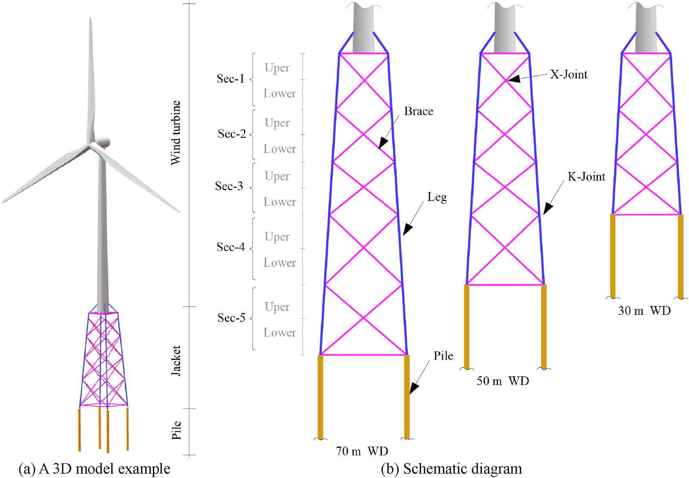
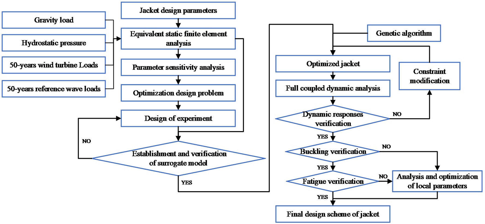
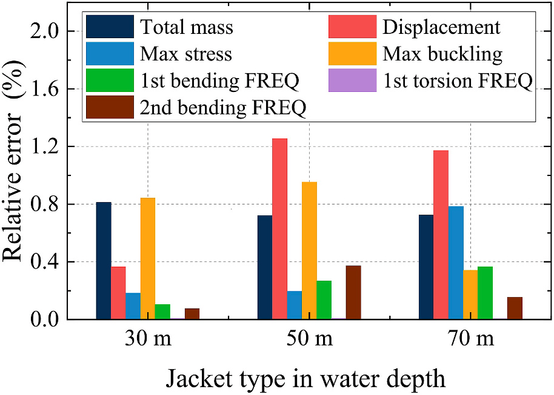
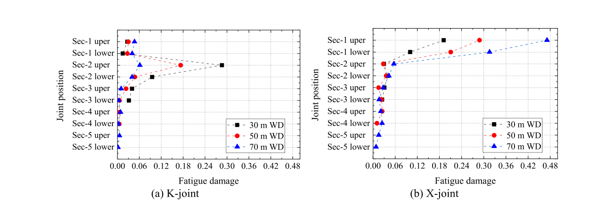

# 一体化分析 | 导管架轻量化，怎样减少计算又不漏掉疲劳检查？

导管架减重不能只把钢管做细。尺寸一变，刚度、应力、屈曲和焊接节点疲劳都可能改变，反复计算又很耗时。这项研究把快速寻找方案与详细安全复核分开，用代理模型减少优化中的有限元求解，再检查局部薄弱节点。

## 论文信息

- 论文题名：Efficient optimization design method of jacket structures for offshore wind turbines
- 作者：<u>Zheng Shunyun</u>；**Li Chao**\*；Xiao Yiqing
- 期刊：Marine Structures
- 年份：2023
- DOI：[10.1016/j.marstruc.2023.103372](https://doi.org/10.1016/j.marstruc.2023.103372)
- WOEAI 相关方向: 海洋能源结构 / 一体化分析

## 摘要

随着海上风能开发逐步推进，未来将向更深水域扩展。水深增加时，导管架基础将取代目前单桩基础。基础占海上风电场建设成本的大部分，导管架结构优化将带来可观经济收益。结构优化是计算量巨大的复杂迭代过程，因此本文提出基于代理模型的方法，高效解决该问题，快速获得轻量化导管架方案。

优化主要考虑50年重现期等效静态极端荷载下响应，以参数敏感性分析确定关键变量，将有限元模型转为代理模型，用遗传算法直接优化。随后以耦合动力分析、屈曲强度和疲劳寿命复核，并对不满足要求的局部构件精细再优化。30、50、70 m水深轻量化方案说明方法适用且高效。敏感性分析可将变量数减半，代理模型约节省原计算时间98.61%。作者认为所提方法精度和效率较高，适用于工程实践。

本文研究对象是海床桩支撑的底固定式导管架，不是漂浮平台；这里沿用其关联研究分类。摘要中的效率数字对应指定优化计算，不能扩展为整个工程设计周期或省去后续验证。

## 研究问题与解决思路

设计者要在满足结构约束的前提下减少用钢量，但每轮修改都做完整时域分析，难以在短时间内找到合适方案。只按经验留出冗余，又可能错过减重空间。本文先辨别哪些尺寸真正影响整体性能，用有限元样本建立便于反复求解的近似模型，再寻找轻量化方案。疲劳没有被删掉，而是放到后续动力复核中定位薄弱节点，并对局部尺寸作针对性调整。

论文图 2 三种水深的底固定式导管架构型

四根腿柱由交叉支撑连接，底部四根桩伸入海床。图中的分段和X节点位置，也是后续比较应力、屈曲和疲劳的依据，不能把它理解成有系泊的漂浮基础。

## 先找出影响大的尺寸，再用代理反复求解

研究采用DTU $10\,\mathrm{MW}$基准风机，对应$30$、$50$、$70\,\mathrm{m}$水深的导管架分别有18、23、28个初始设计变量，包括顶宽、底宽、分段高度，以及腿柱、支撑和桩的尺寸。

参数多，不等于每个参数都同样重要。敏感性分析显示，顶宽、底宽和腿柱直径、壁厚对主要响应更敏感。支撑参数对一阶扭转频率有影响，但这一频率不是本文优化中的控制性约束。作者因此把关键变量集中在整体宽度与腿柱尺寸，固定分段高度，支撑和桩先取允许下限，设计变量约减少一半。这是本算例的筛选结果，不能直接作为其他导管架的通用取值规则。

随后，研究用有限元样本建立Kriging代理模型。它描述“尺寸变化以后，质量和响应怎样变化”的关系，优化算法反复调用的是代数预测，而不是每次重算有限元。优化目标为导管架与桩的总质量，约束包含应力、屈曲、机舱位移和固有频率。

初步优化以50年重现期极端风浪等效静力为主，并非把风机动力问题当成纯静力问题。找到方案以后，仍需耦合动力、屈曲和疲劳检查，未满足要求时返回修改。

论文图 1 快速优化与后续完整性检查的流程

左侧减少的是反复求解的成本，右侧保留动力和完整性检查。图中的返回箭头说明，优化器给出的轻方案不自动等于最终合格方案。

## 计算快了多少，要连同精度和比较范围一起看

研究比较了200至1000个训练样本，并另取100个满足优化约束的验证点。质量和固有频率用较少样本就能较好预测，应力和屈曲更难：最大响应所在位置可能随尺寸切换，造成预测关系不平滑。作者因此按导管架分段分别建立应力和屈曲模型，而不是只拟合一个全结构最大值。

最终采用800个样本时，验证点的相对误差小于5%。在优化结果处，又以额外有限元计算进行复核，各项相对误差小于1.3%。后一个数字针对优化点，前一个数字针对选定的可行验证点，两者都不是任意尺寸、任意工况下的误差保证。

论文图 9 优化方案处代理预测与有限元结果的相对误差

不同颜色对应质量、位移、应力、屈曲和模态频率。不要只挑最低的误差柱评价整个模型，影响安全约束的响应也需要逐项检查。

三个水深算例经历约5.8万至7.1万次优化评价。按论文表6的同次数有限元直接优化比较，代理方案计算效率提高至71.78–87.00倍，节省98.61%–98.85%的优化时间。这个比例不能当作后续192个动力工况、疲劳检查和完整工程设计的整体加速比。

减重结论同样有明确基线：$50\,\mathrm{m}$水深的初步优化导管架本体由参考方案的$1210\,\mathrm{t}$降到$546.86\,\mathrm{t}$，约减少55%。这里不含桩，也不是三种水深的统一减重比例；后续安全复核还可能要求加回材料。

## 初步方案通过强度，不代表焊接节点疲劳也合格

动力复核采用16种风浪组合、3个偏航角和4个荷载方向，共192个工况，每次模拟10分钟。模型考虑风浪同向，未计海流。导管架动力材料强度利用率约为40%–56%，支撑屈曲利用率小于0.20，说明初步静力设计在这些检验中保留了余量。

疲劳检查却找到了局部问题。焊缝几何会放大名义应力，研究在主管侧和支管侧各检查8个热点，由应力时程雨流计数、S–N曲线和累积损伤计算预测25年疲劳。所用疲劳设计系数为3，因此损伤限值为$1/3$。25年结果转述论文，原式并未展开时长换算和各方向工况的聚合实现，不能仅凭该式重现寿命预测。

论文图 17 初步优化导管架的25年疲劳损伤

左图为K节点，右图为X节点。超限集中在$70\,\mathrm{m}$水深方案顶部第1段的X节点，不是整座导管架所有节点都不合格，也不是强度利用率较低就能免做疲劳检查。

超限发生在焊缝第3个热点。作者比较直径与壁厚对热点应力因子的影响，判断在该局部内力变化不大的条件下，优先增厚更有利。第1段支撑壁厚从$20\,\mathrm{mm}$增至$25\,\mathrm{mm}$后满足疲劳要求，架桩总质量由$1241.33\,\mathrm{t}$增至$1264.38\,\mathrm{t}$，原文记增加约1.8%；按这两个质量直接计算约为1.86%。修改后再检查静力、动力、屈曲及机舱响应，不能只看疲劳一项改善。

## 方法可用于初选，场址条件仍要重新核对

潜在应用需要机组荷载、场址风浪和土参数、设计变量边界，以及明确的强度、频率和疲劳约束。

原模型忽略腐蚀、冲刷和土体退化，环境组合也有范围限制。水深继续增加时，一阶弯曲频率可能比应力更早成为控制条件；换机组、换土层或换节点后，敏感参数和局部修改策略也可能变化。因此，这些数值结果不替代现行规范复核，更不是已经完成实海认证或漂浮风机验证。

## 从论文到工程

这项研究为导管架方案设计提供了协调计算效率与结构性能的思路，使尺寸调整能够在更清楚的约束下逐步收敛。它的工程价值在于将整体选型与局部疲劳检查衔接起来，帮助设计者先识别值得细化的候选，再把较昂贵的动力分析投入到真正影响设计的位置。这样的设计组织方式也为不同水深和基础参数的比较提供了方法参考，让轻量化研究始终与构件受力和节点寿命保持联系，支持后续更有针对性的详细设计。采用仍需结合场址与现行设计要求复核。

点击“阅读原文”查看完整科学正文精解、18张原图、15个公式和9张可编辑表，以及原文公式记号与量纲疑点的说明。精解不含利益冲突声明、数据可用性说明和致谢尾节。

本文由 AI 辅助整理与撰写
