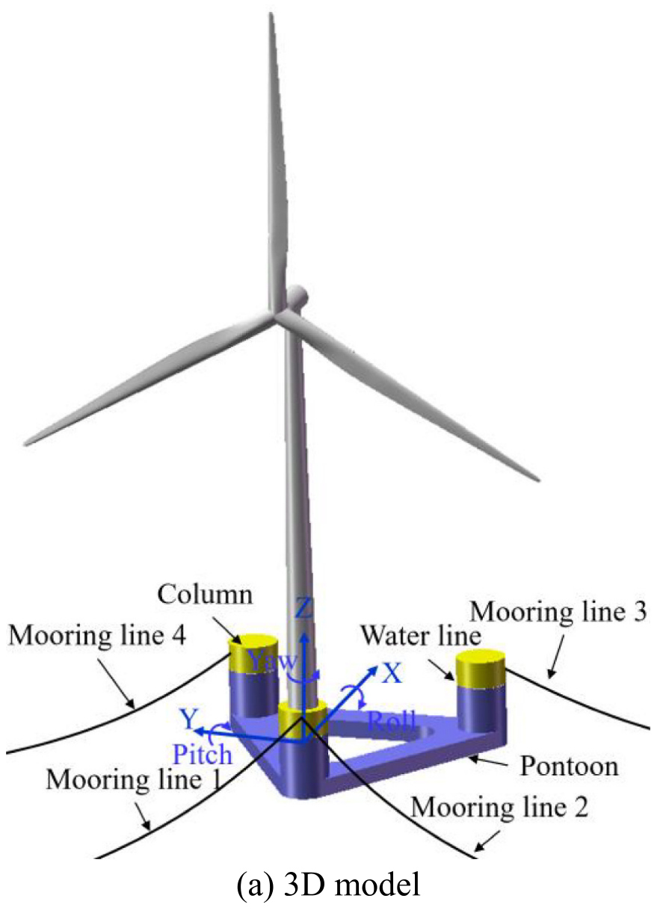
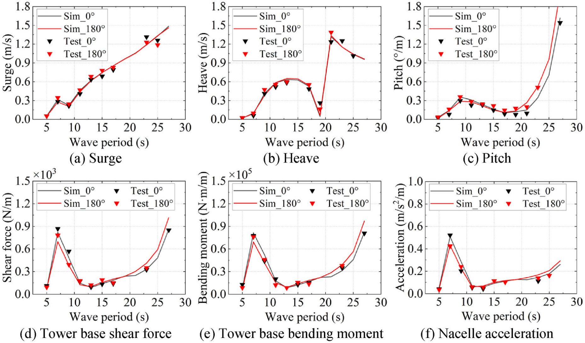
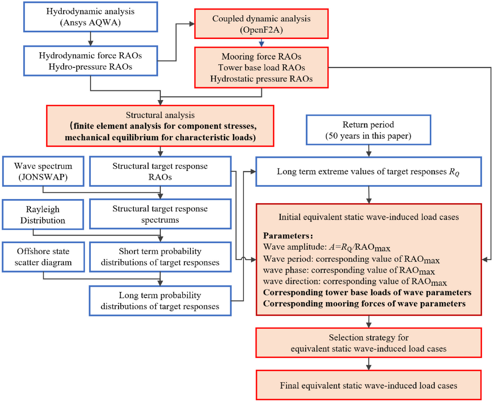
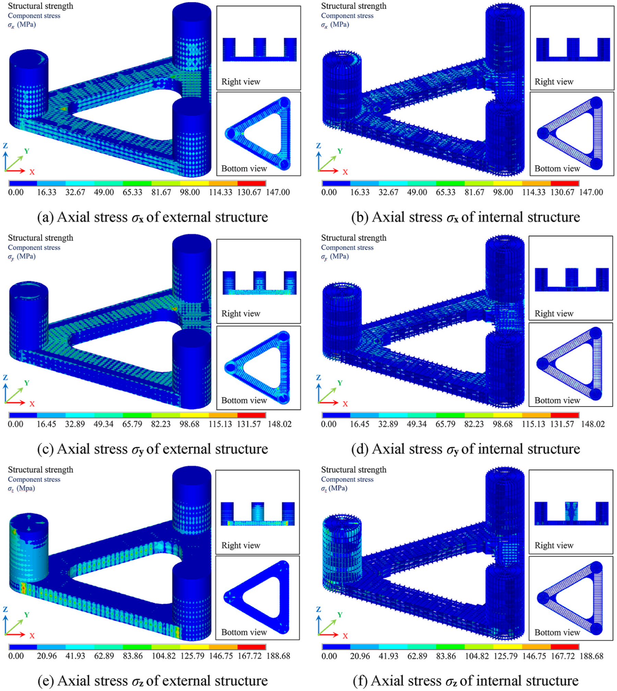
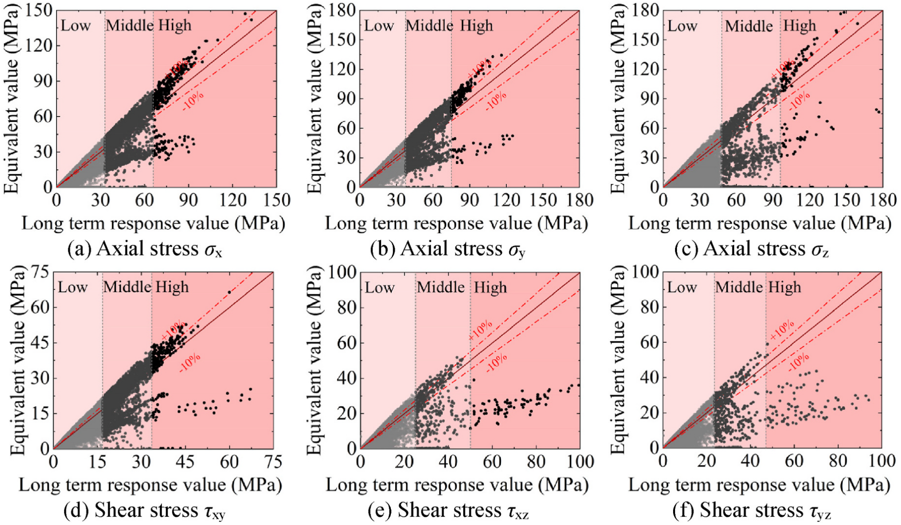
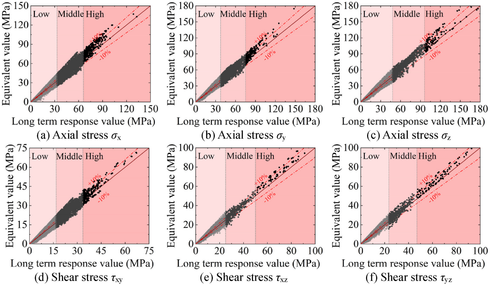
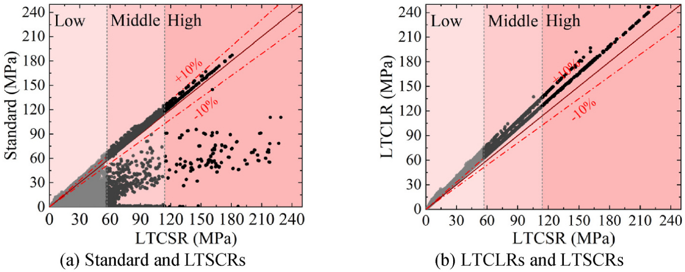

# 海洋能源结构 | 半潜平台的设计波，怎样覆盖关键结构应力？

用少量静力工况进行平台强度设计，前提是这些工况能覆盖真正危险的响应。浮式风机除承受波浪水压力，还会受到塔底和系泊载荷影响。本文比较三种等效波浪荷载路线，检验工况数量、保守性与应力精度的取舍。

## 论文信息

- 论文题名: Evaluating equivalent static wave loads for a delta-shaped semi-submersible 10-MW wind turbine
- 作者: <u>Zheng Shunyun</u>; Liu Shangpei; **Li Chao**\*; Wang Xiaolu; Ou Jinping
- 期刊: Ocean Engineering
- 年份: 2025
- DOI: https://doi.org/10.1016/j.oceaneng.2025.121336
- WOEAI 相关方向: 海洋能源结构 / 一体化分析

## 摘要

传统设计波方法常用于油气平台，以确定等效静力波浪荷载；但当它直接用于浮式风机时，会受到平台几何构型差异和兆瓦级风机强耦合作用的限制。为解决这一问题，本文对设计波方法进行增强和扩展，以确定能够同时考虑水压力、系泊导缆孔力和塔底载荷的等效静力波浪荷载，并分别以 $50$ 年重现期的长期特征载荷响应和应力分量响应作为等效目标。

论文对设计波方法和增强方法进行了系统比较，并严格验证了这些方法预测三角形半潜式平台在波浪荷载作用下应力的有效性。结果表明，传统设计波方法由于考虑过于简化，实际适用性不足。由长期特征载荷确定的等效静力波浪荷载精度更好，但计算需求更高；由长期应力分量确定的荷载精度最高，同时也最耗时。总体而言，论文建议根据设计流程所处阶段选择合适的方法。

## 研究问题与解决思路

传统设计波方法主要围绕平台水动力响应选取工况，直接用于浮式风机时，可能遗漏塔底和导缆孔载荷共同作用下的局部高应力。本文研究如何用有限的等效静力工况代表长期波浪响应，分别以特征载荷和应力分量作为等效目标，连接耦合动力分析与有限元计算，再筛选工况。两条路线所需信息和计算代价不同，需按初步设计或详细设计的目标选择。

## 以长期载荷或应力为目标，怎样构造等效工况？

::: figure 1

论文图 1(a) 三角形半潜式 10 MW 风机系统三维模型

原图子图(a)为三维系统；按箭头辨认三根立柱、浮筒、四根系泊线及平台坐标方向。

:::

图中展示了本文研究对象的基本构型：三根立柱和底部浮筒形成三角形半潜式平台，风机布置在其中一根立柱上，四根悬链线系泊线限制平台运动。

论文首先建立三类模型：ANSYS AQWA 水动力模型、OpenFAST 与 ANSYS AQWA 耦合的 OpenF2A 动力模型，以及 ANSYS APDL 有限元结构模型。水动力模型提供波浪水压力和水动力系数，耦合动力模型给出平台运动、系泊导缆孔力和塔底载荷，有限元模型用于计算结构应力响应。

::: figure 7

论文图 7 三角形半潜式风机系统 RAO

六面板分别为平台运动、塔底剪力/弯矩及机舱加速度；横轴为波周期，曲线表示模拟、三角点表示试验，黑/红区分两个波向。

:::

这组图比较了数值模拟和模型试验得到的平台运动、塔底载荷和机舱加速度响应幅值算子，可用于核对动力模型与试验的对应关系。

在等效目标上，论文引入两条增强路线。第一条路线以长期特征载荷响应 LTCLR 为目标，考虑关键截面的多方向内力、整体加速度、系泊导缆孔力和塔底载荷。第二条路线以长期应力分量响应 LTSCR 为目标，直接让选出的等效静力工况逼近关键高应力区域的长期应力极值。

::: figure 12

论文图 12 基于 LTSCR 和 LTCLR 的 ESWL 方法流程

沿左上水动力分析和右上耦合动力分析两路向下读；橙色框标出结构分析、初始等效工况和筛选步骤。

:::

这张流程图展示了增强方法与传统设计波方法的差异：除了水动力分析，还引入耦合动力分析得到系泊力、塔底载荷和静水压力响应，并用长期极值响应确定初始等效静力波浪荷载工况，再通过选择策略压缩工况数量。

论文的核心等效思想可以概括为：先通过响应谱和统计外推得到 $50$ 年重现期的长期极值目标响应，再用目标响应与响应幅值算子的比值确定等效规则波幅值。用论文中的记号表示，等效波幅值可写作：

$$
A=\frac{R_Q}{RAO_{\mathrm{max}}}
$$

这里 $R_Q$ 为累积分布概率 $Q$ 对应的长期响应；按原文式 (5) 的 $F_R^{\mathrm{LT}}(R_Q)=Q$，$Q$ 是不超越概率，超过该阈值的概率为 $1-Q$。$RAO_{\mathrm{max}}$ 是对应等效目标的最大响应幅值算子。这个比值把长期响应目标换算为对应的规则波幅值；目标响应与幅值算子必须采用同一分量和单位。

## 三种方法对高应力区的预测相差多少？

论文先分析 $50$ 年重现期长期应力分量响应在平台上的分布。结果显示，高应力主要集中在立柱与浮筒连接处、风机所在立柱的塔底和系泊导缆孔附近，以及部分底板和内部腹板区域。这些位置受到波浪水压力、塔底载荷和系泊导缆孔力共同影响。

::: figure 13

论文图 13 波浪诱导长期正应力分量分布（原图子图a–f）

此处展示原图子图(a)至(f)：三行分别为三个正应力分量，左列外部、右列内部结构；各图附右视、仰视和独立色标。

:::

图中给出三个正应力分量在平台外部和内部结构上的长期响应分布；剪应力分布另见原论文图 13b。高应力区集中在局部危险区域，提示等效静力工况必须覆盖塔底、系泊导缆孔和立柱-浮筒连接等关键位置。

当使用标准中的传统设计波工况预测 LTSCR 时，高应力区的应力预测误差可达到 $-99.93\%$ 至 $28.58\%$；多数应力分量最大值低于目标值，范围为 $-71.05\%$ 至 $6.75\%$。论文据此指出，传统设计波方法没有对波浪诱导的塔底载荷和系泊导缆孔力进行静力等效，不能直接用于半潜式浮式风机的结构设计与强度评估。

::: figure 14

论文图 14 标准设计波工况的等效精度

上排为三个正应力、下排为三个剪应力；横轴为长期目标，纵轴为等效值，背景划分应力等级，点与对角线及正负10%线对照。

:::

基于 LTCLR 的方法从 $111$ 个特征载荷目标出发，经合并和筛选后得到 $12$ 个最终 ESWL 工况。它考虑的工况更多、波高更大，因此在高应力区给出更保守的等效结果。论文报告，高应力危险区域中，应力分量最大等效误差为 $27.80\%$ 至 $36.91\%$，平均等效误差为 $17.88\%$ 至 $22.71\%$。

基于 LTSCR 的方法直接围绕结构应力响应选择工况，最终只保留 $6$ 个 ESWL 工况。论文结果显示，这 $6$ 个工况能够有效表征波浪作用下平台的 LTSCR；高应力区域的等效结果保持一定保守性，保守率低于 $23.86\%$，各应力分量平均等效误差为 $5.06\%$ 至 $8.06\%$。少数高应力单元仍可能低估，筛选要求为相对误差不低于 $-2.0\%$ 或绝对误差小于 $5.5\,\mathrm{MPa}$，并非保证每个单元均高估。

::: figure 16

论文图 16 基于LTSCR的等效静力波浪荷载工况的等效精度

面板与图14对应相同六个应力分量；横轴为长期目标、纵轴为等效值，按背景应力等级及正负10%线逐项比较。

:::

这给工程设计带来一个实用分工：初步设计阶段需要频繁调整结构，LTCLR 方法不必多次进行复杂有限元应力分析，更直接、更保守；详细设计阶段更关注材料使用和结构经济性，LTSCR 方法虽然需要更多有限元基础工作，却能用更少、更有针对性的工况提高等效精度。

论文进一步采用 Von Mises 屈服准则进行结构强度评估。对 S355 钢材，按 IEC 标准考虑材料分项系数和失效后果系数后，允许材料强度为 $273.08\,\mathrm{MPa}$。三类工况下平台最大 Von Mises 应力分别为：传统标准方法 $187.20\,\mathrm{MPa}$，LTCLR 方法 $252.14\,\mathrm{MPa}$，LTSCR 方法 $228.97\,\mathrm{MPa}$，均低于允许强度。

::: figure 19

论文图 19 基于标准、LTSCR 和 LTCLR 工况的最大 Von Mises 应力对比

横轴为基于LTSCR工况得到的最大Von Mises应力（原图拼作LTCSR），左、右图纵轴分别为标准工况和LTCLR工况的最大Von Mises应力；灰/红背景划分应力等级，红点划线为正负10%比较线。

:::

这张图对比了传统标准方法与增强方法对最大 Von Mises 应力的预测。传统方法在不少元素上低估或错判应力响应，而 LTCLR 与 LTSCR 方法更贴近长期应力目标；其中 LTCLR 更保守，LTSCR 更精细。

需要强调的是，“传统标准方法得到的最大应力也低于允许强度”并不意味着它可靠。论文指出，传统方法的应力分布与长期应力分量响应分布差异很大，尤其不能准确预测塔底和系泊导缆孔附近的局部结构应力。因此，强度评估不仅要看最大数值是否低于限值，也要看等效工况是否覆盖了真实危险区域。

## 初步设计和详细设计应怎样选择路线？

初步设计中结构尺寸经常变化，可先用长期特征载荷路线建立覆盖水压力、塔底载荷和系泊力的工况。进入详细设计后，已有有限元应力信息可支持更有针对性的工况筛选。选择依据是所需精度、已有模型与计算代价，而不是单看最终保留的工况数量。

海况样本覆盖 1992–2016 年，再外推至 $50$ 年重现期，不是 $50$ 年现场应力实测。ESWL 表中的波浪诱导系泊力和塔底载荷不含初始平衡常量，最终线性结构设计须叠加这部分常量。

本文结论基于特定的三角形半潜式 $10\,\mathrm{MW}$ 风机系统、南海目标海域波浪统计、论文建立的水动力-耦合动力-有限元模型，以及 S355 钢结构平台。归入浮式混凝土平台结构设计方向体现其荷载方法的参考价值，不代表本文已验证混凝土材料强度。换成其他平台构型、风机容量、水深、系泊方案或海况分布后，ESWL 工况和应力危险区域都需要重新计算。

论文也明确指出，由于耦合多体系统复杂，极端风荷载与极端波浪荷载之间的相关性尚未被充分考虑。后续研究需要进一步发展等效静力风荷载确定方法，才能形成更完整的浮式风机支撑结构强度评估体系。

## 从论文到工程

这项研究把长期波浪作用转化为可以衔接结构强度分析的代表工况，为浮式风机支撑结构的设计计算建立了更清晰的接口。它的工程价值在于将平台运动、塔底和系泊传力与局部应力联系起来，使设计者能够按设计阶段选择计算代价合适的路线，并把精力集中到关键受力区域。这样的工况组织方式也为后续材料和构型方案的比较提供了荷载分析基础，有助于逐步完善浮式支撑结构的整体评估。具体项目仍需重核海况、构型及风浪联合效应。

点击阅读原文，可查看本论文的全文精解、等效荷载流程与各应力分量的比较。

本文由 AI 辅助整理与撰写
