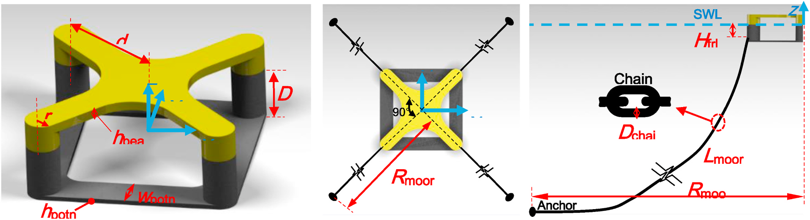
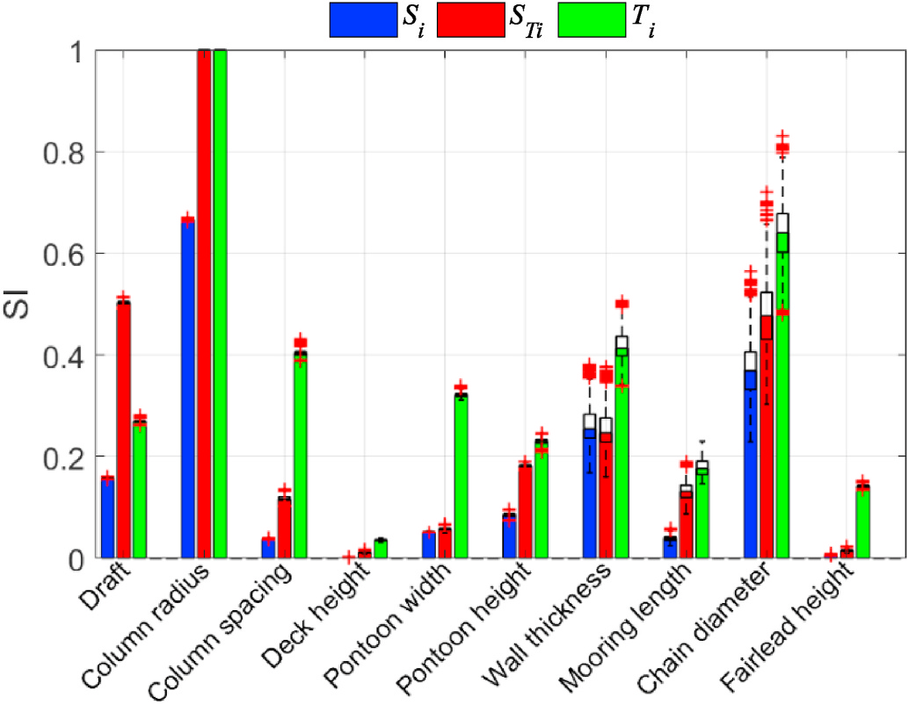
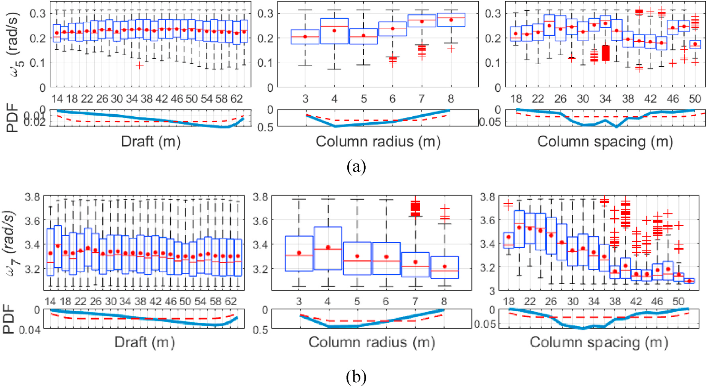
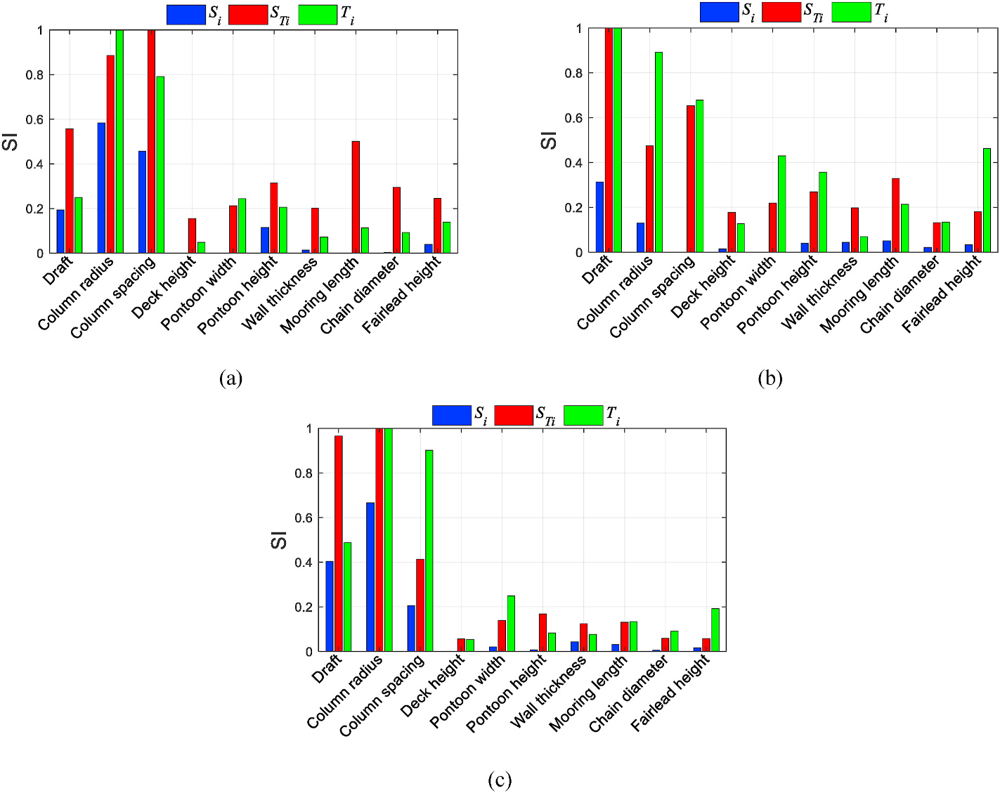
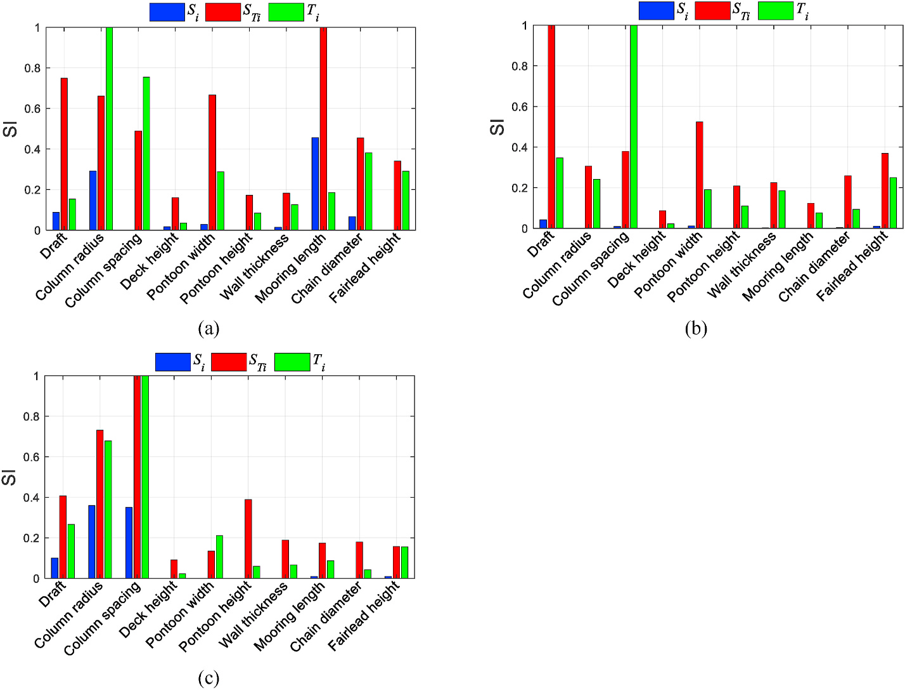

# 一体化分析 | 浮体不能一味做大：哪些尺寸真正影响成本和运动？

半潜式浮体的立柱加粗、间距拉大、吃水加深，都可能改变风机响应，却不会带来同一种收益。更大的尺寸既增加材料，也改变惯性、恢复刚度和波浪激励。要缩小优化范围，先得问清楚：我们究竟在优化制造成本、固有频率，还是波浪中的运动？

## 论文信息

- 论文题名：Global sensitivity study on the semisubmersible substructure of a floating wind turbine: Manufacturing cost, structural properties and hydrodynamics
- 作者：Zhou Shengtao；Müller Kolja；**Li Chao**\*；Xiao Yiqing；Cheng Po Wen
- 期刊：Ocean Engineering
- 年份：2021
- DOI：[10.1016/j.oceaneng.2021.108585](https://doi.org/10.1016/j.oceaneng.2021.108585)
- WOEAI 相关方向: 海洋能源结构 / 一体化分析

## 摘要

通过优化技术权衡下部结构的资本支出与动力表现，是漂浮风机在能源行业广泛应用的关键。下部结构优化是高维问题。敏感性分析可以识别与目标函数或约束最相关的设计参数，降低设计空间维度，并增进对参数相互关系的认识。本文评价浮体主要尺寸和系泊参数对四立柱半潜式漂浮风机制造成本、结构特性及水动力的影响，采用基于方差和基于密度的两种全局敏感性方法，衡量10个设计参数的贡献。

立柱半径是制造成本和纵荡固有频率最有影响的因素之一，纵摇与塔筒前后向固有频率对立柱间距更敏感。立柱间距、半径和吃水，是纵荡、纵摇及塔顶加速度波频响应最关键的三个因素。低频二阶响应中，吃水影响较弱，间距与半径更占主导。输入—输出样本的可视检查确认了这些结果。研究为设计空间提供新视角，也为进一步研究峰值倾角、机舱加速度、塔底和导缆点疲劳等长期表现的敏感性奠定基础。

## 研究问题与解决思路

研究对象是搭载DTU 10 MW风机的NAUTILUS四柱钢制半潜平台，水深130 m，四根悬链线相邻间隔90°。它不是三外柱加中央柱的Y形混凝土平台。

研究先把几何尺寸和系泊布置参数化，剔除不符合基本要求的组合，再分别计算制造成本、结构特性及21个代表波况下的一阶、二阶频域响应。随后用两种敏感性指标交叉比较，并回到箱线图检查排序是否可信。这里寻找的是哪些变量值得优先优化，并非已经得到一个全面最优的工程设计。

::: figure 2

论文图 2 四柱半潜式下部结构与四根系泊线

左图标出四立柱、梁、浮箱和主要几何尺寸，中图为四根相隔 $90^\circ$ 的系泊线，右图区分线长、锚半径、链径和导缆点高度；蓝虚线为静水面。

:::

这些参数会改变不同的质量或恢复力项，不能用“平台大小”一个词概括。

## 先排除不可行组合，再谈谁更敏感

初始设计由11个变量描述，包括吃水、立柱半径和间距、梁与浮箱尺寸、壁厚及四个系泊参数。生成145100个组合后，只有9304个满足约束，不可行比例超过93%。约束不仅要求几何合理，还涉及平均倾角、固有周期、海床躺链长度、允许偏移和塔筒频率避开共振区。

筛选也会改变变量关系。系泊线长与锚半径的相关系数达到0.996；每个线长只剩3–4个可行锚半径。计算方差指标时，作者将两者合并处理，最终比较10个输入因素。若直接对全部组合算敏感性，不可行设计的信息反而会淹没真正能用的方案。

## 两种指标不一致，要回看分布和样本

方差法VBM把输出变化分解为单个变量的主效应和变量间的交互效应；密度法DBM比较固定某个输入前后，输出累积分布的差异。前者能揭示交互，但依赖输入独立等条件，且仅用方差不一定能充分描述高偏态分布。

本研究的纵荡固有频率及多项二阶响应有长右尾，VBM与DBM排序因此明显不同。作者没有只选一个更顺眼的指标，而是对照输入—输出箱线图。例如纵荡固有频率的箱线图支持立柱半径和链径的重要性，而不是VBM给出的“线长明显占主导”。

VBM约3000个样本、DBM约5000个样本可得到较合理的收敛，并不意味着前者更省计算。VBM还要计算额外的交叉样本子集，比较成本不能只看横轴样本数。

## 半径影响成本，间距牵动纵摇与塔筒

制造成本只计材料、焊接、涂装与间接费用，不包含项目相关的安装和运输。作者考虑2000组联合价格样本，发现价格波动对多数敏感性排序影响不大；立柱半径始终最重要，链径、吃水等因素的排序则因方法而异。

制造成本的排序可从三种指标及价格变化范围一起核对。

::: figure 11

论文图 11 制造成本的敏感性指标

横轴为十个设计因素，纵轴为归一化敏感性指标；蓝、红、绿分别表示 $S_i$、$S_{Ti}$、$T_i$。柱长为 2000 组价格下的中位数，箱线显示其变化范围。

:::

这张成本图与下文频率及水动力指标回答不同问题，排序不能相互替代。

增加立柱间距同时改变水线面二次矩和浮体转动惯量，因此纵摇固有频率并非一直增加。算例中，间距小于34 m时刚度效应更明显，超过后惯性效应更占主导。平台静水刚度又会改变塔筒边界条件，所以塔筒频率也对间距敏感。

::: figure 18

论文图 18 纵摇与塔筒频率随三个主要尺寸的变化

上排（a）为纵摇固有频率，下排（b）为塔筒一阶弯曲频率；每排从左到右按吃水、立柱半径、立柱间距分组。红点为均值，红线为中位数，蓝框和黑须表示分布，下方小图为输入概率密度。

:::

同样增加尺寸，不同模态未必同向变化。

## 波频与慢漂，要分别看尺寸和系泊

波频响应中，吃水、半径和间距最关键。增加间距可减轻立柱在波场中的相互作用，适度加深吃水有利于纵摇稳定；但本算例约34 m之后，继续增大吃水或间距的收益明显变小。这个转折与构型和场址波长有关，不能当作通用设计尺寸。更深吃水下，纵荡与纵摇相位关系还可能让机舱加速度略有上升。

一阶波频响应先单列检验，再与后面的二阶慢漂指标比较。

::: figure 19

论文图 19 一阶纵荡、纵摇和机舱加速度加权标准差的敏感性指标

（a）、（b）、（c）依次为一阶纵荡、纵摇和机舱加速度；横轴为十个设计因素。蓝、红、绿柱分别为 $S_i$、$S_{Ti}$、$T_i$，可按同色对照后面的二阶结果。

:::

这样可以区分响应频段变化与指标方法变化，避免把各组柱形当作同一个性能评分。

慢漂响应则重新突出系泊的重要性。三个船体尺寸完全相同、系泊不同的方案，纵荡固有频率分别为0.0454、0.0704和0.109 rad/s，二阶纵荡加权标准差分别为0.802、0.489和0.276 m。最大值接近最小值三倍，说明只优化船体、不考虑系泊，可能遗漏低频响应的重要来源。

::: figure 21

论文图 21 二阶响应的敏感性指标

（a）、（b）、（c）依次为二阶纵荡、纵摇、机舱加速度加权标准差的敏感性；横轴为十个设计因素。蓝、红柱分别为方差法主效应 $S_i$、总效应 $S_{Ti}$，绿柱为密度法总效应 $T_i$。

:::

低频纵荡受系泊影响，低频纵摇更受平台尺寸主导，机舱加速度则组合了平移与转动的影响。

论文采用完整差频QTF及频域模型，把21个波况的响应标准差按概率加权。它没有完成长期峰值倾角、寿命疲劳或全工况安全认证，这些在原文中属于后续工作。

## 从论文到工程

这项研究为半潜式平台的参数选择提供了优先顺序，使总体设计能够把计算精力投入到更影响成本和关键响应的尺寸与系泊变量上。它的工程意义在于将不同频率的运动机制分开考虑，帮助设计者识别哪些调整可能同时影响多个部件，哪些需要协调取舍。对于浮式风机的后续优化，这种敏感性分析也有助于组织样本、缩小搜索范围，并把平台布置与机组受力联系起来，为更全面的方案评价准备基础。具体设计仍需长期极值与疲劳等完整复核。

点击“阅读原文”查看完整逐段译文、全部原图、公式与可编辑表格。

本文由 AI 辅助整理与撰写
