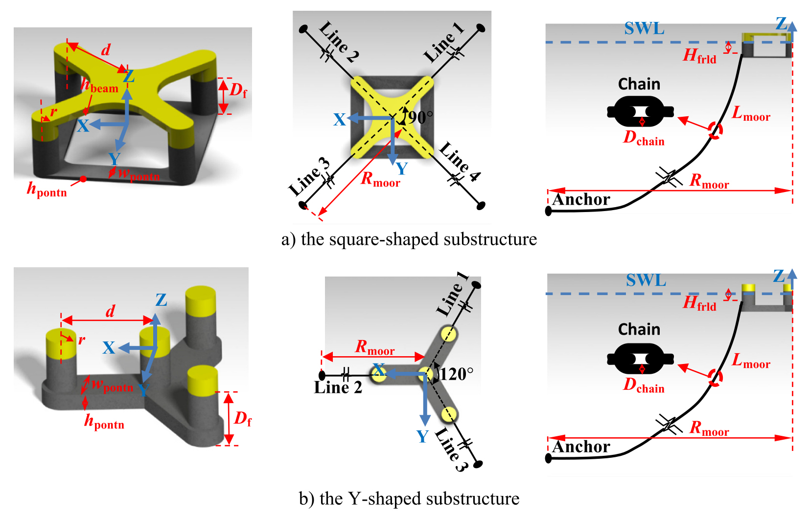
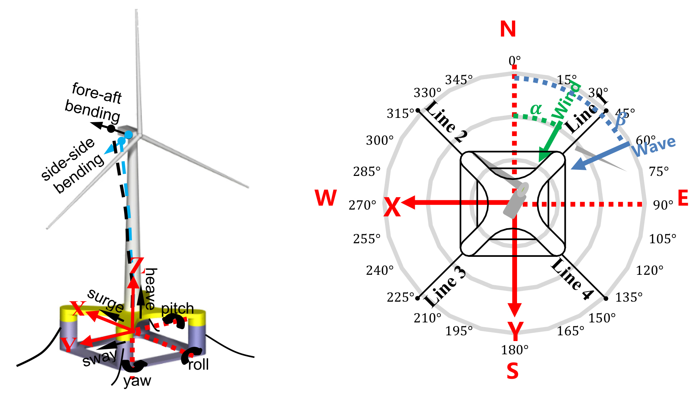
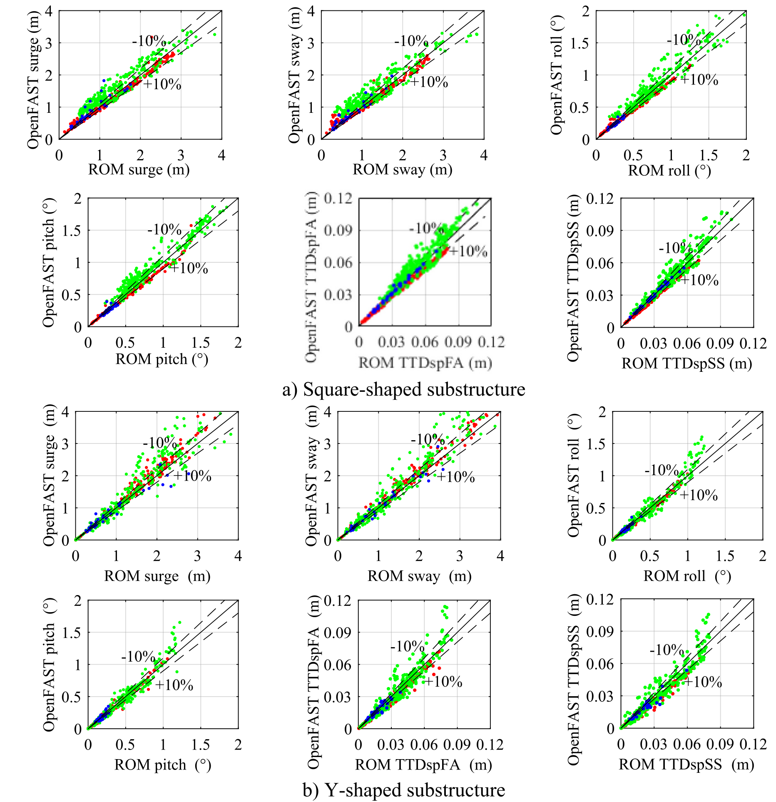
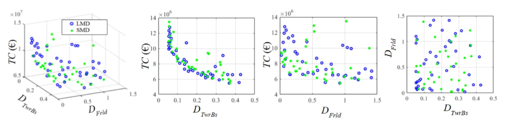
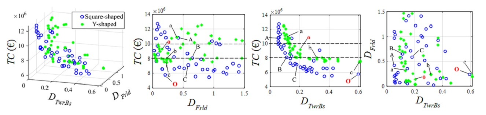
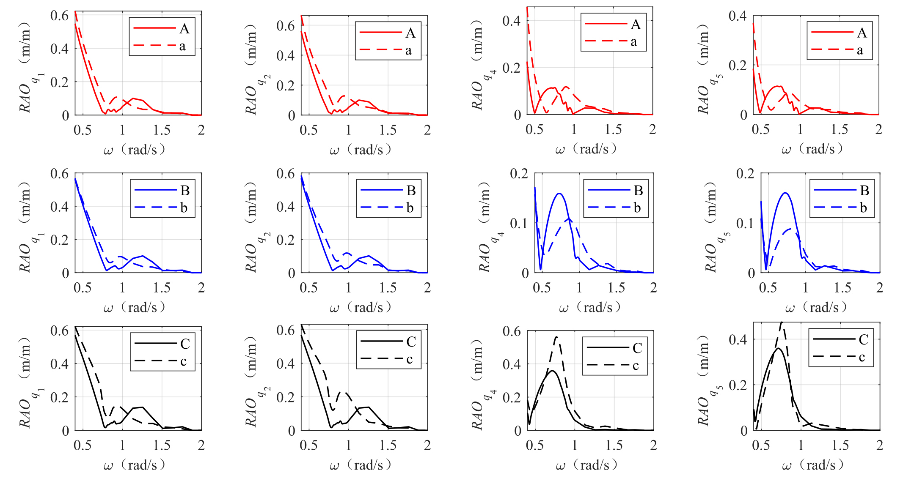

# 海洋能源结构 | 平台选型为何要把长期疲劳提前算进去？

平台在某个海况下运动较小，不代表服役多年后的疲劳和成本也更优。本文将长期风浪统计、快速响应计算与多目标优化连接起来，比较半潜式平台的主尺度和系泊方案，考察短期工况选型可能遗漏的差别。

## 论文信息

- 论文题名: Evaluation of floating wind turbine substructure designs by using long-term dynamic optimization
- 作者: <u>Zhou Shengtao</u>; **Li Chao**\*; Xiao Yiqing; Wang Xiaolu; Xiang Wenyuan; Sun Qing
- 期刊: Applied Energy
- 年份: 2023
- DOI: https://doi.org/10.1016/j.apenergy.2023.121941
- WOEAI 相关方向: 海洋能源结构 / 一体化分析

## 摘要

浮式风机下部结构设计在资本支出和动力性能中都发挥重要作用。为从多种设计概念中确定更具成本效益的船体形状和系泊构型，本文提出一种基于长期动力优化的评估方法。为了使迭代优化过程中的长期动力性能评估在计算上可承受，研究使用 Kriging 代理模型近似浮式风机响应；该模型通过代表性海洋环境参数与相应短期响应之间的回归分析建立。

随机风浪中的短期响应由一个包含八个自由度的高效降阶模型 ROM 模拟。Kriging 模型用于推导长期性能指标，例如塔底和导缆孔处的全寿命累积疲劳损伤、平台峰值运动和机舱加速度。模型有效性通过与 OpenFAST 的验证对比得到确认。随后，研究将该模型嵌入多目标优化框架，以寻找在长期动力性能和制造成本之间具有最佳折中的 Pareto 最优设计。

NSGA-II 算法被用于探索下部结构设计空间，并考虑与结构固有属性和动力性能相关的约束。该方法应用于两类典型半潜式浮式风机：Y 形概念和方形概念。通过比较二者 Pareto 前沿，论文发现，在本文案例中，方形半潜式有望成为更有利的下部结构。在相同制造成本水平下，方形概念的塔底疲劳大多比 Y 形低 $30\%$ 至 $50\%$。两类概念疲劳差异的主要原因是水动力性能差异。这项工作为把哪一种浮式风机下部结构设计作为详细设计阶段输入提供了决策依据。

## 研究问题与解决思路

浮式风机平台的尺度与系泊参数会同时影响成本、塔底和导缆孔疲劳，而长期风浪组合繁多，逐个采用高保真模型计算难以支撑反复优化。本文用降阶动力模型计算代表工况，再以代理模型连接长期环境统计，将疲劳与成本纳入多目标搜索，比较短期与长期设计以及不同平台构型的方案分布。研究服务于概念设计筛选，仍需后续结构强度与详细设计验证。

## 用降阶模型连接长期环境与多目标优化

论文的第一步是建立适合早期设计空间探索的动力分析模型。研究使用八自由度降阶模型 ROM 来计算随机风浪中的短期响应，并通过与 OpenFAST 的对比验证模型有效性。下部结构迭代使用预先生成的转子载荷和气动阻尼查找表，因此可以快速筛选候选方案；这些查找表仍需 OpenFAST 和控制器调谐等前置工作，不能说整条方法完全不依赖翼型或控制器信息。

第二步是建立长期动力性能代理模型。论文将 2007–2018 年缅因湾观测数据经 Nataf 变换采样扩展至 $25$ 年，并从中选取代表性风浪样本，使用 Kriging 代理模型把环境输入与短期响应联系起来，再推导长期指标。这个步骤的关键意义在于：长期性能不再需要对每一个设计方案做大量完整时域仿真，而可以通过代理模型进入优化循环。

第三步是把代理模型嵌入多目标优化。研究采用 NSGA-II 算法探索设计空间，目标是在制造成本 $TC$、塔底累积疲劳损伤 $D_{\mathrm{TwrBs}}$ 和导缆孔累积疲劳损伤 $D_{\mathrm{Frld}}$ 等指标之间寻找折中，同时施加平台固有属性和动力性能约束。

::: figure 7

论文图 7 所研究浮式风机的平台构型与系泊布置

上排（a）为方形平台，下排（b）为 Y 形平台；每排依次给出三维构型、俯视系泊布置与单根锚链剖面，红色尺寸线和蓝色坐标标出对应几何量。

:::

论文比较方形与 Y 形两类钢平台。吃水、柱半径、柱距、系泊线长和链径是五个独立优化变量，锚点半径是从属变量。

::: figure 1

论文图 1 自由度和全局坐标系定义

左图标出平台刚体运动和塔架前后、侧向弯曲；右图为俯视坐标与角度，红轴为全局坐标，风、浪箭头及各根系泊线另有标记。

:::

这张图展示了论文用于快速动力分析的运动自由度、全局坐标、来流方向和系泊线布置，是后续比较平台响应、塔底疲劳和导缆孔疲劳的统一坐标基础。

::: figure 9

论文图 9 1000 个代表性风浪工况下 ROM 与 OpenFAST 的四个平台运动分量及塔顶前后、侧向弯曲位移标准差比较

上半（a）为方形平台，下半（b）为 Y 形平台；每个散点图横轴为 ROM、纵轴为 OpenFAST，对角参考线两侧标有正负 $10\%$ 位置，各小图的坐标标识对应响应。

:::

图9检验的是代表工况中的响应标准差，不是所有疲劳损伤或极值的误差保证；超额定风速与强海况的限制仍在后文保留。

## 长期设计与平台构型如何改变疲劳—成本关系？

论文比较了基于简化海洋环境数据 SMD 和长期海洋环境数据 LMD 得到的优化结果。图中 SMD 设计的疲劳也已用长期代理模型重新计算。高成本区塔底疲劳前沿较接近，低成本区 LMD 有改善；导缆孔疲劳改善主要在高成本区。因此，长期海况的作用随成本区间和响应指标而变化。

::: figure 19

论文图 19 不同环境输入得到的 Pareto 前沿对比

蓝色空心圆为长期环境 LMD，绿色点为简化环境 SMD；左图为成本与两种疲劳的三维关系，右侧三图依次为其两两投影。

:::

这张图说明，长期海况数据不是只改变输入文件，而会影响设计点在制造成本、塔底疲劳和导缆孔疲劳之间的折中关系。

对工程设计而言，这一点很重要：如果只用简化海况做早期优化，可能得到看似经济但长期疲劳表现并不理想的方案。长期动力优化的价值，就在于把环境统计影响前移到概念筛选阶段。

在相同制造成本水平下，方形半潜式概念的塔底疲劳通常比 Y 形概念低 $30\%$ 至 $50\%$。论文将这一差异主要归因于两类构型的水动力差异：Y 形平台的柱距与波浪波长之间更容易产生衍射影响，使其在部分波频范围内出现更高的平台运动响应。

::: figure 23

论文图 23 方形与 Y 形下部结构的 Pareto 前沿对比

蓝色空心圆为方形，绿色点为 Y 形；先看左侧三维前沿，再对照成本与塔底疲劳、成本与导缆孔疲劳及两类疲劳的投影，字母为后续个体比较的标记。

:::

Pareto 前沿把两类概念放到同一成本和疲劳指标坐标系中比较。论文据此判断，在本文案例下，方形半潜式更有望成为进入详细设计阶段的下部结构方案。

为了解释两类下部结构的疲劳差异，论文进一步选择相近制造成本和主尺度的设计个体进行比较。RAO 分析显示，Y 形模型在 surge/sway 方向以及部分波频范围内具有更大的运动响应；在 roll/pitch 上，两类平台也表现出不同的峰值和频率特征。

::: figure 25

论文图 25 两类下部结构在 135 度波向下的平台运动 RAO 对比

从左到右为纵荡、横荡、横摇和纵摇响应幅值；三排分别对应 A/a、B/b、C/c 个体对，实线与虚线区分同一对中的两种设计，横轴为波浪角频率。

:::

RAO 对比帮助解释为什么两个成本接近、主尺度接近的设计概念，在长期疲劳指标上仍可能出现明显差异。也就是说，优化结果不能只从几何尺寸或材料用量解释，还需要回到水动力响应机制。

论文还把 NAUTILUS 和 OO-Star 的原始设计作为参考点。结果显示，在相近成本水平下，优化器可以找到更低塔底疲劳和导缆孔疲劳的方案。以 OO-Star 约 900 万欧元的相关成本水平为例，优化后的 Y 形设计中，$D_{\mathrm{Frld}}$ 和 $D_{\mathrm{TwrBs}}$ 均明显低于原始参考点。

这说明，长期动力优化不仅能用于“方形还是 Y 形”的概念比较，也能用于同一概念内部的主尺度和系泊参数改进。

## 哪些结论可用于概念设计筛选？

平台方案应在一致的成本口径和长期环境下比较。文中部分 Y 型方案降低导缆孔疲劳，伴随更粗的系泊链及相应成本变化；不能把某一疲劳指标的改善理解为无代价收益。优化结果适合缩小候选范围，再交由更完整的动力与结构模型复核。

本文结论来自特定风机、海况、设计变量范围、成本模型和比较构型。方形半潜式在本文案例中更有利，并不意味着所有海域、所有风机容量和所有系泊系统下都应选择同一构型。

ROM 与 OpenFAST 的运动响应标准差在多数验证工况中相对误差约 $10\%$，部分高于额定风速工况达到 $10\%$ 至 $25\%$，涉及气动阻尼和控制器动态效应；强海况下线性黏性阻力还可能低估导缆孔张力。这些范围不能外推为所有疲劳损伤或极值的精度保证。

本研究尚未进行船体强度校核，可能低估内部加强所需钢材和制造成本；累计损伤小于 $1.5$ 是概念筛选的宽松约束，不是最终设计验收标准。

此外，Kriging 代理模型的可靠性依赖代表性样本选择和训练数据覆盖范围。对于不同水深、不同风浪联合分布、不同控制策略或更大容量风机，仍需要重新构建或验证代理模型与优化约束。

## 从论文到工程

这项研究使浮式平台的早期选型能够更充分地考虑长期服役需求，为成本与疲劳之间的取舍提供了可计算的依据。通过将环境统计与方案搜索衔接，设计者有机会在详细设计之前识别平台尺度、系泊配置和关键部件损伤之间的关系，把后续精细分析集中在更有潜力的组合上。这种思路也有助于比较不同构型面对同一场址条件时的适应性，使概念设计阶段的经济讨论与结构性能保持联系。具体方案仍需强度、场址及代理模型复核。

点击阅读原文，可查看本论文的全文精解、长期环境建模与平台优化结果。

本文由 AI 辅助整理与撰写
