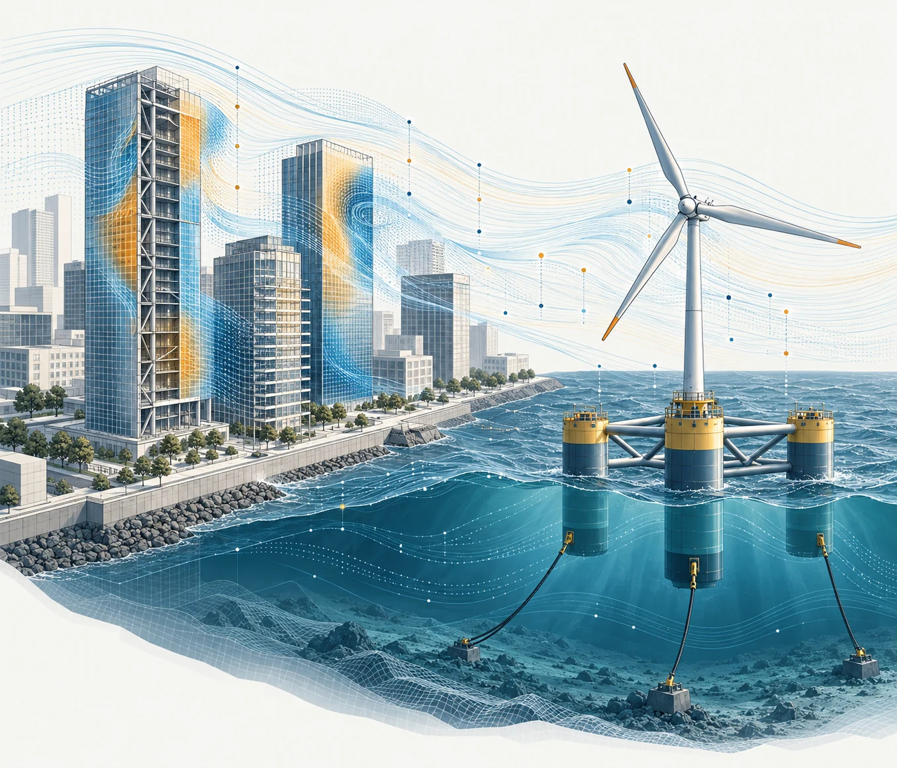

# 你好，这里是 WOEAI｜AI 赋能风与海洋工程

风吹过城市，会改变建筑周围的流动，也会让结构产生振动；风与波浪共同作用于海上的能源设施，又把气动、水动和结构响应联系在一起。

面对这些问题，我们既需要认识背后的物理规律，也需要不断改进分析与设计的方法。人工智能的发展，为这项工作带来了新的可能：能否更快地建立模型，更准确地预测响应，更有效地探索设计方案？这也是我们开设这个公众号的出发点。

图 1 风与海洋工程科研概念示意（AI 生成，非研究数据）。

## 一、我们是谁

我们是一个从事土木工程与海洋工程研究的科研课题组，围绕**结构风工程**与**海洋能源结构**两条主线，结合理论分析、数值模拟、物理试验和人工智能方法，探索建筑与能源结构的分析与设计。

WOEAI（Wind and Ocean Engineering with AI）是我们分享研究成果、交流方法与思考的窗口。我们希望从具体工程问题出发，讨论物理规律与人工智能如何结合，以及研究成果如何为工程分析与设计提供新的可能。

## 二、这里关注哪些问题

**结构风工程。** 从入流风场与城市风环境，到建筑表面风荷载、高层建筑风振、结构优化与振动控制，我们关注风环境、风荷载与结构响应之间的联系，以及怎样让分析更可靠、设计更合理。数值风洞与结构抗风，是这条主线的两个主要切入点。

**海洋能源结构。** 从风浪联合作用下的平台运动，到浮式风机系统的耦合响应，再到混凝土浮体的结构设计，我们关注复杂海洋环境中的能源结构如何分析、如何设计。一体化分析、混凝土浮体与数值水池，是持续开展研究的方向。

人工智能贯穿这两条主线。我们更关心它如何进入具体工程问题，与物理模型和试验数据结合，帮助提高预测、分析和优化的能力。

## 三、今后会分享什么

首先，是**课题组的研究成果解读**。我们希望把论文背后的问题讲清楚：为什么研究它，已有方法哪里不够，新方法改变了什么，以及这些认识可能用于哪些工程场景。比起简单复述摘要，我们更愿意解释研究的思路与价值。

其次，是**值得关注的同行研究**。好的问题和方法并不只来自自己的课题组。我们也计划选择与研究主线相关的外部论文进行解读，明确介绍原作者和成果来源，区分论文结论与我们的理解，讨论不同研究之间可以怎样相互启发。

此外，还会适时分享**研究方法与实践经验**。例如，如何建立适合分析的模型，如何连接模拟与试验，如何评价一个 AI 方法是否真正改善了工程分析。这些内容不追求覆盖所有工具，而希望围绕具体问题，留下可以参考的思路。

## 四、希望你在这里读到什么

如果你从事相关研究，希望这里能帮助你发现问题、理解方法，并找到值得进一步阅读的论文。

如果你是一名工程技术人员，希望这些解读能让你看到研究与实际分析、设计之间的联系。

如果你正在学习这一领域，希望这里能成为一个入口，帮助你逐步认识工程问题如何转化为研究问题。

我们会尽量用清楚的语言介绍专业内容，不以概念堆砌代替解释，也不把尚待验证的潜力写成已经实现的工程能力。涉及论文时提供原文出处，方便读者继续阅读和判断。

## 五、让研究与工程多一些对话

开设这个公众号，也希望与关注相似问题的人建立交流。欢迎分享你关心的工程问题、希望了解的方法，或值得一起阅读的论文。相关研究资料与论文精解，也会在 WOEAI 网站整理，便于按主题查阅。

我们也欢迎有志于土木工程、海洋工程及人工智能交叉研究的同学加入。无论你更关注物理机理、数值模拟、试验研究，还是智能分析与设计，都欢迎带着自己的研究兴趣与我们交流，一起探索值得深入研究的工程问题。

课题组负责人个人主页：https://homepage.hit.edu.cn/lichao

可复制网址，在浏览器中打开。

从风与海洋中的具体问题出发，讨论方法，也讨论它们走向工程的可能。欢迎关注 WOEAI。

点击文末‘阅读原文’，访问 WOEAI 研究网站，了解研究方向、论文精解与交流合作信息。

本文由 AI 辅助整理与撰写。
